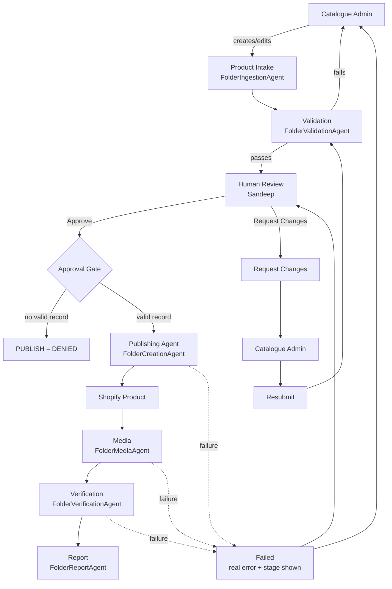

# AGENTS.md — Kiddypi Shopify Product Launch System

Source of truth: `REQUIREMENTS.md` and `ARCHITECTURE.md` (both reviewed and approved). This
document does not contradict either. It was written after re-reading both in full and inspecting
the actual codebase (`agents/`, `tools/`, `workflow/`, `services/`, `shopify_client.py`, `main.py`,
`state.py`, `product_workflow.py`) — no filenames or capabilities below are invented. No
application code is changed by this document.

---

## 1. Human Roles

### Product Decision Maker / Reviewer

Real person today: **Sandeep**. Matches the `APPROVER` role in `ARCHITECTURE.md` §2.

Responsibilities:
- Decide which products should enter the store
- Review submitted products
- Check product information
- Check images/videos
- Check UI/presentation
- Approve
- Request changes

Permissions:
- Read: any submitted, approved, published, or rejected product
- Write: approval decision (`APPROVED` / `CHANGES_REQUESTED`) and review comment only
- Cannot: create or edit product/catalogue data, cannot trigger a Shopify publish directly
  (publishing only happens as a *consequence* of Approve, executed by the agent)
- Cannot approve a product they submitted themselves, by default (`REQUIREMENTS.md` §2/§12, pending
  confirmation — see §19)

### Shopify / Catalogue Admin

Real person today: **Lakshmi**. Matches the `CATALOGUE_ADMIN` role in `ARCHITECTURE.md` §2.

Responsibilities:
- Add product
- Edit product
- Add catalogue information
- Add pricing
- Upload images/videos
- Fix validation errors
- Make requested changes
- Resubmit for review

Permissions:
- Read/write: her own product drafts and resubmissions
- Read: reviewer feedback on her own products
- Cannot: approve, reject, or publish any product — every listing must pass through the Reviewer
  (`REQUIREMENTS.md` §2: "Lakshmi must not be able to bypass the approval process and directly
  publish a product")

### Technical/Admin Role

Required by `ARCHITECTURE.md` §2 (`PLATFORM_ADMIN`). Person not yet assigned —
open question, see §19.

Responsibilities:
- User/access management
- Investigating technical failures
- System configuration
- Monitoring

Permissions:
- Read: full audit log, full technical error detail (stack traces) that Reviewer/Catalogue Admin
  do not see
- Write: user/role assignments
- Cannot: approve, reject, or make any business decision about a product — this role is
  operational, not a business-decision role

---

## 2. AI Agents

**Codebase inspection performed before writing this section.** Existing ADK `Agent` objects found:

- **Product Creation Agent Pipeline** (`agents/folder_agents.py`): `FolderIngestionAgent`, `FolderCreationAgent`, `FolderMediaAgent`, `FolderVerificationAgent`, `FolderReportAgent` — six agents managing standard product draft ingestion, creation, media upload, verification, and reporting.
- **Product Validation Agent** (`agents/product_validation_agent.py`): Central 53-rule validation agent validating products for technical correctness, KiddyPi catalogue compliance, and pre-publish launch readiness.
- **Workshop Creation / Setup Agent** (`agents/workshop_setup_agent.py` & `services/workshop_service.py`): Dedicated agent for workshop-specific setup, presentation content formatting, Liquid section & JSON template generation (`templates/product.workshop.json`), registration contract configuration, human approval boundary enforcement, 53-rule validation invocation, and controlled explicit publication.
- Campaign pipeline (`agents/strategist_agent.py`, `copywriter_agent.py`, `seo_agent.py`, `marketing_agent.py`, `image_prompt_agent.py`, `image_generator_agent.py`, `agents/publisher_agent.py`, `agents/verification_agent.py`, `agents/report_generator_agent.py`) — nine agents for a separate raw-prompt product-generation flow.

### Three Primary Capabilities Architecture

| Agent Capability | Primary Implementation File | Key Responsibility | Approval Boundary | Shopify Action |
|---|---|---|---|---|
| **Product Creation Agent** | `agents/folder_agents.py` | Ingest folder submissions, create product drafts, process media, generate reports | Sandeep review gate | Creates draft (`status="draft"`) |
| **Product Validation Agent** | `agents/product_validation_agent.py` | Run 53-rule validation checklist matrix | Technical audit (non-approver) | No write capability |
| **Workshop Creation / Setup Agent** | `agents/workshop_setup_agent.py` & `services/workshop_service.py` | Workshop ingestion, presentation HTML, theme template generation, registration config, pre-publish validation | Sandeep approval gate (`PENDING_APPROVAL`) | Draft creation + explicit publish trigger |

### Full attribute tables — Primary System Agents

#### FolderIngestionAgent

| Attribute | Value |
|---|---|
| Purpose | Read the product folder/submission and produce a structured manifest |
| Trigger | Start of the workflow, after Lakshmi's submission enters `VALIDATING` |
| Inputs | `product_folder_path` (or equivalent structured submission) |
| Outputs | `manifest`, `detected_images`, `detected_videos` |
| Tools | `ingest_and_extract_folder_tool` (`tools/folder_tools.py`) |
| State required | `product_folder_path` |
| Permissions | Local filesystem read only, within the session's upload directory |
| Allowed actions | Parse `product.json`/fallback text fields, detect media files |
| Forbidden actions | Any Shopify, Firestore, or Storage write; any approval/rejection decision |
| Human approval requirement | None — runs automatically before review |
| Failure handling | Raises on missing/invalid folder; caught with full traceback, `failed_stage="ingest"` |
| Audit events | `PRODUCT_CREATED` (on first ingestion of a new draft) |

#### FolderValidationAgent

| Attribute | Value |
|---|---|
| Purpose | Technical/data-correctness checks — not a business judgment |
| Trigger | After Ingestion |
| Inputs | `manifest` |
| Outputs | `missing_fields_list`, `conflicts_list`, `duplicate_detected`, `existing_product_id/title/url` |
| Tools | `validate_folder_data_tool` |
| State required | `manifest` |
| Permissions | Read-only Shopify lookups (`get_product_by_sku`, `get_product_by_title`) |
| Allowed actions | Flag missing fields, structural issues, duplicates, conflicts |
| Forbidden actions | Modify any Shopify product; approve/reject on business grounds (see §5) |
| Human approval requirement | None — automatic; a failure returns to Lakshmi before Sandeep ever sees the listing |
| Failure handling | Populates `missing_fields_list`/`conflicts_list` for ordinary data problems (not an exception); throws for genuine tool/API errors, `failed_stage="validate"` |
| Audit events | `PRODUCT_UPDATED` (validation result recorded) |

#### FolderCreationAgent

| Attribute | Value |
|---|---|
| Purpose | Create/update the Shopify product |
| Trigger | **Only reachable after the Approval Gate (§3) passes** |
| Inputs | Validated `manifest`, `duplicate_action` |
| Outputs | `shopify_product`, `shopify_product_id`, `shopify_variant_id`, `shopify_url` |
| Tools | `create_shopify_product_tool` (→ `shopify_client.create_product`/`update_product`) |
| State required | Approved, validated manifest |
| Permissions | Shopify write (create/update product) |
| Allowed actions | Create or update the specific product tied to this approved workflow run |
| Forbidden actions | Publish without a passed Approval Gate check; delete products; bypass duplicate handling |
| Human approval requirement | **Yes — mandatory, checked before this agent runs at all** |
| Failure handling | Real `ShopifyAPIError`/`ShopifyConfigError` text preserved, `failed_stage="create"` |
| Audit events | `PUBLISH_STARTED`, `SHOPIFY_PRODUCT_CREATED` or `PUBLISH_FAILED` |

#### FolderMediaAgent

| Attribute | Value |
|---|---|
| Purpose | Upload images/video to the created product |
| Trigger | After Creation completes |
| Inputs | `shopify_product_id`, `detected_images`, `detected_videos` |
| Outputs | `shopify_media`, `media_upload_results`, `conversions`, `unsupported_media` |
| Tools | `upload_folder_media_tool` (→ `services/shopify_media_service.py`) |
| State required | `shopify_product_id` |
| Permissions | Shopify media upload (staged uploads) |
| Allowed actions | Upload media belonging to this product's approved submission only |
| Forbidden actions | Uploading to a different product; unbounded retry (bounded by `image_config.RETRY_COUNT`) |
| Human approval requirement | **Yes — same approval that authorized Creation** |
| Failure handling | Per-file `success: False` + real error text; `failed_stage="media"` — this is the exact stage that previously degraded into `'NoneType' object has no attribute 'state'` before this session's fix; that regression must never be reintroduced |
| Audit events | `MEDIA_UPLOAD_STARTED`, `MEDIA_UPLOAD_COMPLETED` |

#### FolderVerificationAgent

| Attribute | Value |
|---|---|
| Purpose | Confirm the live Shopify listing matches what was published |
| Trigger | After Media completes |
| Inputs | `shopify_product_id` |
| Outputs | `verification_result` |
| Tools | `verify_folder_product_tool` (→ `shopify_client.get_product`, `ShopifyMediaService.verify_media`) |
| State required | `shopify_product_id` |
| Permissions | Shopify read-only |
| Allowed actions | Read and compare live listing data against expected values |
| Forbidden actions | Modify the product |
| Human approval requirement | None — automatic, runs after publishing has already happened under approval |
| Failure handling | `failed_stage="verify"` with the specific mismatch/error |
| Audit events | `VERIFICATION_STARTED`, `VERIFICATION_COMPLETED` |

#### FolderReportAgent

| Attribute | Value |
|---|---|
| Purpose | Write the final Markdown/JSON launch report |
| Trigger | After Verification completes |
| Inputs | Full workflow run state |
| Outputs | `markdown_report_path`, `json_report_path` |
| Tools | `generate_folder_reports_tool` |
| State required | Full run state |
| Permissions | Local/Storage file write only |
| Allowed actions | Write report artifacts |
| Forbidden actions | Any Shopify/Firestore mutation |
| Human approval requirement | None |
| Failure handling | Should not roll back prior successful stages if this stage alone fails |
| Audit events | `PUBLISHED` (on successful completion of this final stage) |

#### WorkshopSetupAgent

| Attribute | Value |
|---|---|
| Purpose | Manage workshop setup, presentation content, theme template generation, approval boundary, and explicit publication |
| Trigger | Ingest workshop input / POST `/api/workshops/setup` |
| Inputs | `WorkshopInput` (name, description, date, time, venue, age_group, price, topics, media, etc.) |
| Outputs | `WorkshopWorkflowState` (website content, liquid section, json template, draft payload, validation results) |
| Tools | `ingest_workshop_input_tool`, `execute_approved_launch_tool` |
| State required | `WorkshopWorkflowState` |
| Permissions | Shopify product create/update, collection assignment, media upload, publish |
| Allowed actions | Process workshop setup, generate theme templates (`template_suffix = "workshop"`), create draft product, trigger 53-rule validation, execute explicit publish |
| Forbidden actions | Publish product without explicit approval (`PermissionError`); publish product when `state != "LAUNCH_READY"` |
| Human approval requirement | **Yes — mandatory stop at `PENDING_APPROVAL` boundary** |
| Failure handling | Sets error state (`INVALID_WORKSHOP_INPUT`, `VALIDATION_FAILED`, `SHOPIFY_SYNC_FAILED`) without publishing |
| Audit events | `WORKSHOP_SETUP_STARTED`, `WORKSHOP_APPROVED`, `SHOPIFY_DRAFT_CREATED`, `VALIDATION_COMPLETED`, `WORKSHOP_PUBLISHED` |

---

## 3. Most Important Rule

> The AI agent MUST NOT make the final business decision to publish.

```text
Product Draft
  ↓
Validation                (FolderValidationAgent — automatic)
  ↓
Human Review               (Sandeep — mandatory stop)
  ↓
APPROVED
  ↓
Publishing Agent           (FolderCreationAgent — only reachable from APPROVED)
  ↓
Shopify
  ↓
Media                      (FolderMediaAgent)
  ↓
Verification                (FolderVerificationAgent)
  ↓
Report                      (FolderReportAgent)
```

The agent cannot skip Human Review. **If approval is missing: PUBLISH = DENIED.** This is enforced
by the **Approval Gate** — a server-side authorization check, not an ADK agent, sitting immediately
before `FolderCreationAgent` is ever invoked. It checks for a durable, identity-attributed approval
record (who approved, when, for exactly this submission) and refuses to proceed without one. A
second, defense-in-depth copy of the same check lives inside `create_shopify_product_tool` itself,
so a bug in the outer check cannot silently defeat the rule (`ARCHITECTURE.md` §5).

---

## 4. Publishing Agent

In this codebase, "the Publishing Agent" is not one component — it is the three-stage sequence
`FolderCreationAgent → FolderMediaAgent → FolderVerificationAgent`, all gated by one Approval Gate
check. Keeping them as three separate agents (rather than merging into one call, the way the
Campaign pipeline's `publish_to_shopify` does — see §16) is deliberate: it's what lets the system
report exactly which stage failed (`failed_stage`) instead of one opaque "publishing failed."

Responsibilities (already implemented, reused unchanged):
- Receive an approved product (via the Approval Gate check, not by any judgment of its own)
- Validate required publishing state (missing-field re-check inside `create_shopify_product_tool`)
- Create/update Shopify product
- Prevent duplicates (SKU/title lookups during Validation, before Creation runs)
- Resolve conflicts according to `duplicate_action` (`CREATE`/`UPDATE`/`ASK`, existing behaviour)
- Upload images
- Upload videos where supported
- Perform staged uploads where required
- Verify Shopify listing
- Update workflow state (`workflow_runs` per `ARCHITECTURE.md` §8)
- Generate publishing result/report

It must **NOT**:
- approve products
- reject products for business reasons
- bypass validation
- publish unapproved products
- change a human approval decision
- expose credentials
- silently ignore errors

None of the inspected tool code (`tools/folder_tools.py`, `shopify_client.py`,
`services/shopify_media_service.py`) does any of the above today. This section documents the rule
so it stays true as the system grows.

---

## 5. Validation Agent / Capability

`FolderValidationAgent` + `validate_folder_data_tool` check:
- Required product fields (title, description, price, etc.)
- Product structure (manifest shape/completeness)
- Pricing (present, numeric, > 0)
- Media (detected files present/well-formed; unsupported formats flagged)
- Product metadata (SKU, inventory, vendor, tags)
- Duplicate/conflict conditions (SKU/title lookups against live Shopify)
- Shopify compatibility (data shape the create/update call expects)

**VALIDATION ERROR is not the same thing as BUSINESS REVIEW REJECTION:**

| | Validation Error | Business Review Rejection |
|---|---|---|
| Checks | Technical/data correctness | Is this product *good enough* to publish |
| Who/what decides | `FolderValidationAgent` (automatic) | Sandeep (human, mandatory) |
| Example | Price missing, SKU already exists on another product | Description tone is off, image quality isn't acceptable, price seems wrong for the market |
| Where it returns to | Lakshmi, before Sandeep ever sees the listing | Lakshmi, with Sandeep's specific feedback |
| Automatable? | Yes — already automated | No — this is explicitly the human decision this whole system exists to protect (§3) |

---

## 6. Review Assistant

**Not required for v1.** `REQUIREMENTS.md` describes what Sandeep needs to see (product info,
pricing, media, presentation, validation results, missing fields, conflicts) but does not ask for
an AI layer that summarizes or pre-judges any of it. The `FolderValidationAgent` output already
provides exactly what a "highlight missing fields / surface warnings" assistant would compute —
what's missing is a Review screen that *displays* that data, not a new agent that re-derives it.

If a Review Assistant is added later, its boundaries must be:

It **can**:
- summarize product information
- highlight missing fields
- identify potential inconsistencies
- present a product preview
- surface validation warnings

It must **NOT**:
- approve
- publish
- override the reviewer
- make the final business decision

Sandeep remains the decision maker in every case. If built, this would be presentation logic over
already-computed `FolderValidationAgent` output — it does not need Shopify write access, media
upload access, or any approval-adjacent permission at all.

---

## 7. Media

**Media handling stays a service/tool, not a standalone judgment-making agent.** The existing
`FolderMediaAgent` is a thin ADK wrapper (one Gemini call that just triggers the tool) around fully
deterministic logic in `upload_folder_media_tool` and `services/shopify_media_service.py`
(`ShopifyMediaService.retry_upload_media`, `.verify_media`). There is no judgment involved in "upload
this file, retry on transient failure, report the real result" — it's mechanical. The current
ADK-wrapper shape is preserved as-is (not modified) because it already works and is tested; this
section documents *why* it's correctly not a heavier "agent" than it needs to be, not a proposal to
change it further.

Preserved, unchanged:
- Images
- Videos
- Staged uploads
- Media verification

**Media failures must return the real error.** Never allow `'NoneType' object has no attribute
'state'` or any unrelated downstream error to hide the original failure — this is not a
hypothetical; it's the exact incident already fixed once in this codebase this session
(`ARCHITECTURE.md` §12, `docs/agents.md` §7), by switching `main.py` from `Runner.run()` (which
silently swallowed tool exceptions in a background thread) to `asyncio.run(run_async())`. This
document requires that fix, and the `failed_stage`/`errors` fields it depends on, to remain in
place.

---

## 8. Verification

`FolderVerificationAgent` + `verify_folder_product_tool` verify, after publishing:
- Shopify product exists
- Product status is correct
- Product data is correct (price, key fields)
- Expected media exists
- Media is ready (status check via `ShopifyMediaService.verify_media`)
- Relevant Shopify fields are correct (variant presence, purchasability)

Verification happens strictly after `FolderCreationAgent` and `FolderMediaAgent` — never before,
and never as a substitute for either. A failed verification does not roll back the Shopify product;
it marks the workflow run `VERIFICATION_FAILED` and surfaces the specific mismatch so a human can
decide the next step (retry, manual fix in Shopify, or escalate).

---

## 9. State Management

```text
Product
  ↓
Validation State        (missing_fields_list, conflicts_list, duplicate_detected)
  ↓
Review State             (submitted_by, submitted_at, reviewed_by, reviewed_at, review_comment)
  ↓
Approval State           (approved_by, approved_at — the record the Approval Gate checks)
  ↓
Publishing State         (shopify_product_id, shopify_variant_id, shopify_url)
  ↓
Media State              (shopify_media, media_upload_results)
  ↓
Verification State       (verification_result)
  ↓
Report State             (markdown_report_path, json_report_path)
```

Important state fields, mapped to what already exists (`state.py`'s `ProductLaunchState`) and what
`ARCHITECTURE.md` §8 adds for durability:

| Field | Exists today (`state.py`) | Durable home (`ARCHITECTURE.md` §8) |
|---|---|---|
| `workflow_id` | Implicit (`session_id` in `main.py`) | `workflow_runs/{runId}` document ID |
| `product_id` | Not explicit — the folder-launch session doubles as the product today | `products/{productId}` document ID |
| Shopify product ID | `shopify_product_id` | `products/{productId}.shopify_product_id` |
| `current_stage` | Implicit (which fields are populated) | `workflow_runs/{runId}.current_stage` |
| `approval_status` | `approved_to_publish` (boolean only, no identity) | `products/{productId}.status` + `approved_by`/`approved_at` |
| `product_status` | `product_status` | `products/{productId}.status` (lifecycle) |
| `media_status` | `media_upload_results`, `shopify_media` | `workflow_runs/{runId}` |
| `verification_status` | `verification_result` | `workflow_runs/{runId}` |
| `failure_stage` | `failed_stage` (added this session) | `workflow_runs/{runId}.failed_stage` |
| `errors` | `errors: Dict[str, str]` | `workflow_runs/{runId}.errors` |
| `timestamps` | Not currently recorded per-stage | `workflow_runs/{runId}` per-stage timestamps + `audit_logs` entries |

**State must not become disconnected between stages.** This was a real, already-fixed incident in
this codebase (`main.py`'s prior use of the exception-swallowing `Runner.run()`) — the fix
(`asyncio.run(run_async())`, `_derive_folder_failed_stage()`) must be preserved by any future change,
and the move from in-memory `active_sessions` to durable `workflow_runs` (§9 above) must not
reintroduce a gap where a stage's output silently fails to reach the next stage.

---

## 10. Agent Tool Permissions

| Agent | Read Product | Modify Product | Shopify Write | Media Upload | Approve | Verify |
|---|---|---|---|---|---|---|
| FolderIngestionAgent | ✓ | No | No | No | No | No |
| FolderValidationAgent | ✓ | No | No (read-only lookups only) | No | No | No |
| Review (Sandeep — human, not an agent) | ✓ | No | No | No | **✓** | No |
| FolderCreationAgent | ✓ | ✓ | ✓ | No | No | No |
| FolderMediaAgent | ✓ | No | No | ✓ | No | No |
| FolderVerificationAgent | ✓ | No | Read | Read/Check | No | ✓ |
| FolderReportAgent | ✓ | No | No | No | No | No |

Only a human (Sandeep) can Approve. No agent has that permission, by design — this row exists in
the table specifically to make the absence explicit rather than silent.

---

## 11. Human-in-the-Loop Matrix

| Action | Human | Agent | Approval Required |
|---|---|---|---|
| Add product | Catalogue Admin | No | No |
| Validate | No | Agent | No |
| Submit review | Catalogue Admin | No | No |
| Review | Reviewer | No | Yes |
| Approve | Reviewer | No | **YES** |
| Publish | No | Agent | **YES — must already exist (Approval Gate check)** |
| Upload media | No | Agent | YES — same approval that authorized Publish |
| Verify | No | Agent | No |
| Request changes | Reviewer | No | Yes |
| Resubmit | Catalogue Admin | No | No |

---

## 12. Failure Handling

| Failure | Behaviour |
|---|---|
| Validation failure | Return to Lakshmi with the specific missing/conflicting fields; workflow state `VALIDATION_FAILED` |
| Missing media | Recorded in `unsupported_media`; upload proceeds for supported files; Lakshmi sees exactly which files were skipped |
| Shopify API failure | Real `ShopifyAPIError` message preserved; `PUBLISH_FAILED`; product never marked Published |
| Staged upload failure | Retried with exponential backoff (`image_config.RETRY_COUNT`), then reported per-file with the real error |
| Media upload failure (stage-level) | `failed_stage="media"` + real error — never degrades into an unrelated error (§7) |
| Firebase failure | Falls back to local mock storage/Firestore today (dev convenience); for the durable state described in §9, this must become a hard, visible failure rather than a silent local-disk fallback, since local disk isn't durable across restarts either |
| Verification failure | `failed_stage="verify"` + specific mismatch; product remains in whatever Shopify state it's actually in — not falsely reported as fully verified |
| Session failure (e.g. `get_session()` returns `None`) | Caught by `main.py`'s outer exception handler since this session's fix; full traceback attached, never silently dropped |
| Authentication failure | 401, no detail beyond "not authenticated" |
| Authorization failure | 403, logged, no detail about what permission *would* have been needed |

Rules, restated because they are non-negotiable:
- Never use generic exception suppression (no `except: pass` anywhere in this design).
- Never silently continue after a critical failure.
- Always preserve: original error, workflow stage, product ID, workflow ID, actor (human or
  agent), timestamp.

---

## 13. Audit Logging

```text
PRODUCT_CREATED            PRODUCT_UPDATED
SUBMITTED_FOR_REVIEW       REVIEW_STARTED
CHANGES_REQUESTED          PRODUCT_APPROVED
PUBLISH_STARTED            SHOPIFY_PRODUCT_CREATED
MEDIA_UPLOAD_STARTED       MEDIA_UPLOAD_COMPLETED
VERIFICATION_STARTED       VERIFICATION_COMPLETED
PUBLISHED                  PUBLISH_FAILED
```

Each event records: `workflow_id`, `product_id`, `actor`, `actor_type` (`human` / `agent` /
`system`), `timestamp`, `action`, `result`, `error` (if applicable). Home: `audit_logs/{logId}`,
append-only (`ARCHITECTURE.md` §8, §11) — not implemented today, net-new work.

---

## 14. Agent Guardrails

**Publishing Agent (`FolderCreationAgent` + `FolderMediaAgent` + `FolderVerificationAgent`):**

```text
ALLOW
✓ Publish approved products
✓ Create/update Shopify product
✓ Upload approved media
✓ Verify product
✓ Generate report

DENY
✗ Publish without approval
✗ Change approval status
✗ Override rejection
✗ Delete products without authorization
✗ Expose credentials
✗ Ignore validation errors
✗ Hide Shopify errors
```

**Validation Agent (`FolderValidationAgent`):**

```text
ALLOW
✓ Read product data
✓ Perform read-only Shopify duplicate lookups
✓ Flag missing fields / conflicts

DENY
✗ Modify any Shopify product
✗ Approve or reject based on data-quality findings — flagging is not deciding
```

---

## 15. Complete Agent Workflow



---

## 16. Existing Code Mapping

| Existing File | Existing Component | Type | Agent Responsibility | Reuse/Modify |
|---|---|---|---|---|
| `main.py` | FastAPI app, `active_sessions`, `run_folder_workflow_background`, `/launch-folder`, `/api/folder-launch/{id}/approve`, `/status/{id}` | Service/orchestration entry point | Drives the workflow; today's approval check lives here | **Modify** — add authentication, the Approval Gate, and Firestore writes at stage boundaries; keep the existing `asyncio.run(run_async())` execution pattern |
| `product_workflow.py` | `folder_product_workflow`, `product_launch_workflow` | Workflow (ADK DAG definitions) | Orchestrates agent sequence | **Reuse unchanged** |
| `state.py` | `ProductLaunchState` | Data model | Shared state schema across all agents | **Modify (additive only)** — add durable lifecycle fields (`submitted_by`, `reviewed_by`, `review_comment`, timestamps) alongside existing fields |
| `workflow/adk_runner.py` | `runner`, `folder_runner`, `session_service` | Workflow runner setup | Executes the ADK workflow | **Reuse unchanged** |
| `workflow/session_manager.py` | `create_session`, hardcoded `USER_ID` | Session bootstrap | Seeds initial ADK session state | **Modify** — `USER_ID` needs to become the real authenticated user once auth exists, instead of the current hardcoded `"default-user"` |
| `tools/folder_tools.py` | `ingest_and_extract_folder_tool`, `validate_folder_data_tool`, `create_shopify_product_tool`, `upload_folder_media_tool`, `verify_folder_product_tool`, `generate_folder_reports_tool` | Tools | The actual technical work behind each Folder agent | **Reuse unchanged**, except `create_shopify_product_tool` gets the defense-in-depth Approval Gate check added (§3) |
| `services/shopify_media_service.py` | `ShopifyMediaService` (`retry_upload`, `retry_upload_media`, `verify_media`) | Service | Resilient Shopify media upload/verify | **Reuse unchanged** |
| `shopify_client.py` | `create_product`, `update_product`, `get_product`, `get_product_by_sku`, `get_product_by_title`, `upload_product_media_files` | Service (Shopify Admin API client) | All direct Shopify HTTP calls | **Reuse unchanged** |
| `agents/folder_agents.py` | `FolderIngestionAgent`, `FolderValidationAgent`, `FolderCreationAgent`, `FolderMediaAgent`, `FolderVerificationAgent`, `FolderReportAgent` | Agents | The six agents this document is built around | **Reuse unchanged** |
| `agents/publisher_agent.py` | `PublisherAgent`, `publish_to_shopify` | Agent (Campaign pipeline) | Creates product + generates/uploads/verifies media all in one tool call | **Not modified** — out of scope for this workflow (§2); its silent-skip approval behaviour is flagged in §19, not fixed here |
| `agents/verification_agent.py` | `VerificationAgent`, `verify_product_listing` | Agent (Campaign pipeline) | Campaign-pipeline equivalent of `FolderVerificationAgent` | **Not modified** — same scope note as above |
| `services/firebase_service.py` | `save_product`, `get_product`, `update_workflow_status` | Service (Firestore, with local-mock fallback) | Firestore persistence | **Reuse as the implementation layer** behind the durable `products`/`workflow_runs` design in `ARCHITECTURE.md` §8 |
| `services/firebase_storage_service.py` | `upload_file` | Service (Firebase Storage, with local-mock fallback) | Media/report file storage | **Reuse**, plus the new non-public path for pre-approval draft media (`ARCHITECTURE.md` §9/D8) |

---

## 17. What Should NOT Be an Agent

Explicitly kept as deterministic services, tools, or orchestration — not AI agents:

- `shopify_client.py` — Shopify Admin API client. Deterministic HTTP calls; no judgment involved.
- `services/shopify_media_service.py` — retry/backoff and verification logic. Mechanical.
- `services/firebase_service.py`, `services/firebase_storage_service.py` — deterministic
  persistence integrations.
- `workflow/adk_runner.py`, `product_workflow.py` — workflow orchestration (the DAG wiring itself),
  not a decision-making component.
- The **Approval Gate** — an authorization check ("does a valid approval record exist"), not a
  judgment. Building it as an LLM agent would be the single worst design mistake available here,
  since it would reintroduce exactly the ambiguity §3's rule exists to prevent.
- The **Review screen** — UI presenting validated data to Sandeep. Not an agent; Sandeep is the
  decision-maker, the screen just shows him what he needs.
- Database/Firestore read-write operations in general — bookkeeping, not reasoning.

---

## 18. Testing

| # | Test | Existing coverage (`tests/`) | Status |
|---|---|---|---|
| A | Unapproved product cannot publish | Not yet — needs the Approval Gate to exist first | New |
| B | Approved product can publish | `tests/test_media_state_regression.py::test_g_actual_create_from_folder_workflow` (full E2E, pre-dates the Approval Gate) | Needs extension |
| C | Rejected product returns to admin | Not yet — needs the review/reject flow to exist first | New |
| D | Validation failure | `tests/test_folder_workflow.py` | Exists |
| E | Shopify failure | `tests/test_media_state_regression.py` | Exists |
| F | Media failure | `tests/test_media_state_regression.py` (images/video/no-media scenarios) | Exists |
| G | Staged upload failure | `tests/test_media_state_regression.py` | Exists |
| H | Verification failure | `tests/test_verification.py` (Campaign pipeline) | Needs a Folder-pipeline equivalent |
| I | State propagation | `tests/test_media_state_regression.py::test_f_create_then_media_state_propagation` | Exists |
| J | Duplicate prevention | `tests/test_folder_workflow.py` | Exists |
| K | Complete Draft → Review → Approve → Publish workflow | Not yet — needs the full lifecycle (review/approve screens + Approval Gate) to exist first | New — the core end-to-end test this project needs once built |

---

## 19. Open Questions

Only items genuinely requiring Sandeep's confirmation, not answered by `REQUIREMENTS.md` or
`ARCHITECTURE.md`, and specifically relevant to agent behaviour/boundaries:

1. **Self-approval.** Can Sandeep approve a listing he created himself (if he's ever allowed to
   create one directly)? This document assumes no, per `REQUIREMENTS.md` §2/§12's default —
   confirmation still needed.
2. **Campaign pipeline scope.** Is the separate raw-prompt Campaign pipeline
   (`agents/strategist_agent.py` etc.) part of the Kiddypi catalogue workflow at all? If yes, its
   silent approval-skip (§16) needs the same Approval Gate treatment as the Folder pipeline before
   it can be exposed to Lakshmi/Sandeep.
3. **Resubmission depth.** When a rejected product is fixed and resubmitted, does it need to go
   through `FolderValidationAgent` and full review again, or only a lighter re-check of the
   specific fields Sandeep flagged? `REQUIREMENTS.md` §4 assumes a full fresh review by default.
4. **Who is the Technical/Admin (Platform Admin)?** Not yet assigned to a specific person
   (`REQUIREMENTS.md` §2).
5. **Retry semantics after a technical publish failure.** If `MEDIA_FAILED`/`VERIFICATION_FAILED`
   occurs for infrastructure reasons (not data problems), can Lakshmi/system retry the same
   approved workflow run without requiring a brand-new Approve from Sandeep? `REQUIREMENTS.md`
   doesn't address this distinction explicitly.

---

## Recommended Agent Architecture

| Component | Type | Purpose | Human Decision? |
|---|---|---|---|
| `FolderIngestionAgent` | Agent | Parse submission into a manifest | No |
| `FolderValidationAgent` | Agent | Required-field/duplicate/conflict checks | No |
| Review Screen | UI (not an agent) | Present validated data to Sandeep | **Yes — the decision itself** |
| Approval Gate | Service (authorization check) | Enforce that a human decision was made before publishing | No — enforces, doesn't decide |
| `FolderCreationAgent` | Agent | Create/update Shopify product | No |
| `FolderMediaAgent` | Agent | Upload media | No |
| `FolderVerificationAgent` | Agent | Confirm live listing | No |
| `FolderReportAgent` | Agent | Write launch report | No |
| Audit Log Writer | Service | Record every transition | No |

## Existing Agents/Components

Six Folder-pipeline agents (`agents/folder_agents.py`), their tools (`tools/folder_tools.py`), the
Shopify client (`shopify_client.py`), media service (`services/shopify_media_service.py`), Firebase
services (`services/firebase_service.py`, `services/firebase_storage_service.py`), and the ADK
workflow/runner plumbing (`product_workflow.py`, `workflow/adk_runner.py`,
`workflow/session_manager.py`) — plus a separate, out-of-scope Campaign pipeline (nine agents).

## Components to Reuse

All six Folder-pipeline agents and their tools, `shopify_client.py`,
`services/shopify_media_service.py`, `services/firebase_service.py`/`firebase_storage_service.py`,
`product_workflow.py`, `workflow/adk_runner.py`, and this session's `asyncio.run(run_async())`
exception-propagation fix in `main.py`.

## Components to Modify

`main.py` (auth, Approval Gate, Firestore writes at stage boundaries), `state.py` (additive durable
fields), `workflow/session_manager.py` (real user identity instead of hardcoded `"default-user"`),
`create_shopify_product_tool` (defense-in-depth approval check).

## New Components Required

Approval Gate (service), authentication/authorization layer, `audit_logs`/`workflow_runs`/`users`
Firestore collections, Review Queue + Review screen, Add/Edit Product screen for Lakshmi.

## Human-in-the-Loop Points

Exactly one mandatory stop: **Sandeep's Review → Approve/Request Changes.** Everything before it
(intake, validation) and after it (create, media, verify, report) is automatic once triggered by a
human action (submit, or a passed Approval Gate check).

## Security Boundaries

No agent has Approve permission (§10). No agent can reach Shopify write access without a passed
Approval Gate check (two-layer enforcement, §3). Credentials (Shopify token, Firebase service
account) remain server-side only, never in frontend code (unchanged from today). Full technical
error detail is restricted to the Platform Admin role; Lakshmi and Sandeep see friendly
messages + failed stage only.

## Open Questions

See §19 for full detail. Summary: self-approval policy, Campaign-pipeline scope, resubmission
review depth, Platform Admin's real identity, and retry semantics after an infrastructure-caused
publish failure — all require Sandeep's confirmation before implementation of the affected behavior
begins.
