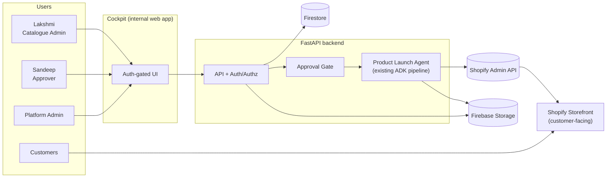
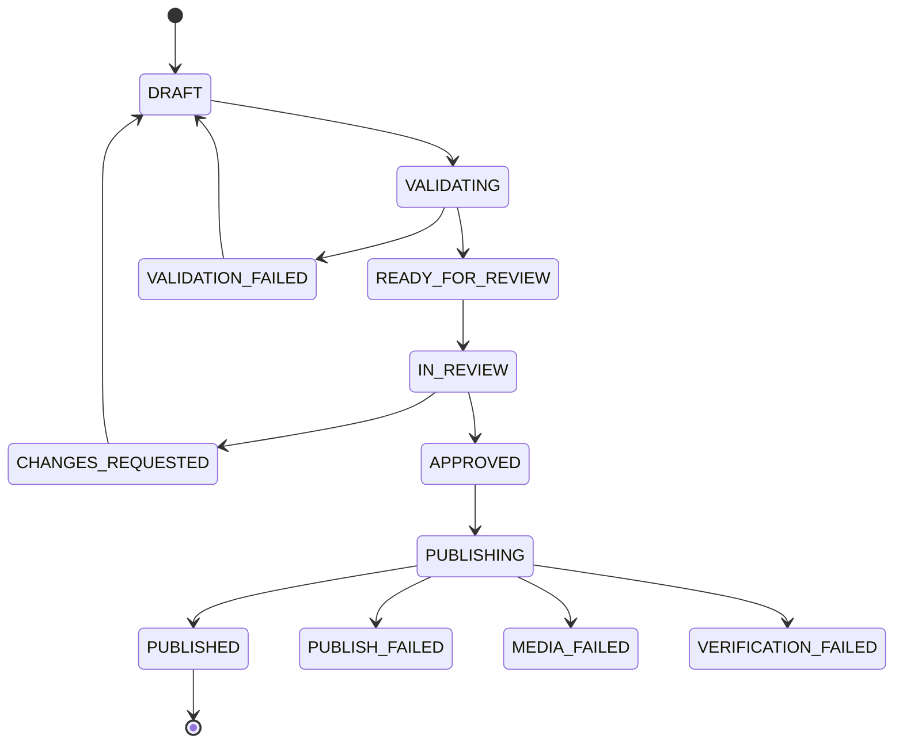
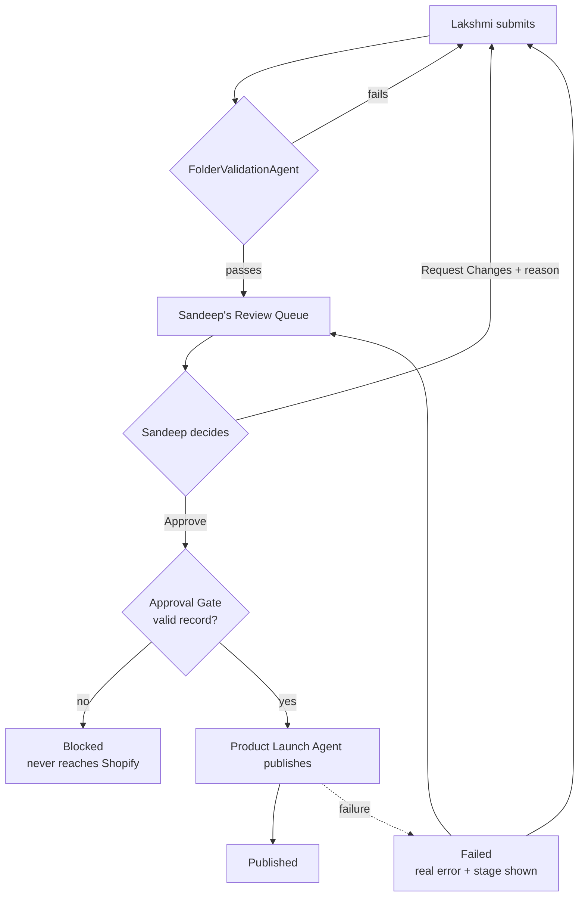
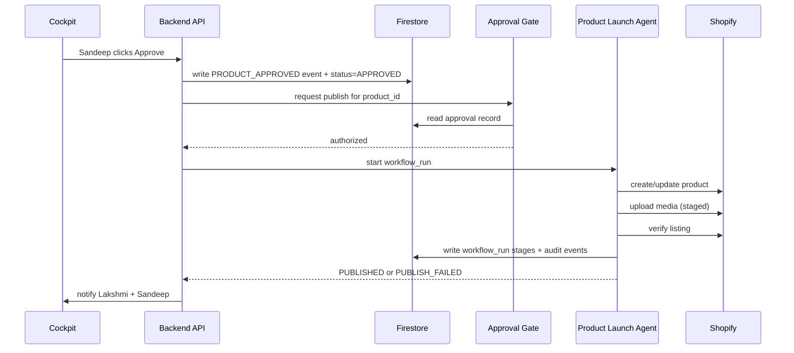
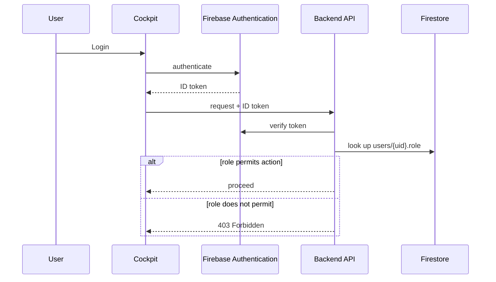
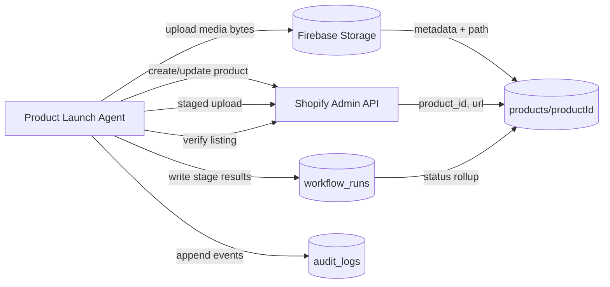

# Shopify Product Launch System — Architecture

Source of truth for this document: `REQUIREMENTS.md` (reviewed and approved). Every section below
either implements a confirmed requirement or is explicitly marked as **proposed technical
architecture** where `REQUIREMENTS.md` leaves the "how" open. Where something is genuinely
unanswered by `REQUIREMENTS.md`, it is listed in §19, not guessed at. Findings about the *existing*
codebase referenced throughout are grounded in direct inspection, previously recorded in
`docs/CURRENT_ARCHITECTURE.md` and `docs/agents.md` — this document does not repeat that inspection,
it builds on it.

---

## 1. System Overview

**Purpose:** provide a controlled pipeline for getting Kiddypi products onto the live Shopify store,
where Lakshmi prepares a listing, Sandeep makes the business call on whether it's ready, and the
AI agent only performs the technical publish once that human decision has been made and recorded.
No product reaches the live store without that recorded approval (`REQUIREMENTS.md` §13, Key
Business Rule).

**Major components:**

| Component | Role |
|---|---|
| **Cockpit (internal web app)** | Where Lakshmi and Sandeep work — catalogue entry, review queue, approvals, activity/audit view |
| **Product Launch Agent (existing)** | The Google ADK pipeline that does the technical work: Ingest → Validate → Create → Media → Verify → Report against the real Shopify Admin API. Already built and working (`agents/folder_agents.py`, `tools/folder_tools.py`) — reused, not rebuilt |
| **Approval Gate (new, not an agent)** | A server-side authorization check confirming a durable, identity-attributed approval record exists before the Product Launch Agent is allowed to touch Shopify |
| **Firestore** | Durable system of record for products, workflow runs, users/roles, audit log, and notifications |
| **Firebase Storage** | Product media (images, video) and generated reports |
| **Shopify Admin API** | The live store — source of truth for the published catalogue |
| **BOSS work-cockpit (external, unconfirmed)** | Referenced identity/navigation model; exact integration is an open item (§19) — this system is built so it can plug into BOSS later without a rework |

**How they fit together, at a glance:**

```text
Lakshmi & Sandeep
        │
        ▼
    Cockpit (auth-gated)
        │
        ▼
 FastAPI backend  ──────────────►  Approval Gate  ──►  Product Launch Agent  ──►  Shopify
        │                                                        │
        ▼                                                        ▼
    Firestore (products, workflow_runs,               Firebase Storage (media, reports)
    users, audit_logs, notifications)
```

This is a **single backend service**, not a microservice fleet — see Architectural Decision D6 (§18)
for why.

---

## 2. Users and Roles

Directly from `REQUIREMENTS.md` §2, restated as an access architecture:

| Role | Real person | Can access | Cannot access |
|---|---|---|---|
| **Approver** | Sandeep | Review Queue, Product Review screen (any status, for reference), Approve/Request-Changes actions, publishing progress, all reports | Add/Edit Product screens (does not enter catalogue data — `REQUIREMENTS.md` §2 permissions table); cannot trigger a Shopify publish directly, only through Approve |
| **Catalogue Admin** | Lakshmi | Add/Edit Product, Draft list, Submit for Review, view feedback on rejected items, Resubmit | Approve/Request-Changes actions; cannot trigger a live Shopify publish under any path |
| **Platform Admin** | Not yet assigned (`REQUIREMENTS.md` §2, open question) | User/role management, full audit log, full technical error detail (stack traces) | Not a business-decision role — does not approve/reject products |
| **AI Publish Agent** | The existing Product Launch Agent (system identity, not a login) | Only what the Approval Gate exposes after approval: create/update product, upload media, verify, report | Cannot authenticate as a user; cannot act without a passed Approval Gate check |
| **Customers / end users** | Shopify storefront visitors | The public Shopify store only | No access to the Cockpit, Firestore, or any internal screen — completely outside this system's authentication boundary |

This access model is enforced server-side (§3) — the frontend reflects it for UX, it does not
decide it.

---

## 3. Authentication and Authorization

**Login:** every Cockpit screen requires an authenticated session (`REQUIREMENTS.md` §11, NFR-1).
No anonymous access to any catalogue, review, or publish action — this directly closes the gap
found in the existing app, where `POST /api/folder-launch/{id}/approve` currently accepts a request
from anyone (`docs/CURRENT_ARCHITECTURE.md` §8, `docs/agents.md` §2.6).

**Authentication provider:** Firebase Authentication, as the interim identity provider —
`firebase-admin` is already a project dependency and nothing in the current codebase talks to BOSS.
This is explicitly conceptually aligned with, but not the same as, BOSS (§19 — BOSS's own auth
mechanism could not be confirmed; see `docs/agents.md` §10). Firebase Auth is chosen so it can be
swapped for direct BOSS integration later without touching the agent/tool layer, since
authentication is a backend request-handling concern, not something any agent or tool touches.

**Role-based access control:** a user's role (`APPROVER`, `CATALOGUE_ADMIN`, `PLATFORM_ADMIN`) is
looked up server-side from Firestore (`users/{uid}`, §8) on every authenticated request — never
trusted from a value the frontend sends (`REQUIREMENTS.md` §12).

**Session handling:** Firebase ID tokens, verified on the backend on every API call. Session
expiration is handled by the standard Firebase token-refresh flow; the Cockpit prompts re-login on
an expired/invalid token rather than failing silently.

**Protected screens vs. actions:** every Cockpit screen requires *authentication*; specific actions
(Approve, Request Changes, Submit for Review, Publish retry) additionally require the matching
*role*, checked in the API handler, not just hidden in the UI.

**Who can perform which action:**

| Action | Catalogue Admin | Approver | Platform Admin |
|---|---|---|---|
| Create/edit a draft | ✓ | ✗ | ✗ |
| Submit for review | ✓ | ✗ | ✗ |
| Approve | ✗ | ✓ | ✗ |
| Request changes | ✗ | ✓ | ✗ |
| View any listing | ✓ (own) | ✓ (all) | ✓ (all) |
| Manage users/roles | ✗ | ✗ | ✓ |
| View raw technical errors | ✗ | ✗ | ✓ |

Whether an Approver can also act as a Catalogue Admin, and whether self-approval is blocked, are
open items already flagged in `REQUIREMENTS.md` §2/§24 — this architecture implements the
default assumption stated there (no self-approval) until confirmed otherwise.

---

## 4. Product Lifecycle

```text
Product selected/initiated (Sandeep, off-system)
        ↓
Product Catalogue
        ↓
Lakshmi creates/edits product          ← HUMAN (data entry)
        ↓
Validation                              ← AGENT (FolderValidationAgent, automatic)
        ↓
Submit for Review                       ← HUMAN (Lakshmi's action)
        ↓
Sandeep Review                          ← HUMAN DECISION (mandatory stop)
   ┌─────────────────┴─────────────────┐
Reject / Changes                     Approve
   ↓                                     ↓
Back to Lakshmi                     Approval Gate check         ← SYSTEM (authorization, not a decision)
   ↓                                     ↓
Resubmit                            Product Launch Agent        ← AGENT (automatic, post-approval only)
                                          ↓
                                     Shopify Product Creation
                                          ↓
                                     Media Upload
                                          ↓
                                     Verify
                                          ↓
                                     Published
```

Where each kind of actor sits:

| Stage | Actor | Stops and waits for human? |
|---|---|---|
| Product selection | Sandeep (business decision, off-system per `REQUIREMENTS.md` §3) | — |
| Create/edit product | Lakshmi | — |
| Validation | Agent (automatic) | No — but a failure here returns to Lakshmi before Sandeep ever sees it |
| Submit for Review | Lakshmi | — |
| Sandeep Review | **Sandeep** | **Yes — mandatory stop, no timeout/auto-approve** |
| Approval Gate | System check | No (enforces the human decision already made; makes no decision itself) |
| Create/Media/Verify/Report | Agent (automatic) | No — but any failure returns actionable detail, not silence |
| Published | — | — |

The only mandatory human stop in the entire lifecycle is **Sandeep's Review**. Everything before it
(validation) and after it (publishing) is automatic once triggered by a human action (submit, or
approve).

---

## 5. Human-in-the-Loop Architecture

The rule, stated plainly and enforced at two layers:

> The AI agent must never decide whether a product is commercially ready for publishing. Sandeep's
> approval is the only thing that authorizes the Product Launch Agent to proceed.

**Layer 1 — workflow control (`main.py` / API layer):** the Product Launch Agent's workflow
(`folder_runner` in the existing code) is only ever invoked from the code path that follows a
recorded Approve action. It is never invoked directly from Submit-for-Review.

**Layer 2 — defense in depth (inside the publishing tool itself):** the Shopify product-creation
tool independently checks for a valid, durable approval record before it will create/update a live
product — so a bug or future change in Layer 1 cannot silently defeat the rule. This mirrors the
recommendation already made in `docs/agents.md` §9 and is repeated here because it's the single
most safety-critical design decision in this architecture.

Neither layer is an LLM decision. Both are ordinary authorization checks — "does an approval record
exist for this exact listing, made by an Approver who did not submit it themself" — not a judgment
call delegated to the agent.

---

## 6. Agent Architecture

Full per-agent detail (purpose, inputs/outputs, tools, allowed/forbidden actions, failure behaviour)
already exists in `docs/agents.md` and is not repeated here — this section gives the architecture
view: which capabilities exist, and whether each needs to be a new agent.

| Capability | New agent needed? | Why |
|---|---|---|
| Product Intake | No — reuse `FolderIngestionAgent` | Already parses a structured product record into a manifest |
| Product Validation | No — reuse `FolderValidationAgent` | Already does required-field, duplicate, and conflict checks |
| Product Review/Preparation | **No — this is not an agent at all** | This is Sandeep reading real data and deciding. An LLM "review assistant" would blur exactly the boundary this system exists to enforce. What's needed is a Review screen (UI), not an agent |
| Shopify Product Publishing | No — reuse `FolderCreationAgent` | Already creates/updates the Shopify product correctly, with draft protection and duplicate handling |
| Media Upload | No — reuse `FolderMediaAgent` | Already does staged uploads with retry for images and video |
| Verification | No — reuse `FolderVerificationAgent` | Already re-reads the live listing after publish |
| Reporting | No — reuse `FolderReportAgent` | Already writes the Markdown/JSON report |
| **Approval Gate** | **Yes — new, but a service/authorization check, not an ADK agent** | Doesn't exist today; is the missing piece between "Approve" and "Publishing Agent" |

Per-agent contract (condensed from `docs/agents.md`; see that document for the complete version):

| Agent | Input | Output | Human approval required first? |
|---|---|---|---|
| Ingestion | Product folder / structured submission | Manifest, detected media | No |
| Validation | Manifest | Missing fields, conflicts, duplicate flags | No |
| Creation | Validated manifest | Shopify product ID/URL | **Yes** |
| Media | Shopify product ID, media files | Upload results | **Yes** (same approval as Creation — one Approve authorizes the whole publish sequence) |
| Verification | Shopify product ID | Verification result | **Yes** |
| Report | Full run state | Report files | **Yes** |

**No new AI agent is required by this architecture.** The only new component is the Approval Gate,
which is deliberately *not* built as an agent, so it can never be reasoned about as "making a
decision" — it only checks that one was already made by a human.

---

## 7. Shopify Integration

Reused as-is from the existing `shopify_client.py` and `services/shopify_media_service.py`
(`docs/CURRENT_ARCHITECTURE.md` §6, `docs/agents.md` §6):

- **Product creation/update:** via the Shopify Admin API, only reached after the Approval Gate
  passes.
- **Draft handling:** products can be created in a non-active status, protecting against premature
  customer visibility before the pipeline completes.
- **Media upload:** GraphQL staged uploads, used for both images and video, with retry/backoff on
  transient failures.
- **Product status:** tracked through the pipeline (`DRAFT` internally → created on Shopify → media
  attached → verified) and reflected back into the product's Firestore record (§8) at each stage.
- **Duplicate prevention:** SKU/title lookups run during Validation, before any create/update call.
- **Verification:** a live read-after-write check confirms the listing matches what was intended
  (status, price, variant, media presence).
- **Error handling:** real Shopify API errors (`ShopifyAPIError`/`ShopifyConfigError`) propagate
  with their actual message and the specific failed stage — never replaced with a generic or
  unrelated error (§12).

**The agent must never bypass the approval workflow** — enforced by the two-layer check in §5. No
Shopify write call (create, update, media upload) is reachable from any code path that hasn't
passed the Approval Gate.

---

## 8. Firebase / Firestore Architecture

Kept intentionally simple — five collections, not one per concept, to avoid unnecessary
fragmentation (Architectural Decision D5, §18). Each conceptual entity from the brief is mapped to
where it actually lives:

| Conceptual entity | Where it lives |
|---|---|
| Users | `users/{uid}` |
| Products | `products/{productId}` |
| Product submissions | Fields on `products/{productId}` (current submission state) + historical entries in `audit_logs` |
| Reviews | Fields on `products/{productId}` (latest review outcome/comment) + historical entries in `audit_logs` |
| Approvals | Fields on `products/{productId}` (`approved_by`, `approved_at`) + historical entries in `audit_logs` — this is the durable record the Approval Gate checks |
| Workflow state | `products/{productId}.status` (lifecycle state, §10) + `workflow_runs/{runId}` (one document per actual pipeline execution) |
| Agent executions | `workflow_runs/{runId}` (stage-by-stage progress, mirroring today's `ProductLaunchState`) |
| Audit logs | `audit_logs/{logId}` — append-only |
| Errors | `workflow_runs/{runId}.errors` (technical detail) + a friendly summary surfaced on `products/{productId}` |
| Notifications | `notifications/{notificationId}` |

**`products/{productId}`** — the catalogue entry and current lifecycle status. Holds: title,
description, price, SKU, inventory, vendor, tags, images/video references (pointing into Storage,
§9), `status` (§10), `submitted_by`, `submitted_at`, `reviewed_by`, `reviewed_at`,
`review_comment`, `approved_by`, `approved_at`, `shopify_product_id`, `shopify_url`,
`current_failed_stage`.

**`workflow_runs/{runId}`** — one document per actual Product Launch Agent execution (a product can
have more than one run, e.g. a retry after a technical failure). This is the durable counterpart to
today's in-memory `ProductLaunchState`/`active_sessions` (`docs/agents.md` §7) — holds per-stage
status (ingest/validate/create/media/verify/report), the real error text and failed stage on
failure, and timestamps. `products/{productId}.status` reflects the *lifecycle*; `workflow_runs`
holds the *execution detail* behind it.

**`users/{uid}`** — `role` (`APPROVER` / `CATALOGUE_ADMIN` / `PLATFORM_ADMIN`), display name, email,
active/inactive flag.

**`audit_logs/{logId}`** — a single append-only ledger, not one collection per event type. Each
entry: `event_type` (one of the values listed in §11), `product_id`, `workflow_run_id` (where
applicable), `actor` (`user:<uid>` or `agent:<name>`), `timestamp`, `status`, `detail`. Filtering by
`event_type` and `product_id` covers every audit need in `REQUIREMENTS.md` §13 without needing
separate `submissions`/`reviews`/`approvals` collections.

**`notifications/{notificationId}`** — `user_id`, `product_id`, `type` (matches §15), `read`,
`created_at`. In-app only for v1, per the default assumption in `REQUIREMENTS.md` §24 pending
confirmation.

No field is invented beyond what §4 lifecycle, §10 state machine, §11 auditability, and §15
notifications require.

---

## 9. Storage Architecture

| Asset | Where | Why |
|---|---|---|
| Product images | Firebase Storage, `products/{productId}/images/{filename}` | Matches the existing `services/firebase_storage_service.py` path convention |
| Product videos | Firebase Storage, `products/{productId}/videos/{filename}` | Same convention |
| Generated reports (Markdown/JSON) | Firebase Storage, `products/{productId}/reports/{runId}/` | Kept per-run so a retry doesn't overwrite the prior attempt's report |
| Source documents (e.g. an uploaded `product.json` for folder-based intake) | Firebase Storage, `products/{productId}/source/` | Preserves the original submission for traceability |

**Relationship between Storage and Firestore:** Storage holds the bytes; Firestore holds the
metadata and the reference (`storage_path`, `public_url`, `content_type`, `size`,
`uploaded_at` — the same shape `services/firebase_storage_service.py` already returns today). A
product's Firestore document never embeds binary data, only Storage paths/URLs. Draft media (not
yet approved/published) should not be made public the same way already-published product media is
— see §13.

---

## 10. Workflow State Machine

```text
DRAFT
  → VALIDATING
    → READY_FOR_REVIEW
      → IN_REVIEW
        → CHANGES_REQUESTED → (back to DRAFT, editable)
        → APPROVED
          → PUBLISHING
            → PUBLISHED
Failure states (reachable from VALIDATING / PUBLISHING): VALIDATION_FAILED, PUBLISH_FAILED,
MEDIA_FAILED, VERIFICATION_FAILED
```

(Matches `REQUIREMENTS.md` §6 exactly; the simpler flow in this document's brief is the same
lifecycle at a lower resolution.)

| Transition | Triggered by | Notes |
|---|---|---|
| `DRAFT → VALIDATING` | Lakshmi saves/updates a draft | Automatic on save, not a separate button |
| `VALIDATING → READY_FOR_REVIEW` | `FolderValidationAgent` (automatic) | Only on a clean validation pass |
| `VALIDATING → VALIDATION_FAILED` | `FolderValidationAgent` (automatic) | Returns to Lakshmi with the specific missing/conflicting fields |
| `READY_FOR_REVIEW → IN_REVIEW` | Lakshmi submits | Explicit action, not automatic |
| `IN_REVIEW → CHANGES_REQUESTED` | **Sandeep** | Requires a reason (`REQUIREMENTS.md` FR-11) |
| `IN_REVIEW → APPROVED` | **Sandeep** | The only transition the Approval Gate treats as authorization to publish |
| `CHANGES_REQUESTED → DRAFT` | Lakshmi edits | Re-enters the same cycle |
| `APPROVED → PUBLISHING` | Approval Gate passes → Product Launch Agent starts | Automatic, immediate |
| `PUBLISHING → PUBLISHED` | `FolderReportAgent` completes | Automatic |
| `PUBLISHING → PUBLISH_FAILED` / `MEDIA_FAILED` / `VERIFICATION_FAILED` | Any pipeline stage failing | Automatic; `workflow_runs` records exactly which stage and why |

No transition into `PUBLISHING` is reachable except from `APPROVED`, and `APPROVED` is only ever set
by an Approver action — never by the agent, never by a timeout, never by a default.

---

## 11. Auditability

Every action below is recorded as an `audit_logs` entry (§8) with **actor, timestamp, action, and
relevant workflow information** (`product_id`, `workflow_run_id`, prior/new status):

```text
PRODUCT_CREATED            PRODUCT_UPDATED
SUBMITTED_FOR_REVIEW       REVIEW_STARTED
CHANGES_REQUESTED          PRODUCT_APPROVED
PUBLISH_STARTED            SHOPIFY_PRODUCT_CREATED
MEDIA_UPLOAD_STARTED       MEDIA_UPLOAD_COMPLETED
VERIFICATION_STARTED       VERIFICATION_COMPLETED
PUBLISHED                  PUBLISH_FAILED
```

`audit_logs` is append-only — no update or delete path is exposed to `CATALOGUE_ADMIN` or
`APPROVER` roles; only `PLATFORM_ADMIN` can read the full log (write access belongs to the backend
only, never the frontend directly — see §13).

---

## 12. Error Handling

| Failure | Propagation |
|---|---|
| Validation failure | Show the validation error → return to Lakshmi (state: `VALIDATION_FAILED` → back to `DRAFT`) |
| Review rejection | Return to Lakshmi with Sandeep's feedback (state: `CHANGES_REQUESTED` → `DRAFT`) |
| Shopify API failure | Workflow becomes `PUBLISH_FAILED`; the real Shopify error message is shown; the product is **not** marked Published |
| Media upload failure | Show the actual media/staged-upload error (state: `MEDIA_FAILED`); never a generic or unrelated error — this is the exact regression already fixed once in the existing pipeline (`docs/agents.md` §7) and must not be reintroduced |
| Agent/workflow failure (e.g. an unhandled exception mid-pipeline) | Preserve `workflow_runs` state as-is up to the last completed stage; allow a retry from the failed stage rather than restarting the whole pipeline, once the underlying issue (data or infrastructure) is fixed |

Consistent with `REQUIREMENTS.md` §16: friendly message + failed stage to Lakshmi/Sandeep, full
technical detail (stack trace) to Platform Admin only. No exception is ever suppressed
(`except: pass` is disallowed anywhere in this design, matching the existing pipeline's current
behaviour).

---

## 13. Security Architecture

| Area | Architecture |
|---|---|
| Authentication | Firebase Authentication (§3); no endpoint accessible without a valid token, except the existing Shopify order webhook, which is HMAC-verified (unchanged from today) |
| Authorization | Server-side role check on every state-changing endpoint; frontend role display is a convenience, never the enforcement point |
| Role-based permissions | Per §2/§3 tables |
| Firestore security rules | Deny all direct client writes to `products`, `workflow_runs`, `audit_logs`, and `users` by default; all writes go through the backend, which applies authorization before writing. Reads scoped by role (a Catalogue Admin reads their own submissions; an Approver reads everything pending/decided; Platform Admin reads everything including `audit_logs`) |
| Secret/API key handling | Unchanged from the existing, already-correct pattern: `SHOPIFY_ACCESS_TOKEN`, `SHOPIFY_API_SECRET`, `FIREBASE_SERVICE_ACCOUNT_KEY` read server-side only via environment variables, never sent to the frontend, `.env` gitignored |
| Shopify credentials | Server-side only, as today |
| Firebase service account | Server-side only, as today; never bundled into any frontend build |
| Audit logs | Append-only, `PLATFORM_ADMIN`-read-only (§11) |
| Protection of sensitive data | Draft/pre-approval product media should not use the same "make public" behaviour the existing Storage service applies to published product images — needs a distinct, non-public path or signed URL until a product reaches `PUBLISHED` |

**Never expose API keys or service-account credentials in frontend code** — already true of the
existing codebase (`docs/CURRENT_ARCHITECTURE.md` §14) and this architecture does not change that
boundary. The gaps that *do* need closing relative to today: no authentication at all currently
exists, CORS is currently configured as `allow_origins=["*"]` with `allow_credentials=True` (invalid
once real sessions exist) and needs an explicit allow-list, and `GET /status/{id}`-equivalent reads
need an ownership/role check they don't have today.

---

## 14. UI Architecture

| Screen | Catalogue Admin | Approver | Platform Admin |
|---|---|---|---|
| Login | ✓ | ✓ | ✓ |
| Work Cockpit / Dashboard | ✓ (own activity) | ✓ (review queue focus) | ✓ (system-wide) |
| Product Catalogue | ✓ | ✓ (read) | ✓ |
| Add Product | ✓ | ✗ | ✗ |
| Product Details | ✓ (own) | ✓ (all) | ✓ (all) |
| Submit for Review | ✓ | ✗ | ✗ |
| Review Queue | ✗ | ✓ | ✓ (read) |
| Product Review | ✗ | ✓ | ✓ (read) |
| Approval / Rejection | ✗ | ✓ | ✗ |
| Publishing Progress | ✓ (own) | ✓ | ✓ |
| Workflow History | ✓ (own) | ✓ | ✓ |
| Agent Execution / Status | read-only summary | read-only summary | full detail |
| Error Details | friendly summary only | friendly summary only | full technical detail |
| Reports | ✓ (own) | ✓ | ✓ |
| User/Role Administration | ✗ | ✗ | ✓ |

An early scaffold of this Cockpit already exists (`frontend/`, React + Vite) covering Overview,
Launches, New Launch, Agents, Approvals, and Activity in wireframe form, built directly against the
existing `/launch-folder` / `/status/{id}` / `/approve` endpoints — before authentication existed.
That scaffold's page structure maps cleanly onto the screens above; it needs the login/role gating
and the review/approval screens (§4–§6) added, not a rebuild.

---

## 15. Notifications

| Event | Recipient | Channel (v1) |
|---|---|---|
| Product is ready for review (submitted) | Approver | In-app |
| Product is rejected / changes requested | Catalogue Admin | In-app, with the reviewer's comment attached |
| Product is approved | Catalogue Admin (and implicitly triggers publishing) | In-app |
| Product publishing starts | Catalogue Admin, Approver | In-app |
| Product publishing succeeds | Catalogue Admin, Approver | In-app |
| Product publishing fails | Catalogue Admin, Approver, Platform Admin (for infra-cause failures) | In-app, with failed stage + friendly error |

In-app only for v1, per `REQUIREMENTS.md` §24's default assumption (email is an open question —
SMTP is already configured in this project for the unrelated Workshops order-confirmation flow and
could be reused later if email is confirmed as required).

---

## 16. Architecture Diagrams

### A. High-level system architecture



### B. Product workflow



### C. Human-in-the-loop workflow



### D. Agent interaction



### E. Authentication/authorization flow



### F. Shopify + Firebase integration



---

## 17. Existing System Compatibility

The existing Product Launch Agent already implements everything this architecture treats as the
publishing engine — folder/`product.json` ingestion, validation, Shopify product creation, duplicate
prevention, conflict resolution, staged media upload, image/video handling, Firebase
synchronization (mock-fallback pattern), verification, and report generation
(`docs/CURRENT_ARCHITECTURE.md`, `docs/agents.md`). **None of it is proposed to be replaced.**

What this architecture adds around it:

| Existing capability | Status |
|---|---|
| `agents/folder_agents.py` (6 agents) | Reused unchanged |
| `tools/folder_tools.py` | Reused unchanged |
| `shopify_client.py`, `services/shopify_media_service.py` | Reused unchanged |
| `services/firebase_service.py`, `services/firebase_storage_service.py` | Reused; becomes the implementation behind the Firestore/Storage architecture in §8–§9 |
| `main.py`'s `asyncio.run(run_async())` execution pattern (this project's own prior fix for exception-swallowing) | Reused unchanged — must not be regressed |
| `ProductLaunchState` / in-memory `active_sessions` | Becomes the shape of `workflow_runs/{runId}` (§8) — the execution-time model is preserved, just persisted durably instead of only in memory |
| `/launch-folder`, `/status/{id}`, `/api/folder-launch/{id}/approve` endpoints | Extended with authentication/authorization (§3, §5), not replaced — the underlying trigger/poll/approve shape stays the same |

The integration point is the Approval Gate (§5, §6): it sits between "Sandeep clicked Approve" and
"the existing `folder_runner` starts," and nowhere else. Everything downstream of that point is
untouched existing code.

---

## 18. Architectural Decisions

| # | Decision | Reason | Impact |
|---|---|---|---|
| D1 | Reuse the existing Folder pipeline (6 ADK agents) as the sole publishing engine; do not write a new one | It already works against the real Shopify store, is tested, and matches every technical requirement in §6/§7 | Zero rewrite risk to the hardest-to-get-right part of the system |
| D2 | The Approval Gate is a backend authorization check, not an ADK agent | An LLM component making or influencing the publish decision would violate the core business rule (§5) | Publishing tools gain one additional, deterministic check; no new AI surface area |
| D3 | Two-layer approval enforcement (API layer + inside the publishing tool) | A single check point is a single point of failure for the system's most important guarantee | Slightly more code in the publishing tool; materially safer |
| D4 | Firebase Authentication as the interim identity provider, pending BOSS confirmation | `firebase-admin` is already a dependency; BOSS's actual auth mechanism could not be confirmed from outside (§19) | Auth can be swapped later without touching the agent/tool layer |
| D5 | Five Firestore collections (`users`, `products`, `workflow_runs`, `audit_logs`, `notifications`), not one per concept | Matches `REQUIREMENTS.md`'s own suggested collection list; avoids unnecessary fragmentation | Simpler queries, simpler security rules, easier to reason about |
| D6 | Single FastAPI backend, no microservices | The existing app is already a single service; the added surface area (auth, gate, Firestore writes) doesn't justify splitting it | Matches the existing `Dockerfile`/`cloudbuild.yaml` deployment shape; lower operational complexity |
| D7 | `workflow_runs` is a separate collection from `products`, not embedded fields | A product can have multiple publish attempts (retry after failure); execution detail and lifecycle status change at different rates and for different reasons | One extra collection, but avoids an ever-growing array on the product document |
| D8 | Draft/pre-approval media is not made public the same way the existing Storage service treats published media | Pre-approval content shouldn't be publicly guessable before Sandeep has reviewed it | New code path in `firebase_storage_service.py`-equivalent logic (signed URL or restricted rule) for the pre-`PUBLISHED` case |
| D9 | No self-approval, by default | `REQUIREMENTS.md` §2/§12 states this as the default pending confirmation | Approval Gate compares `submitted_by` against the approving user |

---

## 19. Open Questions

Only items `REQUIREMENTS.md` does not answer (its own open questions in §24 are business
decisions for Sandeep, not repeated here — these are architecture-level items):

1. **BOSS's actual authentication/role/embedding mechanism.** `agentic-boss.web.app/work-cockpit` is
   fully client-rendered; its real auth flow, role model, and whether this app should be
   embedded in or linked from BOSS could not be determined from outside (`docs/agents.md` §10).
   This architecture uses Firebase Auth as an interim, swappable choice until this is confirmed.
2. **Deployment target.** The repo already contains a `Dockerfile` and `cloudbuild.yaml` suggesting
   Google Cloud Run — this document assumes that stays the target, but it isn't stated in
   `REQUIREMENTS.md` and should be confirmed before any infrastructure work starts.
3. **Firestore region/backup/retention policy** for `audit_logs` specifically — `REQUIREMENTS.md`
   requires audit history to exist but doesn't specify a retention window.
4. **Whether the Campaign pipeline** (the separate, raw-prompt AI product flow already in the
   codebase, distinct from the Folder pipeline this architecture is built around) is in scope for
   Kiddypi's catalogue workflow at all, or a legacy/unrelated feature (`docs/agents.md` §2.2,
   Open Question 1). This affects whether it also needs an Approval Gate or can be left alone.
5. **Rate limiting/quota handling** for Shopify API calls under this new workflow — not addressed
   in `REQUIREMENTS.md`, and worth a decision before high submission volume is expected.
