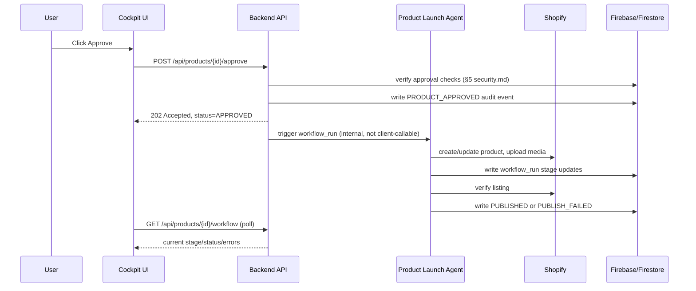

# api-spec.md — Kiddypi Shopify Product Launch System

Source of truth: all six existing documents, including `data-model.md`. Not implemented here — a
contract specification only. Endpoint routes/method choices not already fixed by an existing
real endpoint are **[PROPOSED]**, clearly distinguished from the handful that extend real,
already-implemented routes in `main.py`.

---

## 1. API Architecture

```text
Cockpit (frontend)
   │  HTTPS, authenticated requests only
   ▼
FastAPI backend (existing main.py, extended)
   │                          │                    │
   ▼                          ▼                    ▼
Firestore                Shopify Admin API     ADK Agent Runner
(existing service          (existing            (existing folder_runner,
 layer, extended)           shopify_client.py)    triggered post-approval)
```

The frontend talks **only** to the backend — never directly to Firestore, Firebase Storage, or
Shopify (`security.md` §10, §12). The backend is the single point where authentication,
authorization, the Approval Gate, and audit logging are enforced. Agents run inside the backend
process (as they do today, per `agents.md` §16) — they are not a separately-addressable service in
this design (`architecture.md` §1, Decision D6 — single backend, no microservices).

---

## 2. Authentication

**[PROPOSED, per `security.md` §3]** Every request (except the existing Shopify order webhook and
`/health`) carries a bearer token in the `Authorization` header, verified server-side on every call.
No authentication technology is asserted as final beyond this proposal — the identity provider
itself is **TBD — Requires Confirmation** (`security.md` §22).

```http
Authorization: Bearer <token>
```

A missing or invalid token → `401`. A valid token but insufficient role for the requested action →
`403` (§3).

---

## 3. Authorization

For every protected endpoint (detailed per-endpoint in §10), the backend:
1. Verifies the token (§2).
2. Looks up the caller's role from `users/{uid}.role` (never a client-supplied role claim —
   `security.md` §4).
3. Checks that role against the endpoint's required role/permission.
4. For ownership-scoped resources (a specific product), additionally checks the caller is the
   owner, the assigned reviewer, or holds `PLATFORM_ADMIN`.

**Backend authorization is the source of truth in every case** — the frontend hiding a control is
never treated as sufficient (`security.md` §12, Global Rule 11).

---

## 4. Product APIs

Only APIs required by the workflow in `workflow.md` — no extras.

| API | Purpose |
|---|---|
| Create product | New Draft — either a manual structured submission, or a folder-based bulk import (`requirements.md` §5 FR-2), both landing in the same `DRAFT` state |
| Get product | Full detail for the Product Detail/Review screens (`ui-spec.md` §7/§8) |
| Update product | Edit a Draft or a Changes-Requested product (ownership-scoped) |
| List products | Role-scoped list for the Catalogue/Review screens (`ui-spec.md` §5) |
| Submit for review | `READY_FOR_REVIEW → IN_REVIEW`, owner-only |
| Request changes | `IN_REVIEW → CHANGES_REQUESTED`, Reviewer-only, comment required |
| Approve | `IN_REVIEW → APPROVED` + triggers the Approval Gate → Publishing, Reviewer-only |

---

## 5. Agent APIs

**No client-facing "start agent" endpoint exists that a human can call directly to begin
publishing** — starting the Publishing Agent is a *side effect* of a successful Approve call (§4),
never a separately invokable action. This is not an oversight; it is the direct consequence of the
system's central rule (`agents.md` §3) — a separate "start workflow" endpoint would be exactly the
kind of bypass this design exists to prevent.

| API | Purpose |
|---|---|
| Check workflow status | Extends the existing `GET /status/{id}` pattern — returns the current `WorkflowRun` (stage, status, errors) for a product, ownership/role-scoped (closing the real gap in `docs/CURRENT_ARCHITECTURE.md` §15 item 6, where this endpoint currently has no ownership check at all) |
| Retrieve agent execution detail | Full per-stage detail of a specific `WorkflowRun` |
| Retrieve errors | Included in the status response; full technical detail (stack trace) gated to `PLATFORM_ADMIN` (`security.md` §15) |
| Retrieve results | Report file links, Shopify product URL, once available |

---

## 6. Publishing APIs

**There is no `/publish` endpoint exposed to the frontend.** Publishing is the backend's own
internal sequence — invoked only from inside the Approve handler (§4), after the Approval Gate
passes (`security.md` §5). The frontend never directly performs a privileged Shopify operation; it
only ever calls Approve and then polls/observes status (§5).

The backend-internal interface (not a client-facing route, described here for completeness since
`agents.md`/`workflow.md` require this document to explain how publishing is invoked) reuses the
existing, unmodified functions:
- `shopify_client.create_product` / `update_product`
- `services/shopify_media_service.py`'s `retry_upload_media` / `verify_media`
- The existing `folder_runner.run_async()` execution path (`agents.md` §16)

---

## 7. Review APIs

| API | Purpose |
|---|---|
| Review queue | List of products in `IN_REVIEW`, Reviewer-only (and Technical Admin, read-only) |
| Product review (detail) | Same as "Get product" (§4), opened from the queue |
| Approve | §4 |
| Request changes | §4 |

---

## 8. Audit APIs

Two distinct endpoints, matching the resolution `ui-spec.md` §24 already proposed for the
Workflow-History-vs-Audit-Log ambiguity:

| API | Access |
|---|---|
| Get product workflow history (friendly, per-product timeline) | Owner, Reviewer, Platform Admin |
| Get system-wide audit log (raw event stream) | Platform Admin only |

---

## 9. Notification APIs

Only in-app, matching the confirmed v1 scope (§10 in `data-model.md`, `ui-spec.md` §15):

| API | Purpose |
|---|---|
| List my notifications | Own, unread-first |
| Mark notification read | Own only |

No email-sending endpoint is defined — email is **TBD — Requires Confirmation**.

---

## 10. API Request/Response Format

| # | Method | Route (proposed) | Auth | Role | Request | Response | Validation | Errors |
|---|---|---|---|---|---|---|---|---|
| 1 | POST | `/api/products` | ✓ | Catalogue Admin | Product fields (§3 `data-model.md`), or multipart folder upload — **extends the existing real `POST /launch-folder`** | `{ product_id, status: "DRAFT" }` | Required fields checked at save; full validation runs async (Ingest→Validate) | 400 (bad input), 401, 403 |
| 2 | GET | `/api/products/{id}` | ✓ | Owner, Reviewer, Platform Admin | — | Full `Product` (§3 `data-model.md`) | Ownership/role check | 401, 403, 404 |
| 3 | PATCH | `/api/products/{id}` | ✓ | Owner (only in `DRAFT`/`CHANGES_REQUESTED`) | Partial fields | Updated `Product`, `product_version` incremented | State check (must be editable) | 400, 401, 403, 409 (not editable) |
| 4 | GET | `/api/products` | ✓ | All (scope varies) | Query: `status`, `owner`, search text | `Product[]` (list-shaped subset) | — | 401 |
| 5 | POST | `/api/products/{id}/submit` | ✓ | Owner | — | Updated status → `IN_REVIEW` | Must be `READY_FOR_REVIEW` | 401, 403, 409 |
| 6 | POST | `/api/products/{id}/request-changes` | ✓ | Reviewer | `{ comment }` (required, non-empty) | Updated status → `CHANGES_REQUESTED` | Comment required | 400, 401, 403, 409 |
| 7 | POST | `/api/products/{id}/approve` | ✓ | Reviewer (not `submitted_by`, per default assumption) | — | Updated status → `APPROVED`, then asynchronously → `PUBLISHING` | Full Human Approval Security check (`security.md` §5) — **extends the existing real `POST /api/folder-launch/{id}/approve`, which today has NO authentication at all; this is the single most important gap this API spec closes** | 401, 403, 409 (already decided/stale version) |
| 8 | GET | `/api/products/{id}/workflow` | ✓ | Owner, Reviewer, Platform Admin | — | Current `WorkflowRun` — **extends the existing real `GET /status/{id}`, which today has no ownership check at all** | Ownership/role check | 401, 403, 404 |
| 9 | GET | `/api/products/{id}/history` | ✓ | Owner, Reviewer, Platform Admin | — | `AuditLogEntry[]` scoped to this product | Ownership/role check | 401, 403 |
| 10 | GET | `/api/audit-logs` | ✓ | Platform Admin only | Query: date range, actor, action | `AuditLogEntry[]` | Role check | 401, 403 |
| 11 | GET | `/api/notifications` | ✓ | Self | — | `Notification[]` for the caller | — | 401 |
| 12 | POST | `/api/notifications/{id}/read` | ✓ | Self (owner of the notification) | — | Updated `read: true` | Ownership check | 401, 403, 404 |
| 13 | GET | `/health` | ✗ | — | — | `{ status, adk_ready, runner }` | — | Real, existing, unchanged endpoint |
| 14 | POST | `/api/webhooks/orders/create` | HMAC (not bearer) | — | Shopify webhook payload | `{ status }` | HMAC signature | Real, existing, unchanged endpoint — unrelated to this workflow (Workshops order flow) |

Rows 1, 7, and 8 are explicitly marked as extending real, already-implemented endpoints rather than
being invented from scratch — everything else is **[PROPOSED]**, net-new to support the review/
approval layer.

---

## 11. Error Model

A single, consistent structure across every endpoint:

```json
{
  "error": {
    "stage": "media",
    "message": "Shopify staged upload failed: HTTP 429 Resource Exhausted",
    "user_message": "Media upload failed. Please try again in a few minutes.",
    "recommended_action": "retry",
    "technical_detail": null,
    "correlation_id": "run_abc123"
  }
}
```

- `message` is the real, specific error — never replaced with an unrelated one.
- `technical_detail` (stack trace, internal paths) is populated **only** when the caller is
  `PLATFORM_ADMIN`; `null` otherwise (`security.md` §15).
- `correlation_id` ties the error back to a specific `workflow_run_id` for cross-referencing the
  audit log.

**The API must never turn a genuine error into an unrelated one.** The example given in the
brief — a real Shopify media upload failure degrading into `'NoneType' object has no attribute
'state'` — is not hypothetical; it is the exact incident already fixed once in this codebase this
session (`main.py`'s switch from `Runner.run()` to `asyncio.run(run_async())`, plus
`_derive_folder_failed_stage()`). This error model formalizes that fix as a permanent API contract
requirement, not an implementation detail that could regress.

---

## 12. HTTP Status Codes

| Code | Meaning here |
|---|---|
| 200 | Successful read |
| 201 | Resource created (new product) |
| 202 | Accepted, processing async (e.g. submit triggers async validation; approve triggers async publishing) |
| 400 | Malformed request / failed input validation |
| 401 | Not authenticated |
| 403 | Authenticated but not authorized for this action |
| 404 | Resource not found (or not visible to this caller — see §14 on not leaking existence) |
| 409 | Conflict — action not valid for the resource's current state (e.g. approving a non-`IN_REVIEW` product, or a stale `product_version`) |
| 422 | Well-formed request, semantically invalid (e.g. price ≤ 0) |
| 500 | Unexpected server error — still carries the structured error body (§11), never a bare stack trace |
| 503 | Upstream dependency (Shopify, Firestore) unavailable |

---

## 13. Idempotency

Required for:

| Operation | Rule |
|---|---|
| Approve | Calling Approve twice on an already-`APPROVED`/`PUBLISHING`/`PUBLISHED` product must not trigger a second publish attempt — the handler checks current status first and returns the existing state (409 or a no-op 200) rather than re-running the Approval Gate |
| Publishing (internal) | Exactly one `WorkflowRun` is created per successful Approval Gate pass — a duplicate/replayed trigger for the same `approved_at`/`product_version` must not create a second run (§18, `security.md` threat #11: duplicate publishing) |
| Media upload | Already idempotent-safe in the existing implementation — `services/shopify_media_service.py`'s per-file retry tracks `success`/`attempts` per file, not globally, so a retried stage doesn't re-upload already-successful files — **[PROPOSED]** to confirm this per-file behaviour is preserved when the stage itself becomes retriable at the workflow level (`workflow.md` §14, still open) |
| Workflow execution | A `run_id` is generated once per triggered attempt; re-polling status is always safe (read-only) |

---

## 14. API Security

- **Authentication:** §2, every endpoint except `/health` and the HMAC-verified webhook.
- **Authorization:** §3, enforced per-endpoint, never inferred from frontend state.
- **Input validation:** every write endpoint validates types/required fields/size limits before any
  processing; malformed input never reaches the ADK pipeline.
- **Secret protection:** no endpoint response ever includes `SHOPIFY_ACCESS_TOKEN`,
  `FIREBASE_SERVICE_ACCOUNT_KEY`, or any other secret — already true of every real endpoint
  inspected in the existing codebase, and required to remain true (`security.md` §8).
- **Rate limiting:** **[PROPOSED]** on product-creation and submission endpoints, to prevent
  spam/abuse of the review queue — not specified as a hard requirement by any source document, so
  marked proposed rather than mandatory.
- **Audit logging:** every state-changing endpoint in §10 produces the corresponding
  `AuditLogEntry` from `data-model.md` §9 — read-only endpoints do not, consistent with
  `security.md` §14's event list (all of which are actions, not reads).

---

## 15. Mermaid API Flow



---

## 16. Cross-Document Issues

## Cross-Document Issues Requiring Confirmation

1. **Exact REST route naming and method choices** (§10) are not specified by any of the six source
   documents — they are **[PROPOSED]** here, chosen to extend the real existing routes
   (`/launch-folder`, `/status/{id}`, `/api/folder-launch/{id}/approve`) wherever a direct
   equivalent exists, and to follow ordinary REST convention elsewhere. This is a design proposal
   for implementation to adopt or adjust, not a confirmed contract.
2. **Whether product creation should be one unified endpoint** (handling both manual form
   submission and folder upload) **or two separate endpoints** — `requirements.md` §5 FR-1/FR-2
   describe both intake methods as valid but doesn't specify whether they share one API surface.
   This document proposes one endpoint accepting either a JSON body or multipart form data,
   **[PROPOSED]**, not confirmed.

No other API-level conflicts were found between the six source documents.
