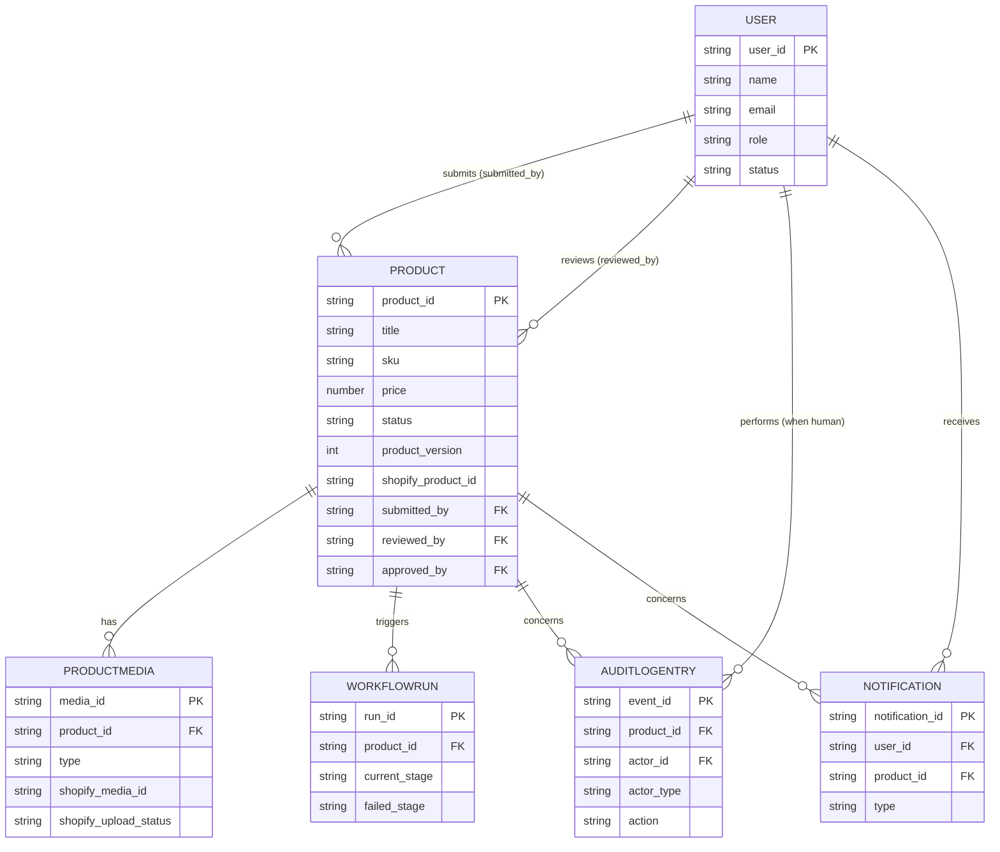

# data-model.md — Kiddypi Shopify Product Launch System

Source of truth: `requirements.md`, `architecture.md`, `agents.md`, `workflow.md`, `security.md`,
`ui-spec.md` (all read completely before writing; none modified). No field, entity, or relationship
below is invented beyond what those six documents establish or what follows as a direct, necessary
consequence of them — such items are marked **[PROPOSED]**. Anything genuinely undefined is marked
**TBD — Requires Confirmation**.

---

## 1. Data Model Overview

```text
User ──creates/submits──> Product ──has──> ProductMedia
User ──reviews/approves──> Product
Product ──triggers──> WorkflowRun (Agent Execution)
Product, User, WorkflowRun ──produce──> AuditLogEntry
Product events ──produce──> Notification (to User)
```

Seven entities: **User**, **Product**, **ProductVersion** (a property of Product, not a separate
top-level record for most purposes — §4), **ProductMedia**, **WorkflowRun** (Agent Execution),
**AuditLogEntry**, **Notification**. This matches the five Firestore collections already proposed
in `architecture.md` §8 (`users`, `products`, `workflow_runs`, `audit_logs`, `notifications`) with
`ProductMedia` and `ProductVersion` living as sub-structures of `products` rather than additional
top-level collections — a **[PROPOSED]** design choice explained in §12.

---

## 2. User

Only the attributes actually required by `requirements.md`/`architecture.md`/`security.md`:

| Field | Type | Notes |
|---|---|---|
| `user_id` | string | The authentication provider's UID (Firebase Auth UID if that proposal is confirmed — `security.md` §3) |
| `name` | string | Display name |
| `email` | string | |
| `role` | enum | `CATALOGUE_ADMIN` \| `APPROVER` \| `PLATFORM_ADMIN` — matches `agents.md` §1/`security.md` §2 exactly; no other role exists |
| `authentication_identity` | string | Provider-specific identity reference (e.g. Firebase UID, if distinct from `user_id`) |
| `status` | enum | `active` \| `inactive` — needed so Platform Admin can deactivate a user without deleting history (`security.md` §2) |
| `created_at` | timestamp | |
| `updated_at` | timestamp | |

No additional attributes (phone, avatar, address, etc.) are modeled — none are required by any
source document.

---

## 3. Product

| Field | Type | Notes |
|---|---|---|
| `product_id` | string | **Internal ID** — Firestore document ID, generated by this system |
| `title` | string | |
| `description` | string | Human-entered or AI-assisted-then-edited (`requirements.md` §5 FR-3) |
| `sku` | string | |
| `price` | number | |
| `currency` | — | **TBD — Requires Confirmation.** Not modeled as a field on the existing `ProductLaunchState`; the sample `product.json` schema in the original README includes a `currency` example but it is not a confirmed, load-bearing field in any of the six source documents. Not included as a confirmed field here |
| `inventory_quantity` | number | |
| `category` | string | |
| `vendor` | string | |
| `tags` | string[] | |
| `media` | ProductMedia[] | See §5 |
| `shopify_product_id` | number, nullable | **External ID** — assigned by Shopify only after `FolderCreationAgent` runs; null until then |
| `shopify_variant_id` | number, nullable | |
| `shopify_url` | string, nullable | |
| `status` | enum | The lifecycle state — exactly the 14 states from `workflow.md` §3, no others (§6) |
| `product_version` | integer | Incremented on every edit while the product is editable (§4) |
| `submitted_by` | user_id, nullable | The Catalogue Admin who submitted this version for review |
| `submitted_at` | timestamp, nullable | |
| `reviewed_by` | user_id, nullable | The Approver who last reviewed it |
| `reviewed_at` | timestamp, nullable | |
| `review_comment` | string, nullable | Required non-empty when the outcome is Request Changes (`security.md` §11) |
| `approved_by` | user_id, nullable | |
| `approved_at` | timestamp, nullable | |
| `approved_at_version` | integer, nullable | The `product_version` value at the moment of approval — the field the Approval Gate's version check (§4, `workflow.md` §6, `security.md` §6) compares against the current `product_version` |
| `current_failed_stage` | enum, nullable | Rolled up from the latest `WorkflowRun` (`architecture.md` §8) |
| `created_at` / `updated_at` | timestamp | |

**Internal `product_id` vs. Shopify `shopify_product_id` are always distinct fields, never
conflated** — the internal ID exists from the moment a Draft is created (before Shopify has ever
heard of the product); the Shopify ID only exists after `FolderCreationAgent` successfully creates
the listing.

---

## 4. Product Version

Required because the Draft → Review → Changes Requested → Edit → Resubmit cycle
(`workflow.md` §7) must be traceable, and because an approval must never authorize a materially
changed product (`workflow.md` §6, `security.md` §6).

**Confirmed-necessary mechanism:** `product.product_version` (integer, incremented on every save
while the product is in an editable state) plus `product.approved_at_version` (recorded at the
moment of approval). The Approval Gate compares the two — if they differ, the approval is stale and
publishing is denied (§7 in `security.md`, restated in `agents.md` §3 as the two-layer enforcement).

**[PROPOSED, not confirmed as required]** A full version-snapshot history
(`products/{productId}/versions/{versionId}`, storing a complete field snapshot at each save) would
enable the field-level diff view `ui-spec.md` §12 marks as **TBD — Requires Confirmation**. This is
not modeled as a required entity here because the diff view itself is not confirmed as required —
if confirmed later, this subcollection is the natural place to add it without changing the
`product_version` counter mechanism above.

---

## 5. Product Media

Modeled as a subcollection of `Product` (§12), one document per file:

| Field | Type | Notes |
|---|---|---|
| `media_id` | string | |
| `product_id` | string | Parent reference |
| `type` | enum | `image` \| `video` |
| `filename` | string | |
| `storage_path` | string | Firebase Storage path — matches the existing `services/firebase_storage_service.py` shape (`products/{product_id}/{folder_name}/{filename}`) |
| `public_url` / `signed_url` | string | Public once the product is `PUBLISHED`; restricted/signed before that (`architecture.md` §9/Decision D8, `security.md` §9) |
| `content_type` | string | |
| `size` | number | Bytes |
| `uploaded_by` | user_id | The Catalogue Admin who attached this file during Add/Edit Product |
| `uploaded_at` | timestamp | |
| `shopify_media_id` | string, nullable | Assigned by the Agent's stage-2 upload (`ui-spec.md` §11), null until Media stage completes |
| `shopify_upload_status` | enum | `pending` \| `uploaded` \| `failed` |
| `shopify_verification_status` | enum | `not_checked` \| `verified` \| `failed` |
| `upload_error` | string, nullable | The real error text, preserved exactly as returned by `services/shopify_media_service.py` (`workflow.md` §10) |

This directly mirrors the existing tool output shapes already in the codebase
(`ShopifyMediaService.retry_upload_media`'s per-file result: `success`, `media_id`, `attempts`,
`status`, `media_content_type`, `error`) — no new shape invented, just given a durable home.

---

## 6. Workflow State

Exactly the 14 states from `workflow.md` §3 — no additions, no omissions:

```text
DRAFT, VALIDATING, VALIDATION_FAILED, READY_FOR_REVIEW, IN_REVIEW, CHANGES_REQUESTED,
APPROVED, PUBLISHING, MEDIA_UPLOAD, VERIFYING, PUBLISHED,
PUBLISH_FAILED, MEDIA_FAILED, VERIFICATION_FAILED
```

Stored as `product.status` (§3). Allowed transitions are defined in `workflow.md` §4 — this document
does not restate the transition table, only confirms the field that holds the value.

---

## 7. Review / Approval

Not a separate top-level entity — represented as fields directly on `Product` (§3:
`reviewed_by`/`reviewed_at`/`review_comment`/`approved_by`/`approved_at`/`approved_at_version`) plus
the corresponding historical record in `AuditLogEntry` (§9: `REVIEW_STARTED`, `CHANGES_REQUESTED`,
`PRODUCT_APPROVED` events). This two-part design — "current decision" on the product, "full history"
in the audit log — is deliberate: most reads (Review screen, Product Detail) only need the current
decision; only the Workflow History/Audit views (`ui-spec.md` §16) need the full sequence.

**Approval must be auditable** — satisfied because every approval also produces a
`PRODUCT_APPROVED` audit entry with the same `approved_by`/`approved_at`/`product_version` values,
so the audit trail and the product's current state can never silently diverge (if they ever do, that
itself is a detectable integrity problem, not an expected state).

---

## 8. Agent Execution (`WorkflowRun`)

One document per actual pipeline execution attempt (`architecture.md` §8, §17 Decision D7 — a
product can have more than one run, e.g. a retry after a technical failure):

| Field | Type | Notes |
|---|---|---|
| `run_id` | string | |
| `product_id` | string | |
| `triggered_by_approval` | { `approved_by`, `approved_at`, `product_version` } | Snapshot of the approval that authorized this run — for traceability even if the product is later edited again |
| `current_stage` | enum | `ingest` \| `validate` \| `create` \| `media` \| `verify` \| `report` |
| `stage_status` | map<stage, enum> | Each stage: `pending` \| `running` \| `completed` \| `failed` \| `skipped` (`ui-spec.md` §10) |
| `started_at` / `completed_at` | timestamp | Overall, plus optionally per-stage |
| `failed_stage` | enum, nullable | Directly mirrors the existing `ProductLaunchState.failed_stage` field already implemented in `state.py` this session |
| `errors` | map<string,string> | Directly mirrors the existing `ProductLaunchState.errors` field |
| `manifest`, `detected_images`, `detected_videos` | — | Ingest output — mirrors existing fields |
| `missing_fields_list`, `conflicts_list`, `duplicate_detected` | — | Validate output — mirrors existing fields |
| `shopify_product_id`, `shopify_variant_id`, `shopify_url` | — | Create output — mirrors existing fields |
| `shopify_media`, `media_upload_results` | — | Media output — mirrors existing fields |
| `verification_result` | — | Verify output — mirrors existing fields |
| `markdown_report_path`, `json_report_path` | — | Report output — mirrors existing fields |

Every field in the bottom five rows is a direct, unmodified carryover from the real, already-working
`ProductLaunchState` model in `state.py` — this entity is that model given a durable home (Firestore)
instead of the current in-memory-only `active_sessions` dict, per `agents.md` §9's exact mapping
table. Nothing about the existing pipeline's data shape changes.

---

## 9. Audit Log

| Field | Type | Notes |
|---|---|---|
| `event_id` | string | |
| `workflow_id` | string, nullable | Only present for workflow/run-related events |
| `product_id` | string, nullable | Absent for account-level events like `USER_LOGIN` |
| `actor_id` | string | `user_id` or agent name |
| `actor_type` | enum | `human` \| `agent` \| `system` |
| `role` | enum, nullable | The actor's role at the time, for human actors |
| `action` | enum | See canonical event list below |
| `previous_state` | string, nullable | |
| `new_state` | string, nullable | |
| `timestamp` | timestamp | |
| `result` | enum | `success` \| `failure` |
| `error` | string, nullable | |
| `comment` | string, nullable | e.g. the Reviewer's rejection reason |

Canonical event list — the union already established consistently across `agents.md` §13,
`workflow.md` §16, and `security.md` §14 (the most complete list, since it adds the
authentication-specific events):

```text
USER_LOGIN                 USER_LOGOUT                 USER_ROLE_CHANGED
PRODUCT_CREATED             PRODUCT_UPDATED
SUBMITTED_FOR_REVIEW        REVIEW_STARTED
CHANGES_REQUESTED           PRODUCT_APPROVED
PUBLISH_STARTED             SHOPIFY_PRODUCT_CREATED
MEDIA_UPLOAD_STARTED        MEDIA_UPLOAD_COMPLETED
VERIFICATION_STARTED        VERIFICATION_COMPLETED
PUBLISHED                   PUBLISH_FAILED
```

**Human actions are distinguished from agent/system actions solely via `actor_type`** — never via a
separate collection or inferred from the action name, keeping the query model simple (§10).

---

## 10. Notifications

Modeled only because `architecture.md` §15/`ui-spec.md` §15 confirm in-app notifications as a v1
requirement:

| Field | Type | Notes |
|---|---|---|
| `notification_id` | string | |
| `user_id` | string | Recipient |
| `product_id` | string, nullable | |
| `type` | enum | `submitted_for_review` \| `changes_requested` \| `approved` \| `publishing_started` \| `publishing_completed` \| `publishing_failed` \| `verification_completed` — exactly the seven events from `ui-spec.md` §15 |
| `message` | string | Friendly text |
| `read` | boolean | |
| `created_at` | timestamp | |

No `email_sent`/`channel` field is modeled — email is **TBD — Requires Confirmation**
(`requirements.md` §24 item 5); this schema is intentionally channel-agnostic so adding email later
doesn't require a schema change, only a new delivery mechanism reading the same records.

---

## 11. Relationships



---

## 12. Firebase / Firestore Mapping

Five top-level collections, matching `architecture.md` §8 exactly, plus one subcollection:

| Collection | Purpose |
|---|---|
| `users/{uid}` | §2 |
| `products/{productId}` | §3 |
| `products/{productId}/media/{mediaId}` | §5 — **[PROPOSED]** subcollection, not a separate top-level collection, since media only ever exists in the context of one product and this keeps ownership/security-rule scoping simple (a Storage-path-mirroring structure, consistent with `architecture.md` §9) |
| `workflow_runs/{runId}` | §8 |
| `audit_logs/{logId}` | §9 |
| `notifications/{notificationId}` | §10 |

No collection beyond these six paths is introduced — no `submissions`, `reviews`, or `approvals`
top-level collections, consistent with `architecture.md` §8's explicit reasoning for keeping the
collection count small (Decision D5).

**Indexes required (proposed, standard Firestore composite indexes):**
- `products`: (`status`, `submitted_by`) — Catalogue Admin's own work queue
- `products`: (`status`) alone — Reviewer's review queue
- `workflow_runs`: (`product_id`, `started_at` desc) — latest run per product
- `audit_logs`: (`product_id`, `timestamp` desc) — per-product Workflow History
- `audit_logs`: (`actor_id`, `timestamp` desc) — Technical Admin's system-wide audit view
- `notifications`: (`user_id`, `read`, `created_at` desc) — unread-first notification list

**Security considerations:** deny-by-default; `products`, `workflow_runs`, `audit_logs` writable
only by the backend's service account, never directly by any client role
(`security.md` §9/§10). Read scoping matches §19 of `ui-spec.md`'s access-control table.
**[PROPOSED convenience field]** `product.active_workflow_run_id` — a pointer to the most recent
`WorkflowRun`, avoiding a query-then-filter round trip on every Product Detail page load. Not a new
business rule, purely a read-performance convenience.

---

## 13. Shopify Data Mapping

| Internal (Firestore) | Shopify (Admin API) | Source of truth |
|---|---|---|
| `product.title` | `product.title` | **Firestore, until published; Shopify thereafter** — Lakshmi edits the internal record; once `FolderCreationAgent` creates the Shopify product, further customer-visible truth lives on Shopify |
| `product.description` (or `generated_description` if AI-assisted) | `product.body_html` | Same as above |
| `product.price` | `variant.price` | Same as above |
| `product.sku` | `variant.sku` | Same as above |
| `product.shopify_product_id` | `product.id` | **Shopify** — this ID only ever originates from Shopify, Firestore stores a copy for reference |
| `ProductMedia` (pre-upload) | `product.media` (post staged-upload) | **Firestore pre-publish; Shopify post-publish** — the file itself is authored/stored via Firebase Storage first, then pushed to Shopify by the Agent |
| `product.status` (business lifecycle: Draft/Review/Approved/etc.) | Shopify `product.status` (`draft`/`active`) | **Deliberately different concepts, tracked separately** (`workflow.md` §11) — Firestore's `status` is never derived from or overwritten by Shopify's status field; they are related but distinct facts |

**"Exists on Shopify" and "verified/complete in this workflow" remain separate facts** — restated
here because it's a data-modeling consequence, not just a UI consequence (`workflow.md` §13,
`ui-spec.md` §13): `product.status = PUBLISHED` is only set after `FolderVerificationAgent` and
`FolderReportAgent` both succeed, never merely because `shopify_product_id` is non-null.

---

## 14. Data Validation Rules

From `workflow.md` §8 and `requirements.md`:

- `title`, `description`, `price` (> 0) are required before a product can leave `DRAFT` for
  `VALIDATING` → `READY_FOR_REVIEW`.
- `sku`/`title` uniqueness is checked via live Shopify lookup during Validation (duplicate
  detection), not enforced as a Firestore-level unique constraint — consistent with the existing
  `get_product_by_sku`/`get_product_by_title` behaviour.
- Media files must be a supported format (existing `tools/file_extractor.py`/ingestion behaviour);
  unsupported files are flagged, not silently dropped (`workflow.md` §10).
- `review_comment` is required (non-empty) when the review outcome is Request Changes
  (`security.md` §11).
- `approved_by` must not equal `submitted_by`, **by default** — pending confirmation
  (`requirements.md` §24, `workflow.md` §22, `security.md` §22 all flag this as the same open
  question; this document does not resolve it, only notes where the check would live if confirmed).
- `product.status` may only be set to `APPROVED`, `PUBLISHING`, or `PUBLISHED` by backend-derived
  logic in response to an authorized action — never accepted as an arbitrary client-supplied value
  on any write (`security.md` §17, `workflow.md` §20).

---

## 15. Data Retention / Audit Requirements

Confirmed: `audit_logs` must be append-only and must exist for every listed event type
(`security.md` §14). **Retention duration is TBD — Requires Confirmation**
(`architecture.md` §19 open question #3) — no source document specifies how long audit history,
workflow run detail, or rejected-product drafts must be kept. This document does not assume a
retention window (e.g. "indefinite" or "7 years") since none is confirmed.

---

## 16. Cross-Document Issues

No hard contradictions were found between the six source documents at the data-modeling level. Two
items are genuine gaps this document had to fill by inference — flagged rather than silently
assumed:

## Cross-Document Issues Requiring Confirmation

1. **Product Media storage shape.** No source document specifies whether media metadata should be a
   Firestore subcollection, an embedded array on the Product document, or a separate top-level
   collection. This document proposes a subcollection (§5, §12) because it mirrors the existing
   Storage path convention and scales better than an embedded array as file counts grow — but this
   is a **[PROPOSED]** technical choice, not something any of the six documents actually decided.
2. **Whether a `product.active_workflow_run_id` convenience pointer is acceptable**, or whether
   `WorkflowRun` lookups should always be a fresh query (§12). Purely a performance/implementation
   choice with no business-rule implication, flagged for completeness rather than left as a silent
   assumption.

No other data-model-specific conflicts were found; items already flagged as open elsewhere
(self-approval policy, retention duration, identity provider) are carried into the relevant fields
above as TBD rather than repeated in full here.
