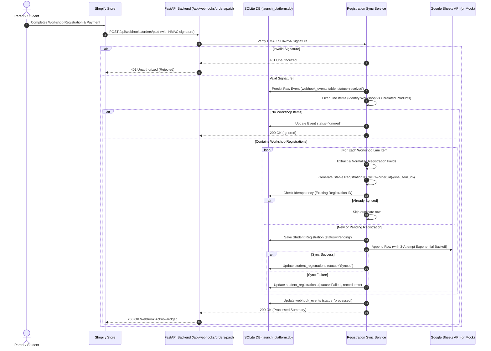

# Student Registration Automation: Shopify to Google Sheets

## 1. Executive Summary

The **Student Registration Automation** module provides reliable, idempotent, and secure synchronization of paid workshop registrations from Shopify store orders directly into Google Sheets for the KiddyPi educational platform.

When parents purchase workshop tickets through the Shopify store, workshop-specific registration details (child name, child age, parent contact information, and area) are captured on the line item properties. This module listens for Shopify webhook events (`orders/paid` and `orders/create`), verifies request authenticity, persists the incoming payload for zero data loss, normalizes registration records, prevents duplicate entries, and writes student attendee data into the designated Google Sheet tab with retry resilience.

---

## 2. Workflow Architecture

### High-Level Architecture Diagram



### Architectural Highlights

1. **Zero Data Loss Pre-Persistence**:
   - The raw webhook payload and metadata are committed to SQLite (`webhook_events`) *before* parsing and API dispatch.
   - If an unexpected error occurs during external network communication, the raw event remains persisted for audit and automated replay.

2. **Strict HMAC Authentication**:
   - Every request is validated using `X-Shopify-Hmac-Sha256` and the store secret (`SHOPIFY_API_SECRET`).
   - Constant-time string comparison (`hmac.compare_digest`) prevents timing side-channel attacks.

3. **Deterministic Idempotency**:
   - A stable, deterministic registration identifier is generated for each workshop attendee:
     `REG-{shopify_order_id}-{line_item_id}`.
   - Repeated webhook deliveries from Shopify do not create duplicate rows in Google Sheets or duplicate database records.

4. **Transient Failure Recovery**:
   - Calls to Google Sheets API utilize exponential backoff retry (3 attempts).
   - If Google Sheets API remains unreachable, the record is tagged as `Failed` with the exact error message and retry count in SQLite.
   - The operational endpoint `POST /api/registrations/sync/retry` recovers and synchronizes all pending or failed records once connectivity is restored.

5. **Customer Privacy Protection**:
   - Logs never print personal information (Parent Name, Child Name, Phone, Email, Residential Area).
   - Only safe operational identifiers (`order_id`, `line_item_id`, `registration_id`, `workshop_name`, `sync_status`) are logged.

---

## 3. Registration Field Mapping

The Shopify workshop registration form captures student and parent attributes directly under line item properties during checkout. The extraction engine supports multiple common property naming conventions and provides fallbacks to order customer objects.

| Target Google Sheet Column | Extracted Key | Line Item Property Aliases | Fallback Sources | Data Type | Sample Synthetic Value |
| :--- | :--- | :--- | :--- | :--- | :--- |
| **Registration ID** | `registration_id` | `registration_id`, `reg_id` | `REG-{order_id}-{item_id}` | String | `REG-700101-88001` |
| **Shopify Order ID** | `shopify_order_id` | `id`, `order_number` | Order `id` / `order_number` | String | `700101` |
| **Workshop Name** | `workshop_name` | `title`, `name` | Catalog Workshop Name | String | `Robotics Explorer Workshop Ticket` |
| **Parent Name** | `parent_name` | `Parent Name`, `parent_name`, `Guardian Name` | `customer.first_name + last_name` | String | `Priya Sharma` |
| **Parent Phone** | `parent_phone` | `Parent Phone`, `parent_phone`, `Mobile`, `Phone` | `customer.phone`, `billing.phone` | String | `+91 98765 43210` |
| **Parent Email** | `parent_email` | `Parent Email`, `parent_email`, `Email` | `customer.email`, order `email` | String | `priya.sharma@example.com` |
| **Area** | `area` | `Area`, `area`, `Location`, `Locality`, `City` | `shipping.city`, `billing.city` | String | `Indiranagar, Bangalore` |
| **Child Name** | `child_name` | `Child Name`, `child_name`, `Student Name` | `note_attributes` Child Name, or `"N/A"` | String | `Aarav Sharma` |
| **Child Age** | `child_age` | `Child Age`, `child_age`, `Student Age`, `Age` | `note_attributes` Child Age, or `"N/A"` | String | `10` |
| **Payment Status** | `payment_status` | `financial_status` | Order `financial_status` (`paid`) | String | `paid` |
| **Registration Date** | `registration_date` | `created_at`, `processed_at` | Order `created_at` or current UTC | ISO 8601 | `2026-10-14T10:00:00Z` |
| **Sync Status** | `sync_status` | Internal status | `"Synced"` or `"Pending"` | String | `Synced` |

---

## 4. Google Sheets Column Schema

All synchronized entries written to Google Sheets strictly match this 12-column order:

```text
Column  1 : Registration ID
Column  2 : Shopify Order ID
Column  3 : Workshop Name
Column  4 : Parent Name
Column  5 : Parent Phone
Column  6 : Parent Email
Column  7 : Area
Column  8 : Child Name
Column  9 : Child Age
Column 10 : Payment Status
Column 11 : Registration Date
Column 12 : Sync Status
```

---

## 5. Files Created and Modified

| File Path | Action | Description |
| :--- | :--- | :--- |
| `services/google_sheets_service.py` | **Created** | Google Sheets API integration supporting `RealGoogleSheetsClient` (Google Sheets v4 via Service Account) and `MockGoogleSheetsClient` for offline testing; includes exponential backoff retry and 12-column enforcement. |
| `services/registration_sync_service.py` | **Created** | Webhook verification (HMAC-SHA256), product filtering (workshops vs kits), line item property parsing, deterministic registration ID generation, SQLite persistence, and retry runner. |
| `data/database.py` | **Modified** | Added schemas and CRUD helpers for `webhook_events` (raw event logging) and `student_registrations` (audit table for sheet sync status and retry counts). |
| `config.py` | **Modified** | Added Pydantic configuration fields for `GOOGLE_SHEETS_SPREADSHEET_ID`, `GOOGLE_SHEETS_TAB_NAME`, `GOOGLE_APPLICATION_CREDENTIALS`, and `MOCK_GOOGLE_SHEETS`. Added secret masking in `__repr__`. |
| `.env.example` | **Modified** | Added template configuration keys under Section 8 for Google Sheets Student Registration Automation. |
| `.env` | **Modified** | Populated local development configuration in Mock mode (`MOCK_GOOGLE_SHEETS=True`). |
| `main.py` | **Modified** | Registered `POST /api/webhooks/orders/paid` endpoint, wired Google Sheets synchronization into `POST /api/webhooks/orders/create`, and registered operational endpoint `POST /api/registrations/sync/retry`. |
| `tests/test_student_registration_sync.py` | **Created** | Comprehensive pytest suite covering all 8 mandatory integration scenarios and column schema compliance. |
| `run_registration_sync_tests.py` | **Created** | Standalone test runner executing all 8 scenarios and rendering synthetic test verification outputs. |
| `pytest.ini` | **Created** | Pytest configuration disabling third-party plugins (`pytest_ethereum`) that conflict with Python 3.12. |
| `docs/STUDENT_REGISTRATION_AUTOMATION.md` | **Created** | Architecture, field mappings, configuration, testing, and production activation documentation. |

---

## 6. Configuration Requirements

The module reads configuration parameters from the root `.env` file via `config.py`.

```ini
# =================================================================
# Google Sheets Student Registration Automation
# =================================================================
# 1. Google Spreadsheet ID (from Google Sheets URL)
# Example URL: https://docs.google.com/spreadsheets/d/1BxiMVs0XRA5nFMdKvBdBZjgmUUqptlbs74OgvE2upms/edit
GOOGLE_SHEETS_SPREADSHEET_ID=your_spreadsheet_id_here

# 2. Sheet Tab Name (Default: Registrations)
GOOGLE_SHEETS_TAB_NAME=Registrations

# 3. Path to Google Cloud Service Account JSON Key
GOOGLE_APPLICATION_CREDENTIALS=/path/to/kiddypi-sheets-service-account.json

# 4. Mock Client Toggle (Set False in Production once Google Cloud permissions are approved)
MOCK_GOOGLE_SHEETS=True

# 5. Shopify Webhook Shared Secret
SHOPIFY_API_SECRET=your_shopify_webhook_secret_here
```

---

## 7. Testing Instructions & Results

### Running Integration Tests

Two test execution mechanisms are provided:

1. **Standalone Test Runner** (displays visual summary and column output):
   ```bash
   python run_registration_sync_tests.py
   ```

2. **Pytest Runner**:
   ```bash
   python -m pytest tests/test_student_registration_sync.py -v
   ```

3. **Regression Test Runner** (verifies existing workshop platform tests remain intact):
   ```bash
   python run_tests.py
   ```

### Actual Test Execution Results

All 9 test cases passed with 100% success:

| # | Test Scenario | Verified Behavior | Status |
| :-: | :--- | :--- | :-: |
| **0** | **Column Order Compliance** | Validates exact 12-column order: `Registration ID`, `Shopify Order ID`, `Workshop Name`, `Parent Name`, `Parent Phone`, `Parent Email`, `Area`, `Child Name`, `Child Age`, `Payment Status`, `Registration Date`, `Sync Status`. | **PASS** |
| **1** | **Valid Paid Workshop Registration** | Webhook extracts all line item properties, persists event to SQLite, saves registration, and appends 1 row in Google Sheets. | **PASS** |
| **2** | **Duplicate Webhook Delivery** | Repeated webhook payloads with identical Order ID are recognized; second delivery skips duplicate appending to Google Sheets. | **PASS** |
| **3** | **Multiple Workshop Registrations** | Single order with 2 different workshop tickets generates two distinct, stable IDs (`REG-700102-88002` & `REG-700102-88003`) and appends 2 rows. | **PASS** |
| **4** | **Missing Student Information** | Order with missing child name/age/area defaults to `"N/A"` without throwing unhandled exceptions and synchronizes successfully. | **PASS** |
| **5** | **Non-Workshop Order** | Order containing physical hardware kits (unrelated products) is identified and ignored (`registrations_synced: 0`, 0 rows added). | **PASS** |
| **6** | **Invalid Webhook Signature** | Webhook with forged or tampered `X-Shopify-Hmac-Sha256` header is rejected with `401 Unauthorized`. | **PASS** |
| **7** | **Google Sheets API Failure** | Simulated 503 outage during Google Sheets append triggers exponential backoff, records `Failed` status and error message in SQLite without crashing. | **PASS** |
| **8** | **Retry After Failure** | Calling `retry_failed_student_registrations()` successfully replays the failed record once API connectivity is restored and updates status to `Synced`. | **PASS** |

---

## 8. Pending Google Cloud Permissions & Production Activation

### Current Status
Google Cloud permissions are currently pending approval. During this phase:
- `MOCK_GOOGLE_SHEETS=True` is active.
- No live Google Cloud credentials or API tokens are required.
- All webhook ingestion, data normalization, database auditing, and retry flows operate fully locally.

### Production Activation Checklist

Once Google Cloud administrative permissions are granted, complete the following steps to switch from Mock mode to live Google Sheets synchronization:

#### Step 1: Enable Google Sheets API in Google Cloud Console
1. Navigate to **Google Cloud Console** > **APIs & Services** > **Library**.
2. Search for **Google Sheets API** and click **Enable**.

#### Step 2: Create a Service Account
1. Navigate to **IAM & Admin** > **Service Accounts**.
2. Click **Create Service Account**.
   - Name: `kiddypi-sheets-sync`
   - Description: `Shopify student registration synchronization service account`
3. Click **Create and Continue**.
4. Grant role: **Editor** (or standard Sheets API caller).
5. Click **Done**.

#### Step 3: Generate Service Account JSON Key
1. Click on the newly created service account (`kiddypi-sheets-sync@...`).
2. Go to the **Keys** tab > **Add Key** > **Create new key**.
3. Select **JSON** and download the key file (e.g., `kiddypi-sheets-service-account.json`).
4. Place the file in a secure server location outside version control (e.g., `C:\Users\honnu\google-keys\kiddypi-sheets.json`).

#### Step 4: Share the Target Google Spreadsheet
1. Open the designated Google Spreadsheet in your browser.
2. Ensure the active tab is named `Registrations` (or matches `GOOGLE_SHEETS_TAB_NAME`).
3. If headers are not yet present, add the 12 columns in Row 1:
   ```text
   Registration ID | Shopify Order ID | Workshop Name | Parent Name | Parent Phone | Parent Email | Area | Child Name | Child Age | Payment Status | Registration Date | Sync Status
   ```
4. Click **Share** (top right).
5. Add the Service Account email address (e.g., `kiddypi-sheets-sync@<project-id>.iam.gserviceaccount.com`).
6. Assign permission: **Editor**.
7. Uncheck "Notify people" and click **Share**.

#### Step 5: Update Server Environment Variables
Update the production `.env` file on the deployment server:
```ini
GOOGLE_SHEETS_SPREADSHEET_ID=your_actual_spreadsheet_id_here
GOOGLE_SHEETS_TAB_NAME=Registrations
GOOGLE_APPLICATION_CREDENTIALS=/secure/path/to/kiddypi-sheets.json
MOCK_GOOGLE_SHEETS=False
```

#### Step 6: Configure Webhook in Shopify Admin
1. In **Shopify Admin**, go to **Settings** > **Notifications** > **Webhooks**.
2. Click **Create webhook**:
   - **Event**: `Order payment` (`orders/paid`)
   - **Format**: `JSON`
   - **URL**: `https://<your-backend-domain>/api/webhooks/orders/paid`
   - **Webhook API version**: `2025-07` (or latest)
3. Copy the **Webhook signing secret** shown at the bottom of the Webhooks page and set:
   ```ini
   SHOPIFY_API_SECRET=your_copied_signing_secret
   ```
4. Save and test by triggering a webhook delivery check.
