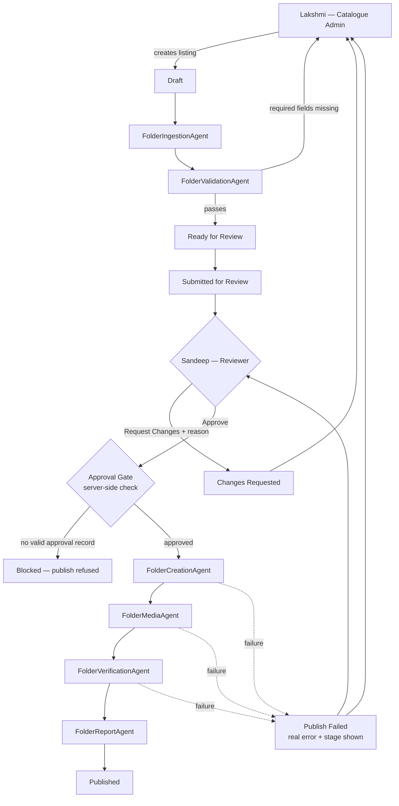

# Agent Architecture — Kiddypi Shopify Product Launch System

Sources read before writing this document: the uploaded `requirements.md` (Product Launch
Workflow — Requirements) and `architecture.md` (Product Launch System — Architecture), plus direct
inspection of the running codebase — every file under `agents/`, `tools/`, `workflow/`,
`services/`, `shopify_client.py`, `main.py`, `state.py`, `product_workflow.py`, and `tests/`. No
code was changed to produce this document. Where the two uploaded documents differ slightly in
wording (e.g. state names, role names), this document follows `requirements.md`'s Sandeep/Lakshmi
framing since that's the one grounded in the actual conversation with the business owner.

---

## 1. Definitions

The existing codebase mixes several different kinds of things under one mental model of "the
agent." This document keeps them separate on purpose, because the human-approval guarantee only
holds if we're precise about which parts are LLM-driven and which are deterministic code:

| Term | Meaning here | Example in this repo |
|---|---|---|
| **Agent** | A Google ADK `Agent` object — has a model (`gemini-2.5-flash`), an instruction prompt, and a small set of tools. Non-deterministic; makes an LLM call. | `FolderValidationAgent` in `agents/folder_agents.py` |
| **Tool** | A plain Python function passed into an Agent's `tools=[...]`. Deterministic, no LLM call, does the real work (file I/O, HTTP calls, state writes). | `validate_folder_data_tool` in `tools/folder_tools.py` |
| **Workflow** | A Google ADK `Workflow` — a fixed DAG of Agents wired together with edges. Orchestration only, no logic of its own. | `folder_product_workflow` in `product_workflow.py` |
| **Service** | A backend integration module, used by tools (and sometimes directly by `main.py`), not itself an ADK object. | `shopify_client.py`, `services/shopify_media_service.py`, `services/firebase_service.py` |
| **Human-in-the-loop step** | A point where a person must act; today this is a boolean flag and an HTTP endpoint, not an ADK concept at all. | `approved_to_publish` field + `POST /api/folder-launch/{id}/approve` |

Nothing in this document calls a tool or a service an "agent." Fifteen `Agent` objects exist in the
codebase today; that is the actual count.

---

## 2. Agent Inventory

There are two separate, parallel pipelines today — a **Campaign** pipeline (raw name/description
in, AI writes everything) and a **Folder** pipeline (a prepared `product.json` + media folder in).
Both are Google ADK `Workflow`s built from the agents below. **The Folder pipeline is the one that
matches the Lakshmi → Sandeep → publish workflow in `requirements.md`** — Lakshmi's "Add Product"
screen is a structured data-entry replacement for what the Folder pipeline today gets from a
`product.json` file. The Campaign pipeline (AI writes the whole product from a two-line prompt) is
a different, lower-control use case and is **not** a good fit for a workflow where a human must
review every field before publish — see §3 and §16.

### 2.1 Folder pipeline agents (`agents/folder_agents.py`) — the relevant pipeline

| Agent | File | Responsibility | Tool(s) | Reads (state in) | Writes (state out) |
|---|---|---|---|---|---|
| `FolderIngestionAgent` | `agents/folder_agents.py` | Read the product folder, parse `product.json` (or fall back to `.txt`/`.md` fields), detect images/videos | `ingest_and_extract_folder_tool` (`tools/folder_tools.py`) | `product_folder_path` | `manifest`, `detected_images`, `detected_videos` |
| `FolderValidationAgent` | `agents/folder_agents.py` | Check required fields, detect duplicates (by SKU/title against live Shopify), flag conflicts | `validate_folder_data_tool` | `manifest` | `missing_fields_list`, `conflicts_list`, `duplicate_detected`, `existing_product_id/title/url` |
| `FolderCreationAgent` | `agents/folder_agents.py` | Create or update the Shopify product record | `create_shopify_product_tool` | validated `manifest`, `duplicate_action` | `shopify_product`, `shopify_product_id`, `shopify_variant_id`, `shopify_url` |
| `FolderMediaAgent` | `agents/folder_agents.py` | Upload detected images/video to the created product via Shopify staged uploads, with retry | `upload_folder_media_tool` | `shopify_product_id`, `detected_images/videos` | `shopify_media`, `media_upload_results`, `conversions`, `unsupported_media` |
| `FolderVerificationAgent` | `agents/folder_agents.py` | Re-read the live Shopify listing and confirm it matches what was published | `verify_folder_product_tool` | `shopify_product_id` | `verification_result` |
| `FolderReportAgent` | `agents/folder_agents.py` | Write the Markdown/JSON launch report to `outputs/` | `generate_folder_reports_tool` | full state | `markdown_report_path`, `json_report_path`, `folder_report` |

Orchestrated by the `folder_product_workflow` Workflow in `product_workflow.py`, run via
`folder_runner` in `workflow/adk_runner.py`.

**Current limitation found in this pipeline:** the human-approval gate today is a plain boolean
(`state.approved_to_publish`) checked by `main.py`, not by any agent — see §4. That's actually the
right shape (agents shouldn't decide), but the *identity* behind the approval isn't captured
anywhere; `POST /api/folder-launch/{session_id}/approve` accepts an approval from anyone who can
reach the endpoint, with no record of who clicked it. See §9 Security and §12 Auditability.

### 2.2 Campaign pipeline agents (`agents/*.py`) — separate pipeline, lower priority for this project

| Agent | File | Responsibility | Tool(s) |
|---|---|---|---|
| `StrategistAgent` | `agents/strategist_agent.py` | Generate campaign name, target audience, strategy, CTA | `get_product_context`, `save_marketing_strategy` |
| `CopywriterAgent` | `agents/copywriter_agent.py` | Write the Shopify HTML product description | `get_product_context`, `save_description` |
| `SEOAgent` | `agents/seo_agent.py` | SEO title, meta description, keywords, slug | `get_product_context`, `save_seo_metadata` |
| `MarketingAgent` | `agents/marketing_agent.py` | Detailed promo copy (email, social, WhatsApp, taglines) | `get_product_context`, `save_marketing_assets` |
| `ImagePromptAgent` | `agents/image_prompt_agent.py` | Write 8 image-generation prompts (hero/lifestyle/banner/etc.) | `get_product_context`, `save_image_prompts` |
| `ImageGeneratorAgent` | `agents/image_generator_agent.py` | No-op placeholder — actual generation is deferred into the publisher tool | `get_product_context`, `generate_images` (pass-through) |
| `PublisherAgent` | `agents/publisher_agent.py` | **Does Create + Media generation + Media upload + Media verify all in one tool call** (`publish_to_shopify`) | `get_product_context`, `publish_to_shopify` |
| `VerificationAgent` | `agents/verification_agent.py` | Re-check the live listing (price, status, variant) | `get_product_context`, `verify_product_listing` |
| `ReportGeneratorAgent` | `agents/report_generator_agent.py` | Write Markdown/JSON report | `get_product_context`, `save_launch_reports` |

Orchestrated by `product_launch_workflow`, run via `runner`.

**Important structural finding:** the Campaign pipeline's approval gate is *not* a workflow-level
pause the way the Folder pipeline's is. It's a silent early-return inside `publish_to_shopify()`
itself: `if not state.get("approved_to_publish", False): return "Publishing skipped: Awaiting admin
approval."` The workflow still runs Verification and Report afterward, against an empty/unpublished
state, rather than actually pausing. This is a real inconsistency between the two pipelines — see
§16.

### 2.3 Tools (deterministic, not agents)

| Tool | File | Used by |
|---|---|---|
| `ingest_and_extract_folder_tool`, `validate_folder_data_tool`, `create_shopify_product_tool`, `upload_folder_media_tool`, `verify_folder_product_tool`, `generate_folder_reports_tool` | `tools/folder_tools.py` | Folder pipeline agents |
| `get_product_context`, `save_description`, `save_seo_metadata`, `save_marketing_strategy`, `save_marketing_assets`, `save_image_prompts`, `generate_images`, `publish_to_shopify`, `verify_product_listing`, `save_launch_reports` | `agents/*.py` (co-located with the agent that owns them) | Campaign pipeline agents |
| `get_workflow_context` | `tools/workflow_context.py` | Defined but not currently wired into any agent's `tools=[...]` — dead code |
| `generate_product_image`, `save_product_image` | `tools/image_generator.py` | Called from `services/image_generation_service.py`, used inside `publish_to_shopify` |
| file/folder parsing helpers | `tools/file_extractor.py` | Called from `ingest_and_extract_folder_tool` |

### 2.4 Services (backend integration, not ADK objects)

| Service | File | Responsibility |
|---|---|---|
| Shopify Admin API client | `shopify_client.py` | `create_product`, `update_product`, `get_product`, `get_product_by_sku`, `get_product_by_title`, `upload_product_image(s)`, `upload_product_media_files` (GraphQL staged uploads), collection helpers |
| Shopify media resilience wrapper | `services/shopify_media_service.py` | `retry_upload` / `retry_upload_media` (exponential backoff), `verify_media` (read-after-write GraphQL check) |
| Image generation | `services/image_generation_service.py` | Generates + verifies product images (Gemini/Imagen, with a Pollinations AI and local-PIL fallback chain) — Campaign pipeline only |
| Firestore | `services/firebase_service.py` | `save_product`, `get_product`, `update_workflow_status`, `save/get_design_system` — falls back to local JSON files under `outputs/mock_firestore/` if `FIREBASE_SERVICE_ACCOUNT_KEY` isn't configured |
| Firebase Storage | `services/firebase_storage_service.py` | `upload_file` — falls back to `outputs/mock_storage/` similarly |
| Theme/design system | `services/theme_analyzer.py` | Shopify theme/template awareness (`selected_shopify_template` field) |

### 2.5 Workflows

| Workflow | File | Runner |
|---|---|---|
| `product_launch_workflow` (Campaign) | `product_workflow.py` | `runner` (`workflow/adk_runner.py`) |
| `folder_product_workflow` (Folder) | `product_workflow.py` | `folder_runner` (`workflow/adk_runner.py`) |
| unused skeletal 3-node DAG | `workflow/dag.py` | not wired to anything — dead code, do not extend |

Both runners share one `InMemorySessionService` and a hardcoded `USER_ID = "default-user"`
(`workflow/session_manager.py`) — there is currently no per-person session identity anywhere in the
ADK layer. That has to change for Sandeep/Lakshmi to be distinguishable — see §7 and §10.

### 2.6 The human-in-the-loop step, as implemented today

Not an agent, not a tool — a plain data flag plus an HTTP endpoint:
- `ProductLaunchState.preview_mode` / `approved_to_publish` (`state.py`)
- `POST /api/folder-launch/{session_id}/approve` (`main.py`) flips `approved_to_publish = True` and
  resumes `run_folder_workflow_background`.

This endpoint has **no authentication and no authorization check today** — anyone who can reach it
with a valid `session_id` can approve a publish. `requirements.md`'s core rule ("no product should
be published without the required human approval") is not currently enforced by the system; it's
only enforced by nobody having found the URL. This is the single most important gap this project
needs to close — see §9.

---

## 3. Proposed Agent Architecture

Working through the candidates from your message against what already exists:

| Candidate | Already exists? | Recommendation | Why |
|---|---|---|---|
| A. Product Validation Agent | **Yes** — `FolderValidationAgent` + `validate_folder_data_tool` | Reuse as-is | Already does required-field checks, duplicate detection (by SKU/title), and conflict flagging against live Shopify data. Nothing to add. |
| B. Product Review Assistant | **No**, and it shouldn't be an agent | Do not build as an LLM agent | The review step is Sandeep reading real data and making a judgment call. An LLM "assistant" here would blur exactly the line `requirements.md` draws: *the agent must never decide whether a product should be publish-worthy.* What's needed instead is a **Review Screen** (UI) presenting the validated data — not an agent that pre-judges it. |
| C. Shopify Publishing Agent | **Yes** — `FolderCreationAgent` + `FolderMediaAgent` + `FolderVerificationAgent`, chained | Reuse as-is; do not merge them into one mega-tool the way the Campaign pipeline's `publish_to_shopify` does | Splitting Create / Media / Verify into separate stages is *why* the Folder pipeline can report which specific stage failed (`failed_stage` field) — the Campaign pipeline's all-in-one tool can't do that. Keep them separate. |
| D. Media Upload capability | **Yes** — `upload_folder_media_tool` + `ShopifyMediaService` | Reuse as-is | Already does staged uploads with retry/backoff for both images and video. |
| E. Verification Agent | **Yes** — `FolderVerificationAgent` + `verify_folder_product_tool` | Reuse as-is | Already re-reads the live Shopify listing after publish. |
| F. Reporting capability | **Yes** — `FolderReportAgent` + `generate_folder_reports_tool` | Reuse as-is | Already writes Markdown/JSON reports. |

**The one thing that's genuinely new and doesn't exist yet is not an Agent at all — it's an
Approval Gate (a backend authorization check):** a server-side check, enforced before the Folder
pipeline is ever invoked, that a durable, identity-attributed "Sandeep approved this" record exists
for this exact listing. Today's `approved_to_publish` boolean is the right *shape* but the wrong
*substance* — it needs to become a lookup against a persisted approval event tied to a specific
authenticated user, not a flag anyone can flip. This is a security/workflow control, not an LLM
component — see §9.

**Conclusion: no new ADK Agent needs to be built.** The six Folder-pipeline agents already
implement A, C, D, E, and F. What's missing is entirely on the human-workflow side: durable
lifecycle state (§7), a real Approval Gate (§9), and the Lakshmi/Sandeep-facing screens
(`requirements.md` §5, §14) — not new AI capability.

---

## 4. Human-in-the-Loop

```text
DRAFT
  → VALIDATION            (FolderValidationAgent — automatic, before Sandeep ever sees it)
  → READY FOR REVIEW
  → HUMAN REVIEW           (Sandeep — not an agent)
       ├── APPROVED → Approval Gate check → FolderCreationAgent → FolderMediaAgent
       │                                     → FolderVerificationAgent → FolderReportAgent → PUBLISHED
       └── CHANGES REQUESTED → Lakshmi (Catalogue Admin) → edits → RESUBMIT → VALIDATION (loop)
```

The agent must never (already true of the existing tools, and must remain true after any change):
- autonomously approve a product
- autonomously reject a product based on business judgement
- bypass the reviewer
- publish an unapproved product
- change the approval status itself
- override a human rejection

None of the six Folder-pipeline tools inspected write to an "approval" field — only `main.py`
(driven by the `/approve` endpoint) does. That separation is correct today; the gap is only that
the endpoint doesn't check *who* is calling it.

---

## 5. Agent Responsibilities

Full detail for the six Folder-pipeline agents (the ones this project's workflow actually runs).
The nine Campaign-pipeline agents follow an identical shape (one Gemini call, one save-tool) and
are condensed into a single combined row afterward rather than repeated six more times — see the
note below the table for why.

### FolderIngestionAgent

| | |
|---|---|
| Purpose | Read the uploaded product folder and produce a structured manifest |
| Trigger | Start of `folder_product_workflow`, after `POST /launch-folder` or `/approve` resumes it |
| Inputs | `product_folder_path` (state) |
| Outputs | `manifest`, `detected_images`, `detected_videos` (state) |
| Tools | `ingest_and_extract_folder_tool` |
| State | Reads `product_folder_path`; writes `manifest`/`detected_images`/`detected_videos` |
| Allowed actions | Read files under the session's upload directory only |
| Forbidden actions | Writing to Shopify, Firestore, or Storage; making any approval/rejection decision |
| External systems | None (local filesystem only) |
| Failure behaviour | Raises on missing/invalid folder; caught by `main.py`'s outer exception handler with full traceback (see §7) |
| Human escalation | Lakshmi — bad folder structure means she needs to fix and re-upload |
| Audit events | `PRODUCT_INGESTED` (proposed — not implemented yet, see §12) |

### FolderValidationAgent

| | |
|---|---|
| Purpose | Enforce required fields, detect duplicates, flag conflicts |
| Trigger | After Ingestion completes |
| Inputs | `manifest` |
| Outputs | `missing_fields_list`, `conflicts_list`, `duplicate_detected`, `existing_product_id/title/url` |
| Tools | `validate_folder_data_tool` |
| State | Reads `manifest`; writes validation result fields |
| Allowed actions | Read-only Shopify lookups (`get_product_by_sku`, `get_product_by_title`) for duplicate detection |
| Forbidden actions | Creating/updating/deleting any Shopify product; approving/rejecting |
| External systems | Shopify Admin API (read-only) |
| Failure behaviour | Populates `missing_fields_list`/`conflicts_list` rather than throwing for ordinary data problems; throws for genuine tool errors |
| Human escalation | Lakshmi, for missing/incorrect data |
| Audit events | `PRODUCT_VALIDATED` (proposed) |

### FolderCreationAgent

| | |
|---|---|
| Purpose | Create or update the Shopify product record |
| Trigger | Only reached after the workflow has resumed post-approval (see §4, §9) |
| Inputs | Validated `manifest`, `duplicate_action` |
| Outputs | `shopify_product`, `shopify_product_id`, `shopify_variant_id`, `shopify_url` |
| Tools | `create_shopify_product_tool` |
| State | Reads validated manifest + duplicate resolution; writes Shopify identifiers |
| Allowed actions | Create/update a Shopify product via `shopify_client.create_product`/`update_product` |
| Forbidden actions | Publishing without an approved state; deleting products; bypassing duplicate checks |
| External systems | Shopify Admin API (write) |
| Failure behaviour | Real `ShopifyAPIError`/`ShopifyConfigError` surfaced with message; `failed_stage="create"` recorded by `main.py` |
| Human escalation | Platform Admin for credential/API errors; Lakshmi for data errors |
| Audit events | `SHOPIFY_PRODUCT_CREATED` / `PUBLISH_FAILED` (proposed) |

### FolderMediaAgent

| | |
|---|---|
| Purpose | Upload detected images/video to the created product |
| Trigger | After Creation completes |
| Inputs | `shopify_product_id`, `detected_images`, `detected_videos` |
| Outputs | `shopify_media`, `media_upload_results`, `conversions`, `unsupported_media` |
| Tools | `upload_folder_media_tool` (→ `services/shopify_media_service.py`) |
| State | Reads product ID + detected media; writes upload results |
| Allowed actions | Staged uploads to the already-created product only |
| Forbidden actions | Uploading to a different product; retrying indefinitely (bounded by `image_config.RETRY_COUNT`) |
| External systems | Shopify Admin API (GraphQL staged uploads) |
| Failure behaviour | Per-file `success: False` + real error text in `media_upload_results`; `failed_stage="media"` if the stage as a whole can't complete — this is the exact stage that produced the `'NoneType' object has no attribute 'state'` incident earlier this session, now fixed (see §7) |
| Human escalation | Lakshmi for bad/corrupt media files; Platform Admin for Shopify API/quota errors (e.g. HTTP 429) |
| Audit events | `MEDIA_UPLOAD_STARTED` / `MEDIA_UPLOAD_COMPLETED` (proposed) |

### FolderVerificationAgent

| | |
|---|---|
| Purpose | Confirm the live Shopify listing matches what was published |
| Trigger | After Media completes |
| Inputs | `shopify_product_id` |
| Outputs | `verification_result` |
| Tools | `verify_folder_product_tool` |
| State | Reads product ID; writes verification result |
| Allowed actions | Read-only Shopify lookups |
| Forbidden actions | Modifying the product |
| External systems | Shopify Admin API (read) |
| Failure behaviour | `failed_stage="verify"` with the real mismatch/error recorded |
| Human escalation | Platform Admin for API issues; Lakshmi if the listing content itself is wrong |
| Audit events | `VERIFICATION_STARTED` / `VERIFICATION_COMPLETED` (proposed) |

### FolderReportAgent

| | |
|---|---|
| Purpose | Write the final Markdown/JSON launch report |
| Trigger | After Verification completes |
| Inputs | Full workflow state |
| Outputs | `markdown_report_path`, `json_report_path` |
| Tools | `generate_folder_reports_tool` |
| State | Reads everything; writes report paths |
| Allowed actions | Write files under `outputs/` |
| Forbidden actions | None Shopify/Firebase-affecting |
| External systems | None |
| Failure behaviour | Should not fail silently; if it does, prior stages remain valid and published |
| Human escalation | Platform Admin (disk/permission issues only) |
| Audit events | `PUBLISHED` (proposed, on successful completion of this stage) |

### Campaign-pipeline agents (condensed)

| | |
|---|---|
| Purpose | Generate marketing copy, SEO, images, and publish for the *Campaign* (raw-prompt) flow — a separate use case from Lakshmi/Sandeep's catalogue workflow |
| Agents | `StrategistAgent`, `CopywriterAgent`, `SEOAgent`, `MarketingAgent`, `ImagePromptAgent`, `ImageGeneratorAgent`, `PublisherAgent`, `VerificationAgent`, `ReportGeneratorAgent` |
| Tools | One `get_product_context` read + one `save_*` write each, except `PublisherAgent`'s `publish_to_shopify`, which does Create+Media+Verify-prep in one call (see §2.2 finding) |
| Allowed actions | Generate content into workflow state only; `PublisherAgent` may create/update Shopify products **only if `approved_to_publish` is already true when it runs** |
| Forbidden actions | Same as Folder agents — no autonomous approval |
| Failure behaviour | Falls back to a silent "Publishing skipped" message rather than pausing — see §2.2, this should be reconciled with the Folder pipeline's pattern if the Campaign flow is kept (§16) |
| Recommendation | Out of scope for the Lakshmi/Sandeep workflow in `requirements.md`. Leave running as-is for whatever it's currently used for; do not route Kiddypi catalogue products through it until/unless `requirements.md` says otherwise. |

---

## 6. Shopify Publishing Agent — pipeline detail

```text
Validate ──► Create/Update ──► Duplicate/Conflict Handling ──► Media Upload ──► Verify ──► Report
```

Mapped to real code:

| Stage | Agent | Tool | Underlying service |
|---|---|---|---|
| Validate | `FolderValidationAgent` | `validate_folder_data_tool` | `shopify_client.get_product_by_sku` / `get_product_by_title` |
| Create/Update | `FolderCreationAgent` | `create_shopify_product_tool` | `shopify_client.create_product` / `update_product` |
| Duplicate/Conflict handling | (inside Validate + Create) | `validate_folder_data_tool`, `create_shopify_product_tool` | `duplicate_action` field drives CREATE / UPDATE / ASK resolution |
| Media Upload | `FolderMediaAgent` | `upload_folder_media_tool` | `services/shopify_media_service.py` (staged uploads, retry/backoff) |
| Verify | `FolderVerificationAgent` | `verify_folder_product_tool` | `shopify_client.get_product`, `ShopifyMediaService.verify_media` |
| Report | `FolderReportAgent` | `generate_folder_reports_tool` | local filesystem |

Already true today and must be preserved:
- Draft protection: products can be created with `product_status` other than `active`, protecting
  against premature customer visibility.
- Duplicate prevention: SKU/title lookups run before creation.
- Real error surfacing: `ShopifyConfigError`/`ShopifyAPIError` messages propagate with actual text,
  not generic failures (confirmed by direct inspection of `shopify_client.py` and
  `services/shopify_media_service.py`).

Must **not** publish unless workflow state indicates human approval — currently enforced only by
`main.py` checking `approved_to_publish` before resuming the workflow at all; the pipeline itself
has no independent check. Recommendation in §9: add a second, defense-in-depth check inside
`create_shopify_product_tool` itself, so the pipeline can never create a live product even if
`main.py`'s gate were ever bypassed by a future code change.

---

## 7. State and Session

### Today

`ProductLaunchState` (`state.py`) is the single shared schema for both pipelines — a flat Pydantic
model with ~50 fields covering input, AI outputs, Shopify IDs, media results, verification,
duplicate handling, and `errors`/`failed_stage`. It lives in `main.py`'s `active_sessions: Dict[str,
ProductLaunchState]` — **an in-memory dictionary, wiped on every server restart or reload.**

Propagation today, stage by stage:

```text
POST /launch-folder
  → active_sessions[id] = ProductLaunchState(...)
  → run_folder_workflow_background(id)
      → asyncio.run(folder_runner.run_async(session_id=id, ...))
          Ingestion   writes manifest, detected_images/videos
          Validation  writes missing_fields_list, conflicts_list, duplicate_*
          Creation    writes shopify_product_id, shopify_url
          Media       writes shopify_media, media_upload_results
          Verification writes verification_result
          Report      writes markdown_report_path, json_report_path
      → state.status = "completed" | "failed" | "awaiting_approval"
GET /status/{id} → returns the current ProductLaunchState
```

**This session's own incident is the concrete cautionary example:** the pipeline previously used
`Runner.run()` (a sync wrapper that drives execution on a bare background thread with a
`queue.Queue()` handoff and *zero exception capture*). Any tool exception — including a genuine
`'NoneType' object has no attribute 'state'` bug — died silently in that thread, and `main.py`'s own
`except` block never saw it, so the UI showed a bare, traceback-less error. That's been fixed this
session by switching to `asyncio.run()` wrapping `run_async()` directly in the calling thread, so
exceptions now propagate and get caught with a full traceback (`state.errors["workflow_error"]`
includes `"Stack Trace:\n..."`), and `_derive_folder_failed_stage()` in `main.py` maps the state of
completion back to the actual failed stage (`ingest`/`validate`/`create`/`media`/`verify`/`report`)
instead of always blaming Media. **Any new architecture must not reintroduce a code path where a
tool's exception can be silently dropped** — this is the direct cause of the exact class of bug
`requirements.md` §7 and this project's earlier debugging both call out.

### What's missing for this project's workflow

The in-memory model above is fine for *running* a single pipeline execution, but it cannot hold the
lifecycle `requirements.md`/`architecture.md` describe:
- Approval must survive a server restart — an in-memory dict can't.
- Approval must be attributable to a specific person — nothing in the current model records *who*.
- A listing needs to exist and be readable in `DRAFT`/`CHANGES_REQUESTED` state for potentially
  days, across many server restarts, before anyone approves it.

This means the durable system of record has to move to Firestore (per `architecture.md` §7, §9),
with `active_sessions`/`ProductLaunchState` continuing to exist as the *execution-time* working
state for an active pipeline run, hydrated from and flushed back to Firestore at each stage
boundary — not replaced by Firestore reads/writes on every tool call (that would be a much bigger,
riskier change to the working tool code than necessary).

---

## 8. Tool Boundaries

Least-privilege mapping — no agent should receive a tool it doesn't need for its own stage:

| Agent | Shopify tools | Firebase tools | Folder/catalogue tools |
|---|---|---|---|
| `FolderIngestionAgent` | none | none | `ingest_and_extract_folder_tool` |
| `FolderValidationAgent` | read-only (`get_product_by_sku`, `get_product_by_title`, via the tool) | none | `validate_folder_data_tool` |
| `FolderCreationAgent` | create/update (`create_product`, `update_product`) | none | `create_shopify_product_tool` |
| `FolderMediaAgent` | media upload (staged uploads) | none | `upload_folder_media_tool` |
| `FolderVerificationAgent` | read-only (`get_product`, `verify_media`) | none | `verify_folder_product_tool` |
| `FolderReportAgent` | none | none (writes local files only) | `generate_folder_reports_tool` |

**Firebase tools are not currently exposed to any agent at all** — `services/firebase_service.py`
and `services/firebase_storage_service.py` are called directly from... nowhere in the current
Folder pipeline; they're wired up for the Campaign/Workshops paths (`design_system`,
`firebase_product_id` fields exist on `ProductLaunchState` but aren't populated by any Folder tool
today). If Firestore becomes the durable state store (§7), the natural design is a small internal
service layer that `main.py` calls at stage boundaries — **not** new tools handed to the LLM agents,
since persistence is bookkeeping, not something that benefits from LLM judgment.

---

## 9. Security

Findings from direct inspection (see `docs/CURRENT_ARCHITECTURE.md` §8, §15 for the full audit):

| Area | Current state | Requirement |
|---|---|---|
| Authentication | **None.** No `Depends()`, no session cookie, no JWT, anywhere in `main.py` | Every internal screen requires login (`requirements.md` §8, `architecture.md` §3.3) |
| Authorization | **None.** `/api/folder-launch/{id}/approve` accepts any caller | Approve/reject restricted server-side to the Reviewer role; create/edit restricted to Catalogue Admin role |
| CORS | `allow_origins=["*"]` **and** `allow_credentials=True` — an invalid/dangerous combination the moment cookies exist | Explicit origin allow-list once auth exists |
| Session/launch ID exposure | `GET /status/{id}` has no ownership check — anyone with the UUID can read full state including errors | Restrict to the assigned Catalogue Admin, the Reviewer, and Platform Admin |
| Firebase Storage | Uploaded media is made public (`blob.make_public()`) unconditionally | Acceptable for already-published product images; needs a distinct rule for pre-approval draft media, which shouldn't be publicly guessable |
| Shopify/Firebase credentials | Correctly read server-side only via `os.getenv`/`FIREBASE_SERVICE_ACCOUNT_KEY`; `.env` is gitignored, never committed | Preserve as-is — do not move any credential into frontend code |
| Error detail | Full tracebacks land in `state.errors`, returned as-is via `GET /status/{id}` to any caller | Tier this: friendly message + stage to Lakshmi/Sandeep, full trace to Platform Admin only (`requirements.md` §16) |

**Defense in depth for the publish gate specifically:** authorization for "may this session be
approved" should be checked in two places — once at the API boundary (`/approve` endpoint, reject
non-Reviewer callers with 403) and again inside `create_shopify_product_tool` itself (refuse to
create a live product if the durable approval record for this listing is missing), so a bug in one
layer doesn't silently defeat the other.

---

## 10. BOSS Framework Alignment

`https://agentic-boss.web.app/work-cockpit` was checked directly. It's a fully client-rendered
application ("Subhanu A-PMX") — no content is visible without executing its JavaScript and,
presumably, authenticating. Nothing about its actual auth mechanism, role model, or
integration/embedding pattern can be confirmed from outside without being logged into it, and per
your instruction this document does not invent any of that. **The following must be confirmed
directly (e.g. by asking whoever administers that system, or by getting a logged-in walkthrough)
before any BOSS integration work starts:**

- Authentication mechanism (OAuth/OIDC? Firebase Auth under the hood? Something else?)
- How user identity is represented and handed to a downstream application like this one
- How roles are modeled in BOSS, and whether "Reviewer"/"Catalogue Admin" map onto existing BOSS
  roles or need to be new ones
- How authorization decisions are made — does BOSS issue a token this app validates, or does BOSS
  itself gate access before this app is ever reached?
- Whether this application is meant to be embedded inside the BOSS "work-cockpit" shell (iframe/
  micro-frontend) or linked out to as a standalone app with BOSS-issued credentials
- How "work items" are represented in BOSS, and whether a submitted-for-review product listing
  should show up there
- Which BOSS navigation/UI conventions (if any) this app is expected to match

Until these are confirmed, the safe default (already reflected in `REQUIREMENTS.md` from earlier in
this project and in `architecture.md` §3.3) is: **Firebase Authentication**, independent of BOSS,
as the interim identity provider — since `firebase-admin` is already a dependency and nothing else
in this codebase currently talks to BOSS at all. This can be swapped for real BOSS integration
later without touching the agent/tool layer, since authentication is a `main.py`-level concern, not
something any Agent or Tool touches directly.

---

## 11. User Roles

| Role | Real person (today) | Can do | Cannot do |
|---|---|---|---|
| **Reviewer/Approver** | Sandeep | View submitted listings, open the full review screen, Approve, Request Changes (with a reason), view publish status/history, view published products | Cannot perform the technical publish himself; cannot edit Lakshmi's catalogue data directly (per `requirements.md` §12) |
| **Catalogue Admin** | Lakshmi | Create/edit/save drafts, upload media, submit for review, view feedback, fix and resubmit rejected listings | Cannot approve her own submission; cannot publish directly to live Shopify |
| **AI Publish Agent** | The six Folder-pipeline agents, collectively | Validate, create/update Shopify product, upload media, verify, report — only after an Approval Gate check passes | Cannot decide whether to publish; cannot act without a valid approval record |
| **Platform/Technical Admin** | Not yet assigned — open question in `REQUIREMENTS.md` §24 / `requirements.md` §14 item 4 | Manage user/role assignments, view full audit log, view raw technical error detail, investigate infrastructure failures | — |

---

## 12. Failure Handling

| Failure type | Where it happens today | Current behaviour | Requirement |
|---|---|---|---|
| Validation failure | `validate_folder_data_tool` | Populates `missing_fields_list`/`conflicts_list`; does not raise | Must stop the workflow from reaching Sandeep's queue until resolved (already true) |
| Missing product data | Ingestion/Validation | Surfaced via `missing_fields_list` | Route back to Lakshmi with the specific missing fields |
| Missing media | `upload_folder_media_tool` | `unsupported_media` list populated; upload proceeds for supported files | Show exactly which files were skipped and why |
| Shopify API failure | Any Shopify-calling tool | Real `ShopifyAPIError` message with response detail (confirmed in `shopify_client.py`) | Keep as-is — do not replace with a generic message |
| Staged upload failure | `services/shopify_media_service.py` | Retries with exponential backoff (`image_config.RETRY_COUNT`), then reports `success: False` + real error per file | Keep as-is |
| Media upload failure (overall stage) | `main.py` / `FolderMediaAgent` | `failed_stage="media"` + real error text since this session's fix | Keep — this is the exact scenario that used to degrade into `'NoneType' object has no attribute 'state'` |
| Firebase failure | `services/firebase_service.py`, `services/firebase_storage_service.py` | Falls back to local mock storage/Firestore automatically, logs a warning | Acceptable for dev; for production durable state (§7) this fallback needs to be a hard failure with a clear message instead of a silent local-disk fallback, since local disk isn't durable across restarts either |
| Authentication failure | Not implemented yet | N/A | Return 401 with no detail beyond "not authenticated" |
| Authorization failure | Not implemented yet | N/A | Return 403, log the attempt, never reveal what the caller *would* have needed |
| Verification failure | `verify_folder_product_tool` | `failed_stage="verify"` + specific mismatch (price/status/variant) | Keep as-is |
| Workflow/session failure (e.g. `get_session()` returns `None`) | `main.py` outer `except` | Caught since this session's `asyncio.run(run_async())` fix, full traceback attached | Keep — never regress to the swallowed-exception behavior |

No `except: pass` exists anywhere in the inspected Folder-pipeline code, and none should be
introduced.

---

## 13. Auditability

**Not implemented today** — this is new work, not a reuse decision. Proposed events, matching
`requirements.md` §11 and `architecture.md` §10, mapped onto the real pipeline stages found above:

```text
PRODUCT_CREATED           (Lakshmi saves a draft)
PRODUCT_VALIDATED         (FolderValidationAgent completes)
SUBMITTED_FOR_REVIEW      (Lakshmi submits)
REVIEW_STARTED            (Sandeep opens the review screen)
CHANGES_REQUESTED         (Sandeep rejects, with reason)
PRODUCT_APPROVED          (Sandeep approves — the record the Approval Gate checks for, §9)
PUBLISH_STARTED           (Approval Gate passes, FolderCreationAgent begins)
SHOPIFY_PRODUCT_CREATED   (FolderCreationAgent completes)
MEDIA_UPLOAD_STARTED / MEDIA_UPLOAD_COMPLETED
VERIFICATION_STARTED / VERIFICATION_COMPLETED
PUBLISHED                 (FolderReportAgent completes successfully)
PUBLISH_FAILED            (any stage's failed_stage is set)
```

Each entry: `timestamp`, `product_id`/`session_id`, `workflow_id`, `actor` (`user:<uid>` or
`agent:<agent_name>`), `action`, `status`, `error` (where applicable). Proposed home: an
append-only `audit_logs` Firestore collection (per `architecture.md` §9), written by `main.py` at
each stage transition — not by the agents/tools themselves, to keep audit-writing in one place
rather than scattered across six tool files.

---

## 14. Agent Guardrails

**Folder Creation/Media/Verification agents (collectively, "Publishing"):**

```text
ALLOW
- create/update the Shopify product for an APPROVED listing
- upload media that was part of the original submission
- verify the resulting listing
- report success or the real failure reason

DENY
- publish a listing without a valid, durable approval record
- change a listing's approval/rejection status
- delete a Shopify product
- retry indefinitely without bound
- expose credentials (Shopify token, Firebase key) in any output, log, or error message
- bypass validation (skip straight to Create without Validation having run)
- bypass verification (mark PUBLISHED without Verification having run)
```

**Validation agent:**

```text
ALLOW
- read product data and perform read-only Shopify duplicate lookups
- flag missing fields / conflicts

DENY
- modify any Shopify product
- approve or reject on data-quality grounds — flagging is not the same as deciding
```

---

## 15. Agent Workflow Diagram



---

## 16. Implementation Guidance

**No code is being written as part of this document.** For when implementation starts:

**Keep exactly as-is (working, tested, no reason to touch):**
- All six Folder-pipeline agents and tools (`agents/folder_agents.py`, `tools/folder_tools.py`)
- `shopify_client.py`, `services/shopify_media_service.py`
- `services/firebase_service.py`, `services/firebase_storage_service.py` (as the mock-fallback
  pattern for whatever isn't yet backed by real Firestore)
- The `asyncio.run(run_async())` execution pattern in `main.py` (this session's fix — do not revert
  to `runner.run()`)
- `_derive_folder_failed_stage()` and the `failed_stage` field

**Modify (small, additive changes to existing files):**
- `main.py`: add authentication middleware/dependency, the Approval Gate check before invoking
  `folder_runner`, and stage-boundary writes to Firestore for durable lifecycle state
- `state.py` / Firestore schema: add durable lifecycle fields (`submitted_by`, `reviewed_by`,
  `review_comment`, timestamps) alongside the existing `ProductLaunchState` fields — additive, not
  a rename of existing fields
- `create_shopify_product_tool`: add the defense-in-depth approval check described in §9

**Add (new, not existing today):**
- Authentication layer (Firebase Auth pending BOSS confirmation, §10)
- Role-based authorization checks on `/api/folder-launch/{id}/approve` and any new
  create/edit/submit endpoints
- Durable `listings` / `listing_events` (audit) Firestore collections
- Lakshmi's Add/Edit Product screen, Sandeep's Review Queue + Review screen (UI only — calls the
  existing pipeline, doesn't reimplement it)
- Audit-log writer at each stage transition in `main.py`

**Should NOT be built:**
- A new "Product Validation Agent" — `FolderValidationAgent` already does this
- A new "Shopify Publishing Agent" — the three existing Folder agents already do this, correctly
  split by stage
- An LLM "Review Assistant" that pre-judges listings — the review decision must stay 100% human
- A rewrite of the Campaign pipeline to fix its silent-skip approval gap, unless `requirements.md`
  confirms the Campaign flow is actually part of the Kiddypi catalogue workflow (currently unclear
  — see Open Questions)

**Where things integrate:**
- BOSS auth (once confirmed, §10) → `main.py` request-handling layer, above the ADK runners
- Firestore durable state (§7) → written by `main.py` at stage boundaries, not by individual tools
- Shopify calls (§6) → unchanged, still only inside the Folder-pipeline tools

---

## 17. Testing Requirements

Mapped against what already exists in `tests/`:

| # | Test | Existing coverage | Gap |
|---|---|---|---|
| 1 | Product validation | `tests/test_folder_workflow.py`, `tests/test_media_state_regression.py` | none |
| 2 | Product submitted for review | — | new: needs a real "submit" endpoint/state to test |
| 3 | Human approval required before publish | Partially — `test_media_state_regression.py` documents `get_session()` returning `None`; no test yet asserts an *unauthenticated* approve is rejected | new |
| 4 | Rejected product returns to Catalogue Admin | — | new |
| 5 | Approved product reaches publishing agent | `test_media_state_regression.py::test_f_create_then_media_state_propagation` (state propagation) | needs extension for the new Approval Gate |
| 6 | Unapproved product cannot publish | — | new — should assert `create_shopify_product_tool` refuses without a durable approval record (§9) |
| 7 | Shopify product creation | `tests/test_folder_workflow.py` | none |
| 8 | Duplicate prevention | `tests/test_folder_workflow.py` | none |
| 9 | Image upload | `test_media_state_regression.py` (images-only scenario) | none |
| 10 | Video upload | `test_media_state_regression.py` (images+video scenario) | none |
| 11 | Staged upload failure | `test_media_state_regression.py` | none |
| 12 | Shopify API failure | `test_media_state_regression.py::test_h_ingest_tool_exception_is_not_swallowed` (pattern reusable for other stages) | none |
| 13 | Verification failure | `tests/test_verification.py` (Campaign pipeline) | needs a Folder-pipeline equivalent |
| 14 | Firebase failure | `tests/test_firebase_workflow.py` | needs a test asserting the durable-state fallback behaves safely, once §7 is implemented |
| 15 | State/session propagation | `test_media_state_regression.py::test_g_actual_create_from_folder_workflow` (full ADK-runner E2E) | none |
| 16 | Complete Draft → Review → Approve → Publish | — | new — this is the core end-to-end test this project needs once the review/approval layer exists |

---

## Final Recommendation

### Recommended Agent Architecture

| Component | Type | Purpose | Human Decision? |
|---|---|---|---|
| `FolderIngestionAgent` | Agent | Parse product folder into a manifest | No |
| `FolderValidationAgent` | Agent | Required-field/duplicate/conflict checks | No |
| Review Screen | UI (not an agent) | Present validated data for Sandeep's judgment | **Yes — the decision itself** |
| Approval Gate | Service (backend authorization check) | Verify a durable, identity-attributed approval exists before publishing | No (enforces the human decision, doesn't make one) |
| `FolderCreationAgent` | Agent | Create/update the Shopify product | No |
| `FolderMediaAgent` | Agent | Upload images/video | No |
| `FolderVerificationAgent` | Agent | Confirm the live listing | No |
| `FolderReportAgent` | Agent | Write the launch report | No |
| Audit Log Writer | Service | Record every transition | No |
| Authentication/Authorization | Service | Identify and permission-check every request | No (enforces roles, doesn't set them) |

### What Already Exists
The complete technical publishing pipeline (Ingest → Validate → Create → Media → Verify → Report)
for the Folder flow, a working Shopify client with staged uploads and duplicate detection, and a
Firebase/Firestore integration with local-mock fallback.

### What Should Be Reused
All six Folder-pipeline agents/tools, `shopify_client.py`, `services/shopify_media_service.py`,
the Firebase service pattern, and this session's exception-propagation fix
(`asyncio.run(run_async())`).

### What Should Be Modified
`main.py` (auth, Approval Gate, Firestore writes at stage boundaries), `state.py`/Firestore schema
(additive lifecycle fields), `create_shopify_product_tool` (defense-in-depth approval check).

### What Should Be Added
Authentication, role-based authorization, durable `listings`/`listing_events` Firestore
collections, Lakshmi's and Sandeep's UI screens, an audit-log writer.

### What Should NOT Be Built
A new Validation agent, a new Publishing agent, or any LLM "assistant" that reviews/pre-approves
listings on Sandeep's behalf. The existing six Folder agents are sufficient; the missing piece is
workflow/security plumbing, not AI capability.

### Open Questions
1. Is the Campaign pipeline (raw-prompt AI product generation) actually part of the Kiddypi
   catalogue workflow, or a separate/legacy use case? Its silent approval-skip behavior (§2.2)
   needs a decision either way before it's exposed to Lakshmi/Sandeep.
2. BOSS's actual authentication/role/embedding model — could not be determined from outside (§10);
   needs direct confirmation.
3. Who is the Platform/Technical Admin in practice (`requirements.md` §14, item 4)?
4. Should the defense-in-depth approval check in `create_shopify_product_tool` (§9) block *all*
   direct calls to the Folder pipeline, including any future automation/API access, or only the
   `/launch-folder` → `/approve` HTTP path?
5. Retention policy for `audit_logs` — indefinite, or a defined retention window?

---

## Summary

**What I found in the codebase:** the Folder pipeline (six ADK agents in `agents/folder_agents.py`,
backed by real tools in `tools/folder_tools.py`) already implements the full technical publishing
pipeline your workflow needs — Ingest, Validate, Create, Media, Verify, Report — against a real
Shopify store, with duplicate detection, staged media uploads with retry, and live verification.
It's solid and shouldn't be rebuilt. What's genuinely missing is entirely on the human/security
side: there's no authentication anywhere in the app, the existing "approve" endpoint
(`/api/folder-launch/{id}/approve`) can be called by anyone with no identity check, and workflow
state lives only in memory — wiped on every server restart — so it can't hold a real Draft →
Review → Approve lifecycle that has to survive days and multiple deploys. There's also a real
inconsistency worth a decision: the separate Campaign pipeline's approval check silently no-ops
instead of pausing, unlike the Folder pipeline's proper pause/resume.

**What `agents.md` recommends:** don't build any new AI agents. Reuse all six Folder-pipeline
agents as-is. Add a non-agent Approval Gate (a server-side authorization check) in front of them,
add real authentication/authorization, move durable lifecycle state into Firestore, and build the
Catalogue Admin and Reviewer screens around the existing pipeline. The three biggest open items are
flagged rather than guessed at: whether the Campaign pipeline is in scope, BOSS's actual
auth/role/embedding model (its site is fully client-rendered and couldn't be inspected from
outside), and who holds the Platform Admin role.
