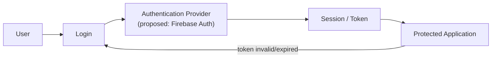
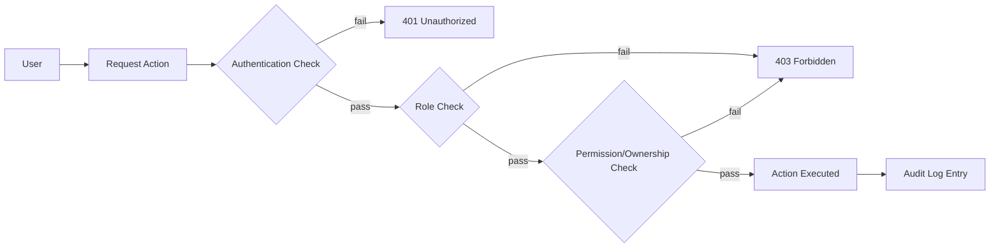
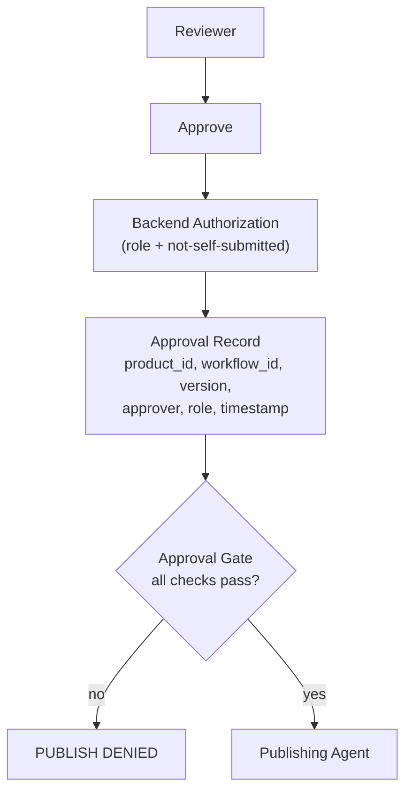
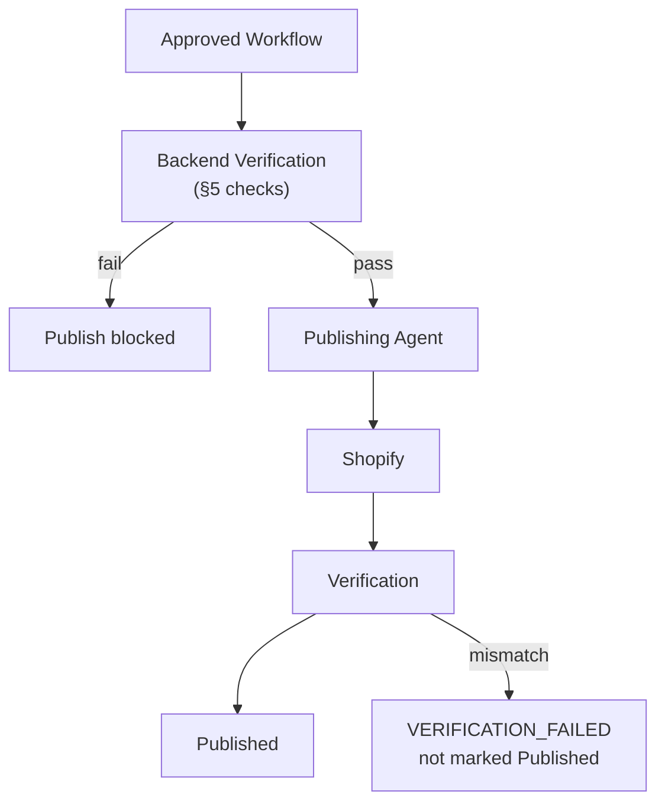

# security.md — Kiddypi Shopify Product Launch System

Source of truth: `REQUIREMENTS.md`, `ARCHITECTURE.md`, `AGENTS.md`, and `workflow.md` (all reviewed
and approved). This document does not contradict any of them. Where a security mechanism below is
already implied or partially specified by those documents, this document formalizes it as a
security control. Where something is genuinely new proposed security design rather than a confirmed
requirement, it is explicitly marked **[PROPOSED]** — nothing here should be read as already
decided unless it traces back to one of the four source documents or to the existing codebase's
current, already-correct behaviour. No application code is changed, no authentication is
implemented, and no business rule is invented by this document.

---

## 1. Security Objective

The system contains human users, AI agents, Shopify, Firebase/Firestore, product and media data,
approval information, workflow state, audit records, and Shopify/Firebase credentials. The security
design ensures:

1. Only authenticated users can access protected application screens.
2. Users can only perform actions allowed by their role.
3. Only the authorized reviewer can approve a product.
4. AI agents cannot approve products.
5. AI agents cannot bypass human approval.
6. Catalogue users cannot directly publish when business rules prohibit it.
7. Shopify credentials and Firebase credentials are never exposed to the frontend.
8. All important actions are auditable.

Guarantee 1 is delivered by §3 (Authentication). Guarantee 2 by §4 (Authorization). Guarantees 3–5
by §5–§7 (Human Approval Security, Approval Version Security, Agent Security) — the most
safety-critical part of this document. Guarantee 6 by §4 and §17 (Workflow Security). Guarantee 7 by
§8–§9 (Shopify/Firebase Credential Security) — already true of the existing codebase and preserved,
not newly introduced. Guarantee 8 by §14 (Audit Logging).

---

## 2. Target Users

### Catalogue / Shopify Admin (Lakshmi)

Responsibilities: create products, edit products, add catalogue information, upload product media,
submit products for review, respond to requested changes, resubmit products.

Permissions:
- Cannot approve.
- Cannot bypass approval.
- Cannot directly publish — `REQUIREMENTS.md` §2: "Lakshmi must not be able to bypass the approval
  process and directly publish a product."

### Product Reviewer / Decision Maker (Sandeep)

Responsibilities: view submitted products, review product information, review images/videos,
request changes, approve products.

Permissions:
- Can approve.
- Can request changes.
- Cannot modify technical publishing state manually (cannot set `PUBLISHING`/`PUBLISHED` directly —
  §17).
- Cannot bypass audit logging — every approval is recorded regardless of who makes it (§14).

### Technical/Admin User (Platform Admin)

Included because `ARCHITECTURE.md` §2 defines this role. Person not yet assigned — open question
(§22).

Responsibilities: user management, configuration, technical monitoring, infrastructure
troubleshooting, error investigation.

Can:
- Manage users and role assignments.
- View the full audit log.
- View full technical error detail (stack traces).

Cannot:
- Approve or reject a product — this role is operational, not a business-decision role
  (`AGENTS.md` §1).
- Manually set a product's approval or publishing status — the same workflow-security rules in §17
  apply to this role as to every other; elevated *visibility* does not mean elevated *authority*
  over the business decision.

### AI Agents

Agents are **not** human users and do not authenticate as one. They operate under explicit system
permissions scoped to their task (§7). Agents cannot:
- approve
- reject a product for business reasons
- change human approval
- bypass workflow gates
- access secrets unnecessarily (e.g., no agent needs the Firebase service-account key directly —
  only the backend service layer does)

---

## 3. Authentication

**[PROPOSED]** Firebase Authentication as the identity provider, for the reasons already given in
`ARCHITECTURE.md` §3/§19 and `AGENTS.md` §19: `firebase-admin` is already a project dependency, and
BOSS's actual authentication mechanism could not be confirmed (`agentic-boss.web.app/work-cockpit`
is fully client-rendered and could not be inspected from outside). This is a proposal, not a
confirmed requirement — the identity provider is an open question (§22) until Sandeep confirms
whether direct BOSS integration is required instead.

Regardless of provider, the architecture requires:

| Capability | Requirement |
|---|---|
| Login | Every Cockpit screen requires an authenticated session before any content loads |
| Logout | Explicit action; invalidates the client-side session/token immediately |
| Session management | Server-side verification of the presented token on every API call — the frontend does not self-certify who it is |
| Protected routes | No route renders application data before authentication is confirmed |
| Authentication state | Cockpit reflects "not signed in" / "signed in as X" clearly (already scaffolded in the frontend shell as a placeholder — `frontend/src/components/AppShell.tsx`) |
| Session expiration | Expired/invalid tokens force re-login rather than silently failing or falling back to an unauthenticated state |
| Unauthorized access handling | A request with no/invalid token receives 401; a request with a valid token but insufficient role receives 403 (§4) — never a silent fallback to allowing the action |

**No specific authentication provider is hard-coded as final.** Firebase Authentication is the
proposed default given today's dependencies; the actual decision is pending BOSS confirmation.

---

## 4. Authorization

Role-based access control, enforced server-side on every request — never inferred from what the
frontend displays.

| Action | Catalogue Admin | Reviewer | Technical Admin | Agent |
|---|---|---|---|---|
| Login | ✓ | ✓ | ✓ | System (no login — internal execution identity) |
| Create Product | ✓ | No | No | No |
| Edit Product | ✓ (own, pre-review or after Changes Requested — `workflow.md` §6) | No | No | No |
| Submit Review | ✓ | No | No | No |
| Review Product | No | ✓ | No (read-only, not an action) | No |
| Request Changes | No | ✓ | No | No |
| Approve Product | No | ✓ | No | No |
| Publish Product | No | No | No (never a direct human trigger — always agent-executed post-approval) | ✓ (only post-Approval-Gate) |
| Upload Media | ✓ (as part of product creation) | No | No | ✓ (as part of publishing, post-approval) |
| View Audit Logs | No | No | ✓ | No |
| Manage Users | No | No | ✓ | No |

This differs from the generic example given in the brief in two deliberate ways, both already
decided in prior documents, not newly assumed here:
- **View Audit Logs** is Technical Admin-only, not "based on policy" — `workflow.md` §18 and
  `ARCHITECTURE.md` §13 already fix this as Platform-Admin-only.
- **Publish Product** is never directly triggered by any human role, including Technical Admin —
  publishing is always the Agent's action, gated by an already-recorded human Approve (§5). A
  Technical Admin may trigger a *retry* of a failed technical stage (`workflow.md` §14), which is
  not the same permission as initiating a fresh, unapproved publish.

No permission in this table is assumed beyond what `REQUIREMENTS.md`, `ARCHITECTURE.md`, or
`workflow.md` already establish.

---

## 5. Human Approval Security

This is the most important section of this document.

**Before the publishing agent starts, the backend must verify:**

| Check | Purpose |
|---|---|
| Product ID | The approval record matches this exact product |
| Workflow ID | The approval record matches this exact workflow run, not a stale or unrelated one |
| Current product version | The product has not changed since this approval was recorded (§6) |
| Approval status | The recorded status is actually `APPROVED`, not absent, not `CHANGES_REQUESTED` |
| Approver identity | A specific authenticated user is attached to the approval, not an anonymous or system actor |
| Approver role | That user held the `Reviewer` role at the time of approval |
| Approval timestamp | `approved_at` is present and not synthetic/backdated |
| Approval belongs to the current product version | Cross-check against §6's version-invalidation rule |

**If any check fails: PUBLISH MUST NOT START.**

This is enforced in two independent places, restated from `AGENTS.md` §3 and `workflow.md` §5
because it is the load-bearing guarantee of the entire system:

1. At the API/workflow layer, before the Publishing Agent (`FolderCreationAgent`) is invoked at
   all.
2. Inside `create_shopify_product_tool` itself, as a defense-in-depth backstop, so a bug or future
   change to layer 1 cannot silently defeat the rule.

**The frontend Approve button is never sufficient authorization on its own.** Clicking it sends a
request; the backend independently re-derives and checks every item in the table above before
recording the approval and before ever allowing publishing to proceed. A compromised, buggy, or
maliciously modified frontend cannot cause a publish — only a valid backend-verified approval
record can.

---

## 6. Approval Version Security

```text
Product Version 1
   ↓
Approved
   ↓
Product edited
   ↓
Product Version 2
   ↓
Old approval is no longer valid
   ↓
Review required again
```

Restating `workflow.md` §6 in security terms: an approval is a statement about *specific data*, not
about a product ID in the abstract. If the underlying data changes after Sandeep approves it — by
any means, including a bug that bypasses the intended edit-lock during review — the approval must be
treated as invalid for the new data. **An old approval must never authorize a changed product.**

This is enforced by the version check in §5 (Human Approval Security), not as a separate mechanism —
it's one of the required checks the Approval Gate performs, called out here on its own because it's
also the answer to a specific threat: **replay of an old approval** (§18, threat #12).

---

## 7. Agent Security

Agents receive only the permissions required for their specific task — restated from `AGENTS.md`
§10's tool permission matrix, framed here as a security boundary rather than a functional one:

**Validation Agent (`FolderValidationAgent`):**
- Read product
- Validate data (including read-only Shopify duplicate lookups)
- No Shopify write

**Publishing Agent (`FolderCreationAgent` + `FolderMediaAgent`):**
- Read approved workflow (only reachable post-Approval-Gate)
- Create/update Shopify product
- Upload media
- No approval permission

**Verification Agent (`FolderVerificationAgent`):**
- Read Shopify/product information
- Verify result
- No approval permission

**Hard rules, true today and required to remain true:**
- Agents cannot grant themselves permissions.
- Agents cannot modify their own authorization.
- Agents cannot bypass workflow states — no agent tool writes an `APPROVED` status anywhere in the
  inspected codebase, and none should be added.

---

## 8. Shopify Credential Security

| Rule | Status |
|---|---|
| Never store secrets in frontend JavaScript | Already true — `shopify_client.py`'s `_get_config()` reads `SHOPIFY_STORE_URL`/`SHOPIFY_ACCESS_TOKEN`/`SHOPIFY_API_VERSION` server-side only; no credential appears in `static/` or `frontend/` code |
| Never commit credentials to Git | Already true — `.env` is gitignored; only `.env.example` (placeholder values) is tracked |
| Never expose credentials through API responses | Already true — inspected endpoints return product/workflow data, never the token itself |
| Store secrets in secure server-side configuration/secrets management | Currently environment variables via `.env` — acceptable for the current deployment shape; a dedicated secrets manager (e.g. Google Secret Manager, given the existing `cloudbuild.yaml`/Cloud Run-oriented deployment) is a **[PROPOSED]** future hardening step, not a confirmed requirement |
| Least privilege | Already true in spirit — the Shopify Admin API token's actual scope is a Shopify-side configuration decision outside this codebase; should be reviewed to ensure it only grants the scopes this system actually uses (products, media, collections) |
| Rotate credentials when necessary | Not currently automated; a manual rotation process (update `.env`/secret store, restart) is sufficient given the current single-store, single-token deployment — no requirement for automatic rotation exists in `REQUIREMENTS.md` |

This entire section describes what is **already correct** in the existing codebase
(`docs/CURRENT_ARCHITECTURE.md` §6, §14) — this document's role is to confirm it must be preserved,
not to introduce it.

---

## 9. Firebase Security

### Firebase Authentication

**[PROPOSED, pending confirmation per §3/§22.]** If selected, used purely for identifying
authenticated users; the resulting UID is looked up against `users/{uid}.role` (`ARCHITECTURE.md`
§8) for every authorization decision — the token itself carries identity, not permissions.

### Firestore

Security rules must enforce:
- **Authenticated access** — no unauthenticated read or write to any collection.
- **Role-based access** — a user's `users/{uid}.role` gates which collections/documents they can
  read; write access to `products`, `workflow_runs`, and `audit_logs` is denied to all client roles
  by default (§10) — the backend, using a privileged service account, performs writes after its own
  authorization checks.
- **Product ownership/access** — a Catalogue Admin reads their own submissions; a Reviewer reads
  everything pending or already decided; Technical Admin reads everything.
- **Review permissions** — only a document write made by the backend on behalf of an authenticated
  Reviewer may set `reviewed_by`/`review_comment`.
- **Approval permissions** — only a backend write on behalf of an authenticated Reviewer, who is not
  the same user as `submitted_by` (§6, `REQUIREMENTS.md` default), may set `approved_by`/
  `approved_at`.
- **Workflow access** — `workflow_runs` are backend-written only; no client role has direct write
  access.
- **Audit-log protection** — `audit_logs` is append-only from the backend's service account; no
  client role has update or delete access, and no client role has *create* access either (only the
  backend writes audit entries, so a client can't forge one).

### Firebase Storage

- Product images/videos belonging to an already-`PUBLISHED` product: may be public (matching the
  existing `blob.make_public()` behaviour in `services/firebase_storage_service.py`), since these
  are meant to be customer-visible via the Shopify storefront anyway.
- Product images/videos belonging to a **pre-approval** draft: must **not** use the same
  public-by-default behaviour — `ARCHITECTURE.md` §9/Decision D8. **[PROPOSED]** a restricted
  Storage rule (readable only by the submitting Catalogue Admin, the Reviewer, and Technical Admin)
  or short-lived signed URLs until the product reaches `PUBLISHED`.
- Generated reports: readable by the roles that can view that product (Catalogue Admin who owns it,
  Reviewer, Technical Admin) — not public.
- **No public write access** to any Storage path under any circumstance — uploads only ever
  originate from the backend/agent, never a direct client-to-Storage write.

---

## 10. Firestore Security Rule Principles

- **Deny by default** — every collection starts with no access; access is explicitly granted, never
  implicitly assumed.
- **Require authentication** — no rule ever permits an unauthenticated request.
- **Verify user role** — every rule that grants access checks `users/{uid}.role`, not a
  client-supplied claim.
- **Validate document ownership/access** — a Catalogue Admin's read access to `products` is scoped
  to documents where they are `submitted_by` (plus whatever `READY_FOR_REVIEW`/published data is
  intentionally shared more broadly, per product requirements).
- **Prevent unauthorized approval changes** — `approved_by`/`approved_at`/`status` transitions into
  `APPROVED` are never client-writable; only the backend service account can set them, after its own
  checks (§5).
- **Prevent users from changing audit records** — `audit_logs` has no client write path at all,
  append-only via the backend (§14).
- **Prevent clients from directly changing protected workflow states** — `APPROVED`, `PUBLISHING`,
  `PUBLISHED` are never accepted as a raw client-supplied field value (§17).

**The client is never trusted to enforce workflow security.** Firestore rules are a second layer of
defense behind the API's own authorization checks (§11) — not a replacement for them, since the
Cockpit talks to the backend API, not directly to Firestore, for any state-changing action.

---

## 11. API Security

| Endpoint (conceptual) | Existing equivalent | Auth required? | Role required? | Input validation? | Authorization check? | Audit event? | Rate limiting? |
|---|---|---|---|---|---|---|---|
| Login/session | New — Firebase Auth token exchange, not a custom endpoint | N/A | N/A | Token format | Token signature verification | `USER_LOGIN` | Standard provider-level protection |
| Create/Edit Product | Extends `POST /launch-folder`-equivalent | ✓ | Catalogue Admin | ✓ (required fields, types, sizes) | Owner-only edit | `PRODUCT_CREATED`/`PRODUCT_UPDATED` | Yes — bulk/spam submission protection |
| Submit for Review | New | ✓ | Catalogue Admin | Product must be in `READY_FOR_REVIEW` | Owner-only | `SUBMITTED_FOR_REVIEW` | Not critical |
| Review (open/read) | New | ✓ | Reviewer, Technical Admin | — | Role check | `REVIEW_STARTED` | Not critical |
| Approve | Extends `POST /api/folder-launch/{id}/approve` — **today this endpoint has no auth at all, the single most important gap this document exists to close** | ✓ | **Reviewer only, and not the submitter (§5/§6)** | Product/workflow ID match, version check | Full Human Approval Security check (§5) | `PRODUCT_APPROVED` | Not critical, but should be logged/alerted on unusual frequency |
| Request Changes | New | ✓ | Reviewer | Comment required (non-empty) | Role check | `CHANGES_REQUESTED` | Not critical |
| Launch/Publish (technical execution) | Existing `run_folder_workflow_background` trigger | Internal — triggered by the backend after Approval Gate passes, never called directly by a client with a raw "publish" intent | System/Agent only | Approval Gate checks (§5) | Approval Gate checks (§5) | `PUBLISH_STARTED`, `SHOPIFY_PRODUCT_CREATED`, `MEDIA_UPLOAD_*`, `VERIFICATION_*`, `PUBLISHED`/`PUBLISH_FAILED` | N/A (system-triggered) |
| Workflow status | Extends `GET /status/{id}` — **today has no ownership check, anyone with the ID can read full state** | ✓ | Owner (Catalogue Admin), Reviewer, Technical Admin | — | Ownership/role check (new — closes the gap) | Read, not typically audited | Not critical |
| Reports | New (report retrieval) | ✓ | Owner, Reviewer, Technical Admin | — | Ownership/role check | Read, not typically audited | Not critical |

The two rows marked in bold are the concrete, already-identified gaps in the existing app
(`docs/CURRENT_ARCHITECTURE.md` §8, §12, §15) that this security design specifically closes: the
unauthenticated approve endpoint, and the unowned status-read endpoint.

---

## 12. Frontend Security

- **Protected routes** — no Cockpit route renders data before authentication is confirmed (§3).
- **Role-based navigation** — a Catalogue Admin does not see an Approve button; a Reviewer does not
  see an Add Product form; this is a UX convenience reflecting §4, not the enforcement of it.
- **Hidden/disabled unauthorized actions** — consistent with the above; disabled/hidden, not merely
  visually de-emphasized.
- **Session handling** — token stored per the auth provider's standard practice (§16); the frontend
  never invents its own session mechanism.
- **No secret credentials in browser** — no Shopify token, Firebase service-account key, or other
  backend secret is ever bundled into frontend code or fetched by it (§8).
- **Safe error messages** — the Cockpit displays the friendly summary + failed stage (`workflow.md`
  §13); full technical detail is only rendered for a Technical Admin session (§15).
- **Input validation** — client-side validation improves UX (immediate feedback) but is never the
  only validation; the backend re-validates everything (§11).

**IMPORTANT: hiding a button is not authorization.** Every sensitive operation (Approve, Request
Changes, Create/Edit Product, Publish) is independently protected on the backend regardless of what
the frontend does or doesn't render.

---

## 13. Data Classification

| Class | Examples | Handling |
|---|---|---|
| **Public** | Published product information intended for the Shopify storefront (title, description, price, images once live) | Freely readable by anyone via the Shopify storefront; no special protection needed once `PUBLISHED` |
| **Internal** | Workflow status, review comments, internal reports, pre-approval draft product data | Readable only by the product's owner, the Reviewer, and Technical Admin — not public, not customer-visible |
| **Sensitive** | User information (`users/{uid}`), approval records, audit data | Readable only by Technical Admin (audit/user data) or the specific parties to an approval (approval record fields on the product itself) |
| **Secret** | Shopify access token, Shopify API secret, Firebase service-account credentials, any API key | Server-side only, never logged in full, never returned in any API response, never in frontend code (§8) |

---

## 14. Audit Logging

Mandatory events (extends the workflow-level list in `AGENTS.md` §13/`workflow.md` §16 with the
security-specific events this document adds — `USER_LOGIN`, `USER_LOGOUT`, `USER_ROLE_CHANGED`):

```text
USER_LOGIN                 USER_LOGOUT
PRODUCT_CREATED             PRODUCT_UPDATED
SUBMITTED_FOR_REVIEW        REVIEW_STARTED
CHANGES_REQUESTED           PRODUCT_APPROVED
PUBLISH_STARTED             SHOPIFY_PRODUCT_CREATED
MEDIA_UPLOAD_STARTED        MEDIA_UPLOAD_COMPLETED
VERIFICATION_STARTED        VERIFICATION_COMPLETED
PUBLISHED                   PUBLISH_FAILED
USER_ROLE_CHANGED
```

Each event captures, where applicable: `event_id`, `workflow_id`, `product_id`, `actor_id`,
`actor_type` (human/agent/system), `role`, `action`, `previous_state`, `new_state`, `timestamp`,
`result`, `error` (if applicable).

**Audit logs are append-only from the application user's perspective** — no role, including
Technical Admin, has an update or delete path exposed through the application. Only the backend
service account (not any end-user identity) ever writes to `audit_logs`, and it only ever appends.

---

## 15. Error Security

Users see useful, human-readable errors:

> "Shopify product creation failed. Stage: Create. Product: ABC123."

not raw internal stack traces. Authorized technical users (Technical Admin) have access to full
diagnostics, including the original exception and traceback, on the same underlying error record —
this is a *view* difference, not two different error-handling code paths (`workflow.md` §13,
`AGENTS.md` §12).

**Never expose, in any error message shown to a non-Technical-Admin role:**
- API keys
- Access tokens
- Service-account credentials
- Internal secrets
- Raw infrastructure paths/stack traces

**Preserve the original technical error internally for debugging** — the friendly message is a
presentation layer over the real error, never a replacement that discards it. This is not a new
principle; it's the exact regression already fixed once in this codebase (the
`'NoneType' object has no attribute 'state'` incident, resolved by `main.py`'s switch to
`asyncio.run(run_async())`) and the concrete gap identified in `docs/CURRENT_ARCHITECTURE.md` §15
item 8: today, `GET /status/{id}` returns the *full* error (including any stack trace) to anyone who
can reach the endpoint, with no role distinction at all. This document requires that distinction be
added.

---

## 16. Session Security

| Concern | Requirement |
|---|---|
| Session expiration | Tokens expire per the auth provider's standard lifetime; the Cockpit prompts re-login rather than silently continuing with a stale session |
| Logout behavior | Immediately invalidates the client-held token/session; subsequent requests using it are rejected |
| Invalid session handling | Any request with a missing, malformed, or expired token receives 401 — never treated as anonymous-but-allowed |
| Concurrent sessions | Not addressed by `REQUIREMENTS.md`; no restriction proposed — a user may reasonably be logged in on more than one device. **[PROPOSED, low priority]** revisit only if abuse is observed |
| Session/token validation | Every API request's token is verified server-side (signature + expiry + issuer) on every call — not cached as "already checked once" |
| Secure cookie/token handling | **Not prescribed here** — whether the implementation uses an `Authorization: Bearer` header or a secure `httpOnly` cookie is an implementation detail appropriately decided when authentication is actually built, not in this document |

---

## 17. Workflow Security

State-transition security rules, restated from `workflow.md` §3/§4 with the authorization actor
made explicit for each:

```text
DRAFT → VALIDATING
  Only system/workflow (automatic on save) — no user or agent "sets" this transition directly.

READY_FOR_REVIEW → IN_REVIEW
  Only the owning Catalogue Admin's explicit Submit action.

IN_REVIEW → APPROVED
  Only an authorized Reviewer, via the Approve action, passing every check in §5.

APPROVED → PUBLISHING
  Only the backend workflow, only after the Approval Gate validation in §5 succeeds.

PUBLISHING → MEDIA_UPLOAD → VERIFYING → PUBLISHED
  Only the backend/agent pipeline, sequentially, never skippable.
```

**No frontend user should be able to directly set `APPROVED`, `PUBLISHING`, or `PUBLISHED` by
modifying a request payload.** These fields are never accepted as arbitrary client-supplied values
on any write endpoint — they are only ever derived server-side, as the *result* of a specific,
authorized action (Approve → `APPROVED`; Approval Gate pass → `PUBLISHING`; `FolderReportAgent`
completion → `PUBLISHED`), never as a value a client can set directly by, for example, sending
`{"status": "PUBLISHED"}` to an update endpoint.

---

## 18. Threat Model

| # | Threat | Mitigation |
|---|---|---|
| 1 | Unauthorized user accessing the application | Authentication required on every route (§3); no route renders without a valid session |
| 2 | Catalogue user attempting to approve | Backend role check on the Approve action (§4, §5) — the endpoint itself verifies the caller holds the Reviewer role, regardless of what the frontend shows them |
| 3 | User attempting to publish without approval | Two-layer Approval Gate (§5) — publishing is structurally unreachable without a validated approval record |
| 4 | Client-side manipulation of workflow state | Protected state fields are never client-writable (§17); all transitions are backend-derived from authorized actions |
| 5 | Stolen authentication token | Token expiration/refresh (§16); provider-level revocation capability; anomalous activity would appear in `audit_logs` (§14) attributed to the compromised identity, enabling detection |
| 6 | Exposed Shopify credentials | Server-side-only storage, never in frontend or API responses (§8) — already true today |
| 7 | Unauthorized Firestore writes | Deny-by-default rules; all writes go through the backend service account after its own authorization checks (§9, §10) |
| 8 | Unauthorized Firebase Storage access | Public access limited to already-published product media; pre-approval draft media restricted (§9) |
| 9 | Malicious product data | Input validation at both the API layer (schema/type/size) and `FolderValidationAgent` (structural/business-data correctness) — §11, `workflow.md` §8 |
| 10 | Agent prompt manipulation | Even if a product's text content contained adversarial instructions, the agents' *tools* (not the LLM's free-text output) are what touch Shopify/Firestore, and those tools independently re-check the durable approval record (§5) before any write — an LLM being "talked into" attempting an action does not grant the underlying tool permission it doesn't already have |
| 11 | Duplicate publishing | Existing SKU/title duplicate detection during Validation (`workflow.md` §11); the Approval Gate / creation tool should additionally refuse to re-run Creation against a product already in `PUBLISHED` state, preventing a replayed or duplicate request from creating a second Shopify product |
| 12 | Replay of an old approval | Approval Version Security (§6) — an approval is invalidated the moment the underlying product data changes |
| 13 | Unauthorized modification of audit logs | Append-only rule, backend-service-account-only write path, no update/delete exposed to any client role (§14) |

---

## 19. BOSS-Style Access Model

Where relevant, the application follows the BOSS/work-cockpit concept as an architectural
reference, not a literal implementation to copy (its actual implementation could not be inspected —
§22):

- Authenticated users
- Role-aware workspace (§4)
- Work assigned to the appropriate person (a submission lands in the Reviewer's queue, not
  everyone's)
- Clear ownership of actions (every audit entry has a specific actor — §14)
- Human approval checkpoints (§5, the system's central design principle)
- Traceable work history (§14, `workflow.md` §16)
- Agent execution visible to users (`ARCHITECTURE.md` §14 — Agent Execution/Status screen)
- Controlled access to actions (§4, enforced server-side, not just hidden in the UI — §12)

This document does not copy BOSS's specific implementation, since it isn't known — it uses the
concept as a reference model for role-based work management and human-agent collaboration, matching
`ARCHITECTURE.md` §10's and `AGENTS.md` §19's treatment of the same open item.

---

## 20. Security Workflow Diagrams

### Authentication Flow



### Authorization Flow



### Approval Security



### Publishing Security



---

## 21. Security Testing

| # | Test | Status |
|---|---|---|
| A | Unauthenticated user cannot access protected screens | New — requires §3 to exist first |
| B | Catalogue Admin cannot approve | New — requires §4 role checks |
| C | Catalogue Admin cannot publish directly | New — publishing has no direct human-trigger path to test against once built (§4, §17) |
| D | Unauthorized user cannot access another user's restricted work | New — requires ownership checks on `GET /status/{id}`-equivalent (§11) |
| E | Agent cannot approve | Structural — no agent tool writes `APPROVED` in the existing codebase (`AGENTS.md` §2); a regression test asserting this remains true is new |
| F | Agent cannot bypass approval | Related to `tests/test_media_state_regression.py`'s existing session/state coverage; a dedicated test asserting `create_shopify_product_tool` refuses without a valid approval record is new (§5, §7) |
| G | Old approval cannot publish a changed product | New — requires §6 (approval versioning) to exist first |
| H | Client cannot directly set `PUBLISHED` | New — requires the write-endpoint schema to reject a client-supplied `status` field (§17) |
| I | Shopify credentials are not exposed | Partially exists today by construction (`shopify_client.py` never returns the token); a regression test asserting no API response ever contains it is new |
| J | Firestore unauthorized writes are rejected | New — requires Firestore security rules (§10) to exist first |
| K | Storage unauthorized writes are rejected | New — requires Storage rules (§9) to exist first |
| L | Audit logs cannot be modified by normal users | New — requires `audit_logs` and its append-only rule (§14) to exist first |

Every test in this list is new relative to the current codebase, because authentication,
authorization, the Approval Gate, and Firestore/Storage rules do not exist yet — this is expected
and consistent with `REQUIREMENTS.md`'s instruction not to claim anything is complete until it
actually works.

---

## 22. Open Security Questions

Only items genuinely requiring confirmation, not answered by any of the four prior documents:

1. **Which identity provider should be used?** Firebase Authentication is proposed (§3) pending
   confirmation of whether direct BOSS integration is required instead
   (`ARCHITECTURE.md` §19, `AGENTS.md` §19).
2. **Exact Technical Admin role — who holds it?** Not yet assigned (`REQUIREMENTS.md` §2/§14,
   `workflow.md` §22).
3. **Who can view detailed technical logs beyond Technical Admin?** This document assumes
   Technical-Admin-only; not explicitly stated as exclusive in `REQUIREMENTS.md`.
4. **Should reviewers receive email notifications** (for a new submission) in addition to in-app
   notifications? `ARCHITECTURE.md` §15/`workflow.md` §22 — open.
5. **Exact BOSS integration/authentication mechanism** — could not be determined from outside
   (§19); needs direct confirmation before any BOSS-specific security work begins.

---

### Security Principles

Deny by default. Authenticate every request. Authorize every action server-side, never trust the
frontend. No agent may approve, reject, or bypass human review. No client may directly set a
protected workflow state. Every important action is auditable and the audit trail is append-only.
Secrets never leave the backend.

### Authentication

Every screen requires a valid, server-verified session. Firebase Authentication is the proposed
provider pending BOSS confirmation (§3, §22).

### Authorization

Role-based, enforced server-side, per the permission matrix in §4. Hiding UI elements is a
convenience, never the actual control (§12).

### Role Permissions

Catalogue Admin: create/edit/submit only. Reviewer: review/approve/reject only. Technical Admin:
users/audit/diagnostics only — no business decision authority. Agent: technical execution only,
strictly post-approval, with least-privilege tool access (§7).

### Human Approval Security

Publishing is structurally unreachable without a backend-verified approval record covering product
ID, workflow ID, version, approver identity/role, and timestamp (§5). The frontend button alone is
never sufficient.

### Agent Security

Each agent has exactly the tool access its stage requires and nothing more. No agent can grant
itself permissions, change its own authorization, or bypass a workflow gate (§7).

### Shopify Security

Credentials remain server-side only, as they already correctly are today. No credential is ever
exposed via frontend code, logs, or API responses (§8).

### Firebase Security

Deny-by-default Firestore rules; backend-only writes to protected collections; pre-approval draft
media is not public; audit logs are append-only and unreadable by non-Technical-Admin roles (§9,
§10).

### Auditability

Every state transition, approval, rejection, and publish attempt is recorded with actor, role,
timestamp, and result, and cannot be altered after the fact (§14).

### Threat Model

Thirteen realistic threats identified, each with a specific, already-designed-for mitigation (§18) —
including AI-specific concerns like prompt manipulation, addressed by keeping tool-level
authorization independent of what an LLM was told.

### Security Testing

Twelve tests (A–L) defined, all currently new since authentication/authorization/the Approval Gate
do not exist in the codebase yet (§21).

### Open Questions

Identity provider choice, Technical Admin's real identity, detailed-log visibility scope, email
notification requirement, and BOSS's actual integration mechanism — see §22.
