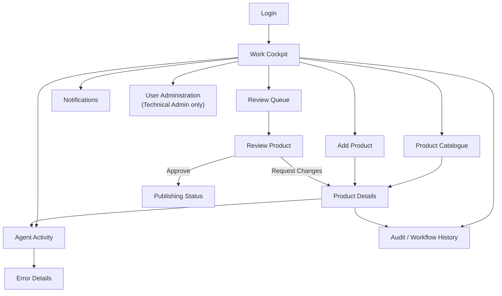

# ui-spec.md — Kiddypi Shopify Product Launch System

Source of truth: `REQUIREMENTS.md`, `ARCHITECTURE.md`, `AGENTS.md`, `workflow.md`, and
`security.md` (all read completely before writing this document; none of them are modified by it).
Nothing below invents a business rule not already supported by those five documents. Where
something is genuinely undefined by them, it is marked **TBD — Requires Confirmation** rather than
assumed. This document specifies UI/UX only — no application code, no implementation.

**Note on the existing frontend scaffold:** an early React/Vite Cockpit shell already exists
(`frontend/`), covering Overview, Launches, New Launch, Agents, Approvals, and Activity in
wireframe form, built directly against the existing pipeline endpoints before authentication
existed (`ARCHITECTURE.md` §14). This specification supersedes that scaffold's page *names* where
they differ (§21 Screen Map uses the terminology from `REQUIREMENTS.md`/`ARCHITECTURE.md`), but its
underlying page structure and the pipeline calls behind it remain valid and reusable — it needs
login/role gating and the review/approval screens added, not a rebuild.

---

## 1. UI Objectives

The UI must make immediately clear, on every relevant screen:

- Who is logged in
- What role they have
- What work is assigned to them
- Which products require their action
- Current product/workflow status
- Which agent is currently running
- What requires human approval
- What has been completed
- What has failed
- What action the user should take next

Every screen in this specification is designed to answer at least one of these questions without
requiring the user to dig or infer.

---

## 2. Target Users

Only the roles defined in `REQUIREMENTS.md`/`ARCHITECTURE.md`/`AGENTS.md` — no additional roles are
assumed.

### Catalogue / Shopify Admin (Lakshmi)

| | |
|---|---|
| Can see | Her own drafts, submissions, review feedback, publishing status of her own products, agent activity (read-only summary) |
| Can do | Create, edit, save draft, submit for review, view feedback, edit after Changes Requested, resubmit |
| Cannot do | Approve, reject, publish directly, view other users' drafts, view full technical error detail, view the audit log |
| Requires confirmation | Submitting for review (irreversible until Reviewer acts); resubmitting after edits |
| Most important information | What's blocking her right now — validation errors or reviewer feedback — and what's already published |

### Product Reviewer / Decision Maker (Sandeep)

| | |
|---|---|
| Can see | Everything submitted, approved, published, or rejected; full product detail; validation results; agent activity (read-only summary) |
| Can do | Approve, Request Changes (with feedback) |
| Cannot do | Create/edit product data, manually set publishing/verification status, view full technical error detail (friendly summary only) |
| Requires confirmation | Approve (this is the single highest-consequence action in the system — §9); Request Changes requires a non-empty comment |
| Most important information | What's waiting in his queue, and — once he opens a product — everything needed to judge it: copy, price, media, presentation, validation status |

### Technical/Admin User (Platform Admin)

Included because `ARCHITECTURE.md`/`AGENTS.md`/`security.md` all define this role, even though the
specific person is **TBD — Requires Confirmation** (`REQUIREMENTS.md` §2/§14).

| | |
|---|---|
| Can see | Everything — full audit log, full technical error detail, all products regardless of owner |
| Can do | Manage users/roles, view full diagnostics, trigger a manual retry of a failed technical stage |
| Cannot do | Approve, reject, or make any business decision about a product (`security.md` §2) |
| Requires confirmation | Role changes to another user |
| Most important information | What's technically broken and why |

### AI Agent

Not a UI user — has no login, no screen of its own. Its activity is *visible to* the human roles
above (§10), but it does not view or interact with the UI itself.

---

## 3. Authentication UI

**TBD — Requires Confirmation** on the exact identity provider (`security.md` §3 marks Firebase
Authentication as proposed, not confirmed). The following UI requirements hold regardless of
provider:

| Element | Requirement |
|---|---|
| Login screen | Single, simple screen — credential/identity input per whatever provider is confirmed. No role selector on this screen — role is looked up server-side after authentication, never chosen by the user (`security.md` §3) |
| Logout | A single, always-reachable control (top-right, per §4); immediately returns to Login |
| Session handling | The Cockpit shows nothing but a loading state until the session is confirmed valid; no flash of protected content before the check completes |
| Unauthorized access | Attempting a direct link to a protected screen while logged out redirects to Login; attempting an action outside one's role shows a clear "Not permitted" message, not a silent no-op |
| Session expiration | A clear, non-alarming prompt ("Your session has expired — please sign in again") rather than a broken or blank screen |
| Loading states | A visible loading indicator during authentication and initial role lookup — never a blank white screen |
| Authentication errors | Specific enough to be useful ("Incorrect credentials" / "Account not recognized") without ever leaking backend implementation detail |

**The UI must never rely only on frontend role checks.** Every screen and action shown here assumes
the backend independently enforces the same rule (`security.md` §12) — the frontend's role-based
hiding is a UX convenience, not the security boundary.

---

## 4. BOSS-Style Work Cockpit

The main landing screen after login — a work cockpit, not a generic admin panel
(`REQUIREMENTS.md` §10 concept reference, `ARCHITECTURE.md` §19/`AGENTS.md` §19/`security.md` §19 —
BOSS's specific implementation is unconfirmed and not copied; only the conceptual model is used).

### Header

- Logged-in user's name
- Role (Catalogue Admin / Reviewer / Technical Admin)
- Notifications (§15)
- Profile/session controls (logout)

### Navigation

Only navigation supported by the source documents (`ARCHITECTURE.md` §14 screen list):
Overview/Dashboard, Product Catalogue, Add Product *(Catalogue Admin only)*, Review Queue
*(Reviewer only)*, Agent Activity, Reports, Audit/User Administration *(Technical Admin only)*.

### Work Queue

Role-scoped, per §2:

| For | Shows |
|---|---|
| Catalogue Admin | Her drafts, products requiring changes, products submitted (awaiting Sandeep), recently published |
| Reviewer | Products awaiting his review, recently approved, products he sent back for changes, recently published |
| Technical Admin | Failed workflows across all products, system-wide activity |

Matches `REQUIREMENTS.md` §14's per-persona dashboard requirements exactly — no additional widgets
invented.

### Agent Activity

- Current agent (e.g. `FolderCreationAgent`)
- Current task ("Creating Shopify product")
- Workflow stage (Ingest/Validate/Create/Media/Verify/Report — §10)
- Progress (which stages are done vs. pending)
- Success/failure
- Timestamps

### Human Actions

Every item in the Work Queue is visually tagged as exactly one of:

- **USER ACTION REQUIRED** — something needs this person's input right now (e.g. "Review Product A",
  "Fix validation errors on Product B")
- **AGENT WORKING** — the pipeline is running automatically, no human input needed yet
- **COMPLETED** — terminal, no action possible or needed

This distinction is the single most important visual signal on the dashboard — it directly answers
UI Objective "what action should the user take next" (§1).

---

## 5. Product Catalogue Screen

Primary audience: Catalogue Admin (own products); Reviewer and Technical Admin can view all
(read-only), per `ARCHITECTURE.md` §14.

Includes:
- Product list (table or card view)
- Search (by title/SKU)
- Filtering (by status — Draft, Awaiting Review, Changes Requested, Published, Failed)
- Product status (lifecycle state, §18)
- Workflow status (which pipeline stage, if actively publishing)
- Assigned user (who created it / who's reviewing it)
- Last updated (timestamp)
- Review status (not submitted / awaiting review / changes requested / approved)
- Shopify status (not yet on Shopify / draft on Shopify / live)

Actions available (role-gated per §19):
- Catalogue Admin: Add Product, open own product to edit
- Reviewer: open any product to view; open a submitted one to review
- Technical Admin: open any product; view technical detail

---

## 6. Add Product Screen

The Catalogue Admin's primary workspace. Fields, grounded in `REQUIREMENTS.md` §5/§7 and the
existing pipeline's actual data model (`state.py`/`ARCHITECTURE.md` §8):

- Title
- Description
- SKU
- Price
- Inventory quantity
- Category / vendor / tags
- Images (multiple)
- Videos (where supported)
- SEO/content fields (title, meta description, keywords) — **optional, AI-assisted** per
  `REQUIREMENTS.md` §5 FR-3: the Catalogue Admin may request AI-drafted description/SEO, review it,
  edit or discard it; AI-suggested content is visually distinguished from human-entered content
  (`REQUIREMENTS.md` §7, "AI-generated" vs "human-edited" indicator)

Actions:
- **Save as Draft** — no validation required to save, but the product cannot move past `DRAFT`
  without passing validation (§8/§18)
- **Submit for Review** — only enabled once validation passes; disabled with an explanatory tooltip
  otherwise

Validation errors are shown inline, next to the specific field, with plain-language text (not a raw
backend error) — matching `workflow.md` §8's "clear, specific errors" requirement.

**The UI must never imply that submitting a product means it is published.** The Submit for Review
button and any confirming message explicitly says "sent for review," never "published" or "live" —
this is a direct requirement flowing from the system's central rule (`workflow.md` §3,
`security.md` §1).

---

## 7. Product Detail Screen

Shown to any role with access to this specific product (§19). Displays:

- Product information (all fields from §6)
- Media (images/video, as uploaded)
- Current workflow status (lifecycle state, §18)
- Product version (§12 — relevant once an edit-after-approval scenario exists)
- Review status (not submitted / in review / changes requested / approved)
- Approval status (who approved, when — visible to all roles with access; full audit detail
  Technical-Admin-only per `security.md` §2)
- Shopify status (not created / draft / live, with product ID/URL once available)
- Agent activity (§10, condensed view)
- Audit/history (§16, condensed — full log Technical-Admin-only)
- Errors, if applicable (§14)

This is the "single pane of glass" for one product — every question in §1 answered for this
specific item.

---

## 8. Review Screen

The Reviewer's primary workspace — must present a professional preview, not a raw data dump
(`REQUIREMENTS.md` §7/§19 — "Sandeep is judging what customers will see").

Sandeep must be able to inspect:
- Product information (title, description, price, SKU, inventory, category, tags, vendor)
- Pricing
- Images
- Video
- Product presentation (a rendered preview approximating the eventual Shopify listing, not just
  field values — `REQUIREMENTS.md` §7 FR-9)
- Relevant Shopify preview information (draft status, template, if selected —
  `ARCHITECTURE.md` §8's `selected_shopify_template`)
- Validation results (what `FolderValidationAgent` found — missing fields, conflicts, duplicate
  flags), so Sandeep is reviewing already-technically-clean data, not raw unchecked input

Actions:
- **APPROVE**
- **REQUEST CHANGES / REJECT** — requires a non-empty feedback comment (`workflow.md` §7,
  `security.md` §11)

If changes are requested:
- Feedback is recorded and attached to the product record
- The product returns to the Catalogue Admin (state → `CHANGES_REQUESTED` → `DRAFT`)
- The product must be resubmitted (re-validated) before Sandeep sees it again — no shortcut

**The human approval boundary must be visually obvious** — e.g. a distinct visual treatment (border,
banner, or dedicated panel) around the Approve/Request Changes controls, separate from the rest of
the page, making clear this is *the* decision point in the whole system (§1, §9).

---

## 9. Approval UI

Exactly what happens, visually, on Approve:

```text
Product Ready
   ↓
Reviewer Approval           (Approve button clicked, confirmation required — §23)
   ↓
Approval Recorded           (backend writes approved_by, approved_at — security.md §5)
   ↓
Agent Activated             (Approval Gate check passes)
   ↓
Publishing                  (visible progress begins — §10)
```

The confirmation step before Approve is final (a lightweight "Are you sure?" style check, not a
heavy modal) is recommended given this is the system's single highest-consequence action — **TBD —
Requires Confirmation** on whether Sandeep wants this extra step or a single-click Approve.

**The UI must explicitly and visibly state that the AI agent cannot publish before approval** — this
is not implicit. A persistent label near any pre-approval product status (e.g. "Not yet approved —
publishing cannot start") reinforces the rule stated in `workflow.md` §3 and `security.md` §5.

---

## 10. Agent Execution Screen

Stages correspond exactly to `workflow.md`'s pipeline (§9) and `AGENTS.md`'s six Folder agents:

```text
Ingest → Validate → Create → Media → Verify → Report
```

For each stage, one of:

| State | Visual |
|---|---|
| Pending | Neutral/greyed, not yet reached |
| Running | Active indicator (e.g. pulsing dot), current stage |
| Completed | Success mark |
| Failed | Error mark, with the real error visible on click/expand (§14) |
| Skipped (if applicable) | e.g. Media stage skipped when a product has no images/video — distinct from both "completed" and "failed" |

**The UI must display the actual failed stage returned by the backend — never a hardcoded stage.**
This is a direct, hard requirement carried over from this project's own prior incident: an earlier
version of this dashboard hardcoded stage 4 (Media) as the always-blamed failure point regardless of
where the real failure occurred, producing a misleading UI. The fix (a real `failed_stage` field
driving the UI) must be the baseline this screen is built on, not something to accidentally regress.

---

## 11. Media UI

Two distinct upload moments exist in this system, and the UI should make the distinction clear
rather than conflating them:

1. **Catalogue Admin's upload**, during Add/Edit Product (§6) — the source files are attached to the
   draft.
2. **Agent's upload**, during Publishing (§10, Media stage) — those same files are staged-uploaded
   to the live Shopify product, only after approval.

UI requirements:
- Upload progress (per file, during Catalogue Admin's upload)
- Successful upload (thumbnail/preview + confirmation)
- Failed upload (during Add/Edit) — real error, which file, why
- Retry — offered where the failure is plausibly transient (§14, `workflow.md` §14); not offered
  for a permanently invalid file (wrong format, corrupt)
- Shopify media status — during/after the agent's stage-2 upload, shown per file (uploaded / failed
  / verified)

**A genuine media failure must show the actual error.** Do not show an unrelated error such as
`'NoneType' object has no attribute 'state'` if that is not the actual cause — this is not a
hypothetical instruction; it is the exact incident already fixed once in this codebase, and this UI
must display whatever `failed_stage`/`errors` the backend actually returns, never a generic or
substituted message.

---

## 12. Change Request Flow

```text
Product Submitted
   ↓
Reviewer Requests Changes         (with required feedback comment — §8)
   ↓
Feedback Displayed                (to Catalogue Admin, prominently, on the product's own screen)
   ↓
Catalogue/Admin User Edits
   ↓
Resubmit
   ↓
Reviewer Reviews Again            (full review again — workflow.md §7 default assumption)
```

Clearly shown, on both the Catalogue Admin's edit screen and the Reviewer's re-review screen:
- Previous feedback (Sandeep's comment, always visible until resolved)
- Changed fields — **TBD — Requires Confirmation**: whether a field-level diff view (highlighting
  exactly what changed since the last review) is required, or a plain "edited, see current values"
  view is sufficient. Not specified in the five source documents.
- Current version (§6 approval versioning concept — surfaced here as "this is version N, last
  reviewed at version N-1")
- Review status (Changes Requested → back to Draft → re-validated → re-submitted → In Review)

---

## 13. Publishing Status

Statuses shown, all sourced directly from backend state (`workflow.md` §3/§18) — never inferred or
assumed client-side:

- Approval status (Not approved / Approved by [name] at [time])
- Publishing status (Not started / In progress: [stage] / Complete / Failed at [stage])
- Shopify status (Not created / Draft on Shopify / Live)
- Verification status (Not run / Passed / Failed — with detail)

**Never display "Published" until the backend's own verification step confirms it.** A product that
exists on Shopify but hasn't passed `FolderVerificationAgent` is shown as "Publishing — verifying,"
not "Published" — matching `workflow.md` §13's rule that "exists on Shopify" and "verified/complete"
are deliberately kept as separate facts.

---

## 14. Error UI

Structured presentation for every error, regardless of source:

| Element | Content |
|---|---|
| Stage | Which pipeline stage (or which UI action) failed |
| What happened | A specific, real description (e.g. "Shopify rejected the request: rate limit exceeded") |
| User-friendly explanation | Plain language, no internals |
| Recommended action | e.g. "Wait a few minutes and retry" vs. "Contact your Catalogue Admin to fix the product data" |
| Retry option | Shown only where retry is actually supported for that failure type (`workflow.md` §14) |
| Technical details | Collapsed by default; only rendered at all for a Technical Admin session (`security.md` §15) |

**Never expose, in any error shown to a non-Technical-Admin role:** API keys, Firebase credentials,
Shopify secrets, or tokens. This is a hard requirement carried directly from `security.md` §15 and
grounded in a real, already-identified gap: today's app returns full raw tracebacks to any caller of
its status endpoint with no role distinction at all — this UI must not reproduce that.

---

## 15. Notifications

Events, matching `ARCHITECTURE.md` §15/`workflow.md` §15/`security.md` exactly:

- Product submitted for review → Reviewer
- Changes requested → Catalogue Admin
- Product approved → Catalogue Admin
- Publishing started → Catalogue Admin, Reviewer
- Publishing completed → Catalogue Admin, Reviewer
- Publishing failed → Catalogue Admin, Reviewer, Technical Admin (if infra-caused)
- Verification completed → Catalogue Admin, Reviewer

**Channel: in-app only is the confirmed default for v1** (`ARCHITECTURE.md` §15). **Email is
TBD — Requires Confirmation** (`REQUIREMENTS.md` §24 item 5) — not built or assumed until confirmed.
The UI's notification center is designed so an email channel could be added later without a redesign
(the in-app list is the canonical event feed regardless).

---

## 16. Audit / History UI

Two related but distinct views — see §24 for the cross-document note on this distinction:

**Per-product Workflow History** (available to the product's Catalogue Admin, the Reviewer, and
Technical Admin — `ARCHITECTURE.md` §14's "Workflow History" screen): a friendly timeline of this
one product's journey —

```text
Product created → edited → submitted → reviewed → changes requested (if any)
  → approved → agent started → Shopify operation completed → verification completed
  → report generated
```

**System-wide Audit Log** (Technical-Admin-only — `security.md` §4/§14/`workflow.md` §18): the raw,
complete `audit_logs` event stream across all products, including events the friendly timeline
doesn't surface (e.g. `USER_LOGIN`/`USER_ROLE_CHANGED`).

Both views show, per entry, the actor as either **Human** (name + role) or **Agent/System** (agent
name) — never ambiguous about who or what performed an action.

---

## 17. Responsive Design

`REQUIREMENTS.md`/`ARCHITECTURE.md` establish this is a professional internal tool; they do not
specify device-level requirements beyond general "responsive" language in `ARCHITECTURE.md` §19
(UI Design Requirements). Concretely:

| Device | Priority | Notes |
|---|---|---|
| Desktop | **Primary** — full Cockpit, Review, Add Product experience | This is where Lakshmi and Sandeep are expected to do most of their work |
| Tablet | **Secondary** — usable, not degraded, especially for the Review screen | Reasonable given Sandeep may review/approve away from a desk |
| Mobile (phone) | **TBD — Requires Confirmation** | Not explicitly specified by any of the five source documents whether phone-optimized Approve/Request-Changes is a hard requirement or a nice-to-have |

No screen should have horizontal overflow at any supported width; this is a baseline usability
requirement, not a business decision requiring confirmation.

---

## 18. UI State Definitions

Consistent with `workflow.md`'s state machine (§3/§10), grouped into the coarser UI-facing labels
this specification uses on cards/badges. Each UI state maps to one or more backend states:

| UI State | Backend state(s) |
|---|---|
| Loading | (transient, no backend state — data fetch in progress) |
| Empty | (no data — e.g. "no products yet") |
| Draft | `DRAFT` |
| Ready for Review | `VALIDATING` (as "Checking…"), `READY_FOR_REVIEW` |
| Changes Requested | `CHANGES_REQUESTED` |
| Approved | `APPROVED` |
| Agent Running | `PUBLISHING`, `MEDIA_UPLOAD`, `VERIFYING` (each shown with its specific stage label, §10) |
| Publishing | `PUBLISHING` (Create stage specifically) |
| Verification | `VERIFYING` |
| Completed | `PUBLISHED` |
| Failed | `VALIDATION_FAILED`, `PUBLISH_FAILED`, `MEDIA_FAILED`, `VERIFICATION_FAILED` (each shown with which one, never just "Failed" alone) |

No UI state is used that doesn't map to a real `workflow.md` state — this table exists specifically
to prevent the UI layer from inventing its own parallel status vocabulary.

---

## 19. Access Control in UI

| Screen/Action | Allowed roles | Hidden/disabled for | Backend authorization requirement |
|---|---|---|---|
| Login | Everyone (unauthenticated) | — | Provider-level |
| Work Cockpit | All authenticated roles | — | Session valid |
| Product Catalogue (view) | All roles (scope varies — own vs. all) | — | Ownership/role check |
| Add Product | Catalogue Admin | Reviewer, Technical Admin | Role check |
| Edit Product | Catalogue Admin (own, pre-review or after Changes Requested) | Everyone else | Ownership + state check |
| Submit for Review | Catalogue Admin (own) | Everyone else | Ownership + validation-passed check |
| Review Queue | Reviewer | Catalogue Admin, Technical Admin (read-only elsewhere if applicable) | Role check |
| Approve / Request Changes | Reviewer | Everyone else | Full Human Approval Security check (`security.md` §5) |
| Agent Execution / Status (summary) | All roles | — | Ownership/role check |
| Agent Execution (full technical detail) | Technical Admin | Catalogue Admin, Reviewer | Role check |
| Reports | Catalogue Admin (own), Reviewer, Technical Admin | — | Ownership/role check |
| User/Role Administration | Technical Admin | Everyone else | Role check |
| System-wide Audit Log | Technical Admin | Everyone else | Role check |

**Frontend visibility is not security.** Every row above assumes the backend independently checks
the same permission on every request — the frontend hides/disables controls purely so the interface
doesn't invite an action that would be rejected anyway (`security.md` §12).

---

## 20. Design Principles

The UI should feel: professional, enterprise-ready, clean, trustworthy, workflow-oriented, easy to
understand, action-oriented, and consistent with the BOSS work-cockpit concept
(`REQUIREMENTS.md` §19, `ARCHITECTURE.md` §19).

Avoid: unnecessary animation, decorative elements that distract from workflow decisions, gaming-style
UI, excessive gradients/glassmorphism, and generic SaaS-template visual noise. The Approve/Request
Changes decision point (§8, §9) in particular should read as serious and deliberate, not casual.

---

## 21. Screen Map



Adjusted from the generic template to include Product Details as the hub most other screens link
through to (matching §7), and to mark User Administration as Technical-Admin-only, per §19.

---

## 22. User Journeys

### Journey A — Clean approval

```text
Add Product → Validate → Submit → Review → Approve → Agent Publish → Verify → Complete
```
Lakshmi adds a product, it validates cleanly, she submits it, Sandeep reviews and approves it
immediately, the agent publishes, verification passes, the product shows Completed/Published.

### Journey B — Change request loop

```text
Add Product → Submit → Review → Request Changes → Edit → Resubmit → Review → Approve → Publish
```
Same start, but Sandeep sends it back once (e.g. asking for a better hero image); Lakshmi fixes it,
resubmits, and it's approved on the second pass.

### Journey C — Publishing failure and recovery

```text
Approved Product → Agent Publishing → Shopify Failure → Error → User Action / Retry if supported
```
A product is approved and publishing begins, but Shopify returns an error (e.g. rate limit). The UI
shows the real error and failed stage (§10, §14); depending on whether the cause is transient
(§14, `workflow.md` §14), either a Retry action is offered (Technical Admin-triggered) or the
product returns to Draft for Lakshmi to address a data issue — the UI does not silently retry
forever and does not mark the product Published.

---

## 23. UI Acceptance Criteria

| Screen | Acceptance criteria |
|---|---|
| Login | User cannot see any protected content before authentication succeeds; failed login shows a specific, safe error; loading state is visible during the auth check |
| Work Cockpit | Role, name, and at least one Work Queue item (or an explicit empty state) are visible within one screen, no scrolling required to see "what needs my action" |
| Product Catalogue | Search and at least one status filter both narrow the visible list correctly; every row shows product status, workflow status, and last-updated timestamp |
| Add Product | Submit for Review is disabled until validation passes; every validation error is shown next to its field, in plain language; Save as Draft never shows a "published"-implying message |
| Product Detail | All eight data categories from §7 are present or explicitly marked not-applicable (e.g. "No media uploaded yet") |
| Review Screen | Approve and Request Changes are visually distinct from all other page controls; Request Changes cannot be submitted with an empty comment |
| Approval UI | The "agent cannot publish before approval" statement is visible on any product not yet approved; the Approve action requires an explicit confirmation step (pending §9's TBD) |
| Agent Execution | The currently active stage is unambiguous at a glance; a failed run shows the real failed stage from the backend, never a fixed/hardcoded one |
| Media UI | A failed upload shows the specific file and the real error text, never a generic or substituted message |
| Notifications | Every event listed in §15 produces a visible, timestamped entry in the in-app notification list |
| Audit/History | Every entry shows actor (Human with role, or Agent/System), action, and timestamp; no entry is editable or deletable from this UI |
| Access Control | Every action listed as "Hidden/disabled for" a given role in §19 is verifiably absent or disabled when viewed as that role |

---

## 24. Cross-Document Consistency

Compared against `requirements.md`, `architecture.md`, `agents.md`, `workflow.md`, and
`security.md`. No direct contradictions were found — the five documents are internally consistent
with each other and with this specification. Two items are flagged below not as conflicts but as
genuine ambiguities this specification had to resolve by inference, which should be explicitly
confirmed rather than left as a silent assumption:

## Cross-Document Issues Requiring Confirmation

1. **"Workflow History" vs. "Audit Log" — same feature or two different ones?**
   `ARCHITECTURE.md` §14 lists a "Workflow History" screen viewable by Catalogue Admin (own),
   Reviewer (all), and Technical Admin (all). Separately, `workflow.md` §18 and `security.md` §4
   restrict "View Audit Logs" to Technical Admin only. Neither document states whether these are the
   same artifact with two different names, or two genuinely different views (a friendly per-product
   timeline vs. a raw system-wide event ledger). This specification (§16) resolves it as **two
   different things** — a per-product Workflow History available more broadly, and a system-wide raw
   Audit Log restricted to Technical Admin — because that reading doesn't require weakening either
   document's stated access rule. This resolution should be explicitly confirmed rather than
   silently relied upon.

2. **Mobile support for the Approval action.** No source document states whether phone-optimized
   Approve/Request-Changes support is a hard requirement. §17 marks this TBD and defaults to
   "desktop primary, tablet usable, phone unconfirmed" rather than assuming either a full mobile
   build or its absence.

No other conflicts were identified. Items already marked open/TBD consistently across multiple
source documents (identity provider, notification email channel, Technical Admin's real identity,
resubmission review depth, "materially changed" granularity for approval versioning) are carried
into this specification as TBD in their relevant sections (§3, §15, §2, §12) rather than repeated
here, since they are pre-existing open questions, not new inconsistencies this document introduced.
