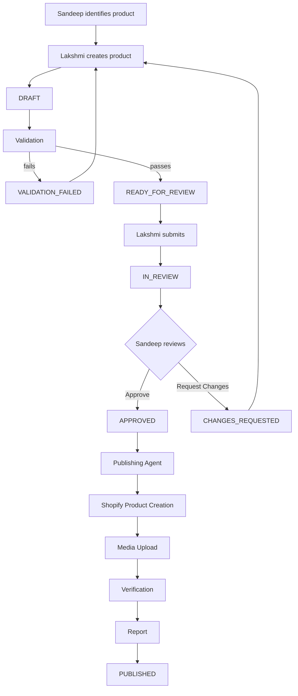
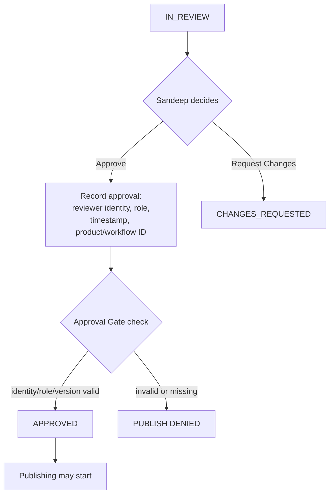
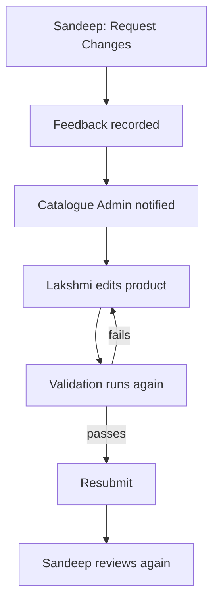
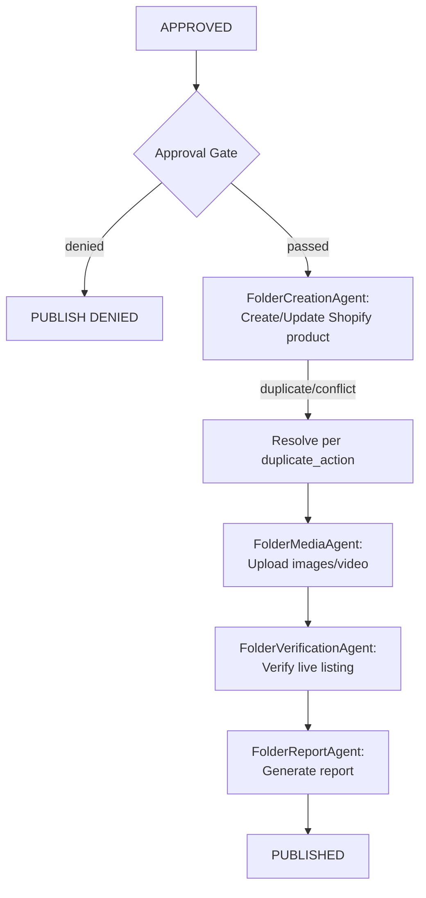
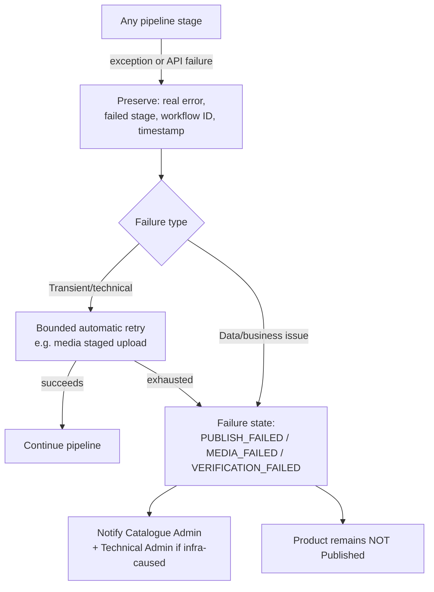
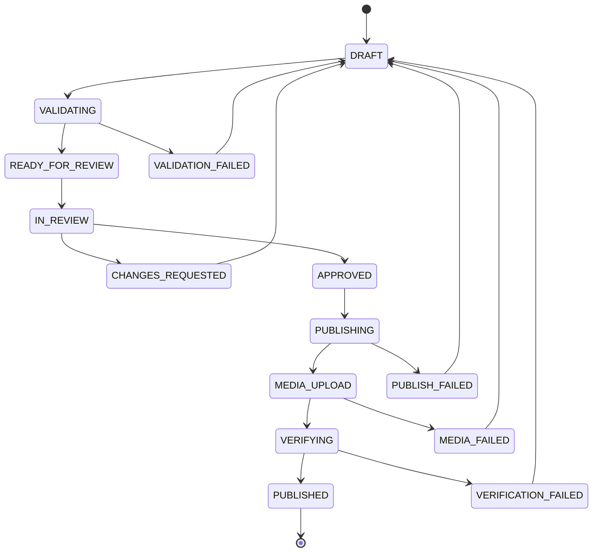

# workflow.md — Kiddypi Shopify Product Launch System

Source of truth: `REQUIREMENTS.md`, `ARCHITECTURE.md`, and `AGENTS.md` (all reviewed and approved).
This document does not contradict any of them — it is the operational detail layer sitting between
`ARCHITECTURE.md`'s system design and `AGENTS.md`'s per-agent contracts. No application code is
changed by this document, no UI is redesigned, and no business rule is invented beyond what those
three documents already establish or what follows as a direct, necessary consequence of them
(flagged as such where it happens).

**What this document answers:**
- Who starts a product? — Sandeep (business decision, off-system) → Lakshmi (creates it in the system)
- Who enters product information? — Lakshmi
- Who validates it? — `FolderValidationAgent`, automatically
- Who reviews it? — Sandeep
- Who approves it? — Sandeep, and only Sandeep
- When is the AI agent allowed to act? — Ingestion/Validation always; Create/Media/Verify/Report
  only after a valid Approval Gate check
- What happens when the reviewer requests changes? — §7
- What happens when publishing fails? — §13
- What happens when verification fails? — §13
- What is the final published state? — `PUBLISHED` (§3)

---

## 1. Actors

| Actor | Kind | Role |
|---|---|---|
| **Sandeep** (Product Decision Maker / Reviewer) | HUMAN | Decides which products proceed; reviews; approves or requests changes |
| **Lakshmi** (Product Catalogue / Shopify Admin) | HUMAN | Creates and edits product listings; submits for review; resubmits after changes |
| **AI Product Launch Agent** | AGENT | The six `agents/folder_agents.py` agents — ingests, validates, and (only post-approval) publishes, uploads media, verifies, reports |
| **Technical/Admin User** (Platform Admin) | HUMAN | Required by `ARCHITECTURE.md` §2 — manages users/roles, investigates technical failures, sees full error detail. Not yet assigned to a specific person (open question, §22) |
| **Shopify** | EXTERNAL SERVICE | The live store — source of truth for the published catalogue |
| **Firebase / Firestore** | SYSTEM | Durable persistence for products, workflow runs, users, audit log, notifications (`ARCHITECTURE.md` §8) |

The **Approval Gate** (introduced in `ARCHITECTURE.md` §5 and `AGENTS.md` §3) is a SYSTEM
component — a backend authorization check — not listed as a separate actor here because it takes
no independent action; it only permits or blocks the Agent's next step based on what a HUMAN
already decided.

---

## 2. Complete Product Workflow

```text
Product identified                         (Sandeep — off-system business decision)
        ↓
Catalogue Admin creates product             (Lakshmi)
        ↓
Product saved as Draft                      (SYSTEM — state = DRAFT)
        ↓
Validation                                  (AGENT — FolderValidationAgent, automatic)
        ↓
Validation Passed
        ↓
Submit for Review                           (Lakshmi's explicit action)
        ↓
Reviewer receives product                   (Sandeep's Review Queue)
        ↓
Reviewer inspects:
  - product information
  - pricing
  - images
  - videos
  - presentation
  - required fields
  - overall readiness
        ↓
   ┌─────────────────────────┐
   │                         │
APPROVE                REQUEST CHANGES
   │                         │
   ↓                         ↓
Publishing Agent         Back to Admin
   │                         │
   ↓                         ↓
Shopify Product          Fix Issues
Creation                     │
   ↓                         ↓
Media Upload              Resubmit
   ↓
Verification
   ↓
Report
   ↓
Published
```

**Stage-by-stage explanation:**

1. **Product identified** — Sandeep decides a product should be considered. This happens off-system
   (a conversation, a decision) — `REQUIREMENTS.md` §3 explicitly places this before any system
   interaction.
2. **Catalogue Admin creates product** — Lakshmi enters catalogue details, pricing, images, and
   video through the Add Product screen (`ARCHITECTURE.md` §14).
3. **Product saved as Draft** — the system creates a `products/{productId}` document, state
   `DRAFT` (`ARCHITECTURE.md` §8, §10).
4. **Validation** — `FolderValidationAgent` runs automatically on save/update, no human trigger
   needed. This happens *before* Sandeep ever sees the product (§8).
5. **Validation Passed** — required fields present, no unresolved duplicate/conflict, media
   references valid.
6. **Submit for Review** — an explicit Lakshmi action (not automatic), moving `READY_FOR_REVIEW →
   IN_REVIEW`.
7. **Reviewer receives product** — appears in Sandeep's Review Queue (`ARCHITECTURE.md` §14).
8. **Reviewer inspects** — full data: title, description, price, SKU, images, video, SEO,
   validation results (`REQUIREMENTS.md` §5, §7).
9. **Approve or Request Changes** — the one mandatory human decision point in the entire workflow
   (§5).
10. **Approve path** → Approval Gate check → Publishing Agent (`FolderCreationAgent`) →
    Shopify Product Creation → Media Upload (`FolderMediaAgent`) → Verification
    (`FolderVerificationAgent`) → Report (`FolderReportAgent`) → **Published**.
11. **Request Changes path** → back to Lakshmi with Sandeep's feedback → Lakshmi fixes the issue →
    product is validated again → resubmitted → loops back to step 7.

---

## 3. Product States

Only the states actually needed by this workflow — matching `ARCHITECTURE.md` §10, refined with
the sub-stages `AGENTS.md` needs for stage-level failure visibility (`failed_stage`). `PUBLISHING`
in `ARCHITECTURE.md` is the coarse lifecycle status; here it's shown as the three sub-stages that
actually execute inside it (Create → Media Upload → Verifying) — this is a detail-level refinement
of the same state, not a contradiction of `ARCHITECTURE.md`'s state machine.

| State | Meaning | Who can enter it | Who can leave it | Allowed next states | Forbidden transitions |
|---|---|---|---|---|---|
| `DRAFT` | Product exists, editable, not yet validated for review | Lakshmi (create), or system (return from `CHANGES_REQUESTED`) | System (auto-validation) | `VALIDATING` | Cannot go directly to `IN_REVIEW`, `APPROVED`, or `PUBLISHING` |
| `VALIDATING` | Automatic technical check in progress | System, on save | System | `READY_FOR_REVIEW`, `VALIDATION_FAILED` | Cannot skip to review without passing |
| `VALIDATION_FAILED` | Required data/structure issue found | System | Lakshmi (after fixing) | `DRAFT` | Cannot enter `IN_REVIEW` from here |
| `READY_FOR_REVIEW` | Passed validation, not yet submitted | System | Lakshmi (submit) | `IN_REVIEW` | Cannot skip Lakshmi's explicit submit action |
| `IN_REVIEW` | In Sandeep's Review Queue | Lakshmi (submit) | Sandeep only | `CHANGES_REQUESTED`, `APPROVED` | **Agent cannot transition this state** |
| `CHANGES_REQUESTED` | Sandeep rejected with feedback | Sandeep only | Lakshmi (edit) | `DRAFT` | Cannot re-enter review without going through `DRAFT`/`VALIDATING` again |
| `APPROVED` | Sandeep's decision recorded; authorization for publishing exists | **Sandeep only** | Approval Gate / System | `PUBLISHING` | **No agent, no automatic process, no timeout may ever create this state** |
| `PUBLISHING` | `FolderCreationAgent` creating/updating the Shopify product | System (post Approval Gate pass) | System | `MEDIA_UPLOAD`, `PUBLISH_FAILED` | Cannot be entered without a passed Approval Gate check |
| `MEDIA_UPLOAD` | `FolderMediaAgent` uploading images/video | System | System | `VERIFYING`, `MEDIA_FAILED` | Cannot be entered before `PUBLISHING` completes |
| `VERIFYING` | `FolderVerificationAgent` confirming the live listing | System | System | `PUBLISHED`, `VERIFICATION_FAILED` | Cannot be entered before `MEDIA_UPLOAD` completes |
| `PUBLISHED` | Live on Shopify, verified, report generated | System (`FolderReportAgent` completion) | — (terminal) | — | Terminal state for this workflow run |
| `PUBLISH_FAILED` | Shopify create/update failed | System | Lakshmi / Technical Admin (depending on cause) | `DRAFT` (data fix) or retry `PUBLISHING` (transient fix, §14) | Cannot silently become `PUBLISHED` |
| `MEDIA_FAILED` | Media upload failed | System | Lakshmi / Technical Admin | `DRAFT` or retry `MEDIA_UPLOAD` | Cannot silently become `PUBLISHED` |
| `VERIFICATION_FAILED` | Live listing doesn't match expected | System | Lakshmi / Technical Admin | `DRAFT` or retry `VERIFYING` | Product is **not** marked `PUBLISHED` despite existing on Shopify |

---

## 4. State Transition Table

| Current State | Action | Actor | Next State |
|---|---|---|---|
| — | Create product | Catalogue Admin | `DRAFT` |
| `DRAFT` | Save/Update | Catalogue Admin | `VALIDATING` |
| `VALIDATING` | Validation passes | Agent | `READY_FOR_REVIEW` |
| `VALIDATING` | Validation fails | Agent | `VALIDATION_FAILED` |
| `VALIDATION_FAILED` | Fix and save | Catalogue Admin | `VALIDATING` |
| `READY_FOR_REVIEW` | Submit for Review | Catalogue Admin | `IN_REVIEW` |
| `IN_REVIEW` | Approve | **Reviewer** | `APPROVED` |
| `IN_REVIEW` | Request Changes | **Reviewer** | `CHANGES_REQUESTED` |
| `CHANGES_REQUESTED` | Edit product | Catalogue Admin | `DRAFT` |
| `APPROVED` | Approval Gate passes → Start Publishing | Agent (post-check) | `PUBLISHING` |
| `PUBLISHING` | Shopify product created/updated | Agent | `MEDIA_UPLOAD` |
| `PUBLISHING` | Shopify API failure | Agent | `PUBLISH_FAILED` |
| `MEDIA_UPLOAD` | Media uploaded successfully | Agent | `VERIFYING` |
| `MEDIA_UPLOAD` | Media/staged-upload failure | Agent | `MEDIA_FAILED` |
| `VERIFYING` | Listing verified | Agent | `PUBLISHED` |
| `VERIFYING` | Verification mismatch | Agent | `VERIFICATION_FAILED` |
| `PUBLISH_FAILED` / `MEDIA_FAILED` / `VERIFICATION_FAILED` | Retry (transient cause) | Technical Admin or system-offered retry (§14) | Back to the failed stage |
| `PUBLISH_FAILED` / `MEDIA_FAILED` / `VERIFICATION_FAILED` | Data correction needed | Catalogue Admin | `DRAFT` |

**The AI agent must NEVER create the `APPROVED` state.** Every row that results in `APPROVED` has
`Reviewer` (Sandeep) as the actor — there is no automated or agent-triggered path to that state
anywhere in this table, by design.

---

## 5. Human Approval Gate

> The publishing agent cannot execute Shopify publishing until a valid human approval exists.

Before `PUBLISHING` can start, the system checks:

| Check | What it verifies |
|---|---|
| Reviewer identity | The approval was recorded by an authenticated user, not an anonymous or system caller |
| Reviewer role | That user holds the `APPROVER` role at the time of approval |
| Approval timestamp | An `approved_at` value exists and is not null/synthetic |
| Product/workflow ID | The approval record matches *this exact* product and workflow run — not a different product's approval |
| Approval status | The recorded status is actually `APPROVED`, not `CHANGES_REQUESTED` or absent |
| Current product version | The product has not materially changed since this approval was recorded (§6) |

**If approval is missing or invalid: Publishing MUST NOT START.** This is enforced twice
(`AGENTS.md` §3):
1. At the API/workflow layer, before `FolderCreationAgent` is invoked at all.
2. Inside `create_shopify_product_tool` itself, as a defense-in-depth backstop.

Both checks read the same durable approval record from `products/{productId}` (`ARCHITECTURE.md`
§8) — there is one source of truth for "is this approved," not two independently-maintained flags.

---

## 6. Approval Versioning

```text
Product Version 1
   ↓
Reviewed
   ↓
Approved  (approval recorded against Version 1)
   ↓
Product changed
   ↓
Approval becomes invalid
   ↓
Product must return to review
```

**Primary safeguard:** once a product enters `IN_REVIEW`, it is locked from further edits by
Lakshmi until Sandeep's decision is recorded. This is the simplest way to guarantee an approval
always corresponds to exactly what was reviewed, and follows directly from the already-established
rule that publishing must reflect what was actually approved — it does not introduce a new business
rule, only a mechanism to keep an existing one true.

**Backstop:** the version check in §5 exists specifically for the case where that lock is ever
bypassed (e.g., a future code path, a direct data edit, a concurrent session). If the product's data
has changed since `approved_at`, the approval is treated as invalid, and the product is returned to
`DRAFT`/`IN_REVIEW` rather than allowed to publish against stale approval. **An old approval must
never authorize a materially changed product.**

This document does not define "materially changed" beyond "any change to the fields Sandeep
reviewed" — a finer distinction (e.g., a typo fix vs. a price change) is not specified in
`REQUIREMENTS.md` and is listed as an open question (§22) rather than assumed.

---

## 7. Change Request Workflow

```text
Reviewer
  ↓
Request Changes
  ↓
Feedback recorded              (review_comment, on products/{productId})
  ↓
Catalogue Admin notified       (§15)
  ↓
Admin edits product            (state → DRAFT)
  ↓
Validation                     (automatic, again — no shortcuts)
  ↓
Resubmit                       (Lakshmi's explicit action → IN_REVIEW)
  ↓
Reviewer reviews again
```

Tracked at each step (`ARCHITECTURE.md` §8, `AGENTS.md` §9):
- Reviewer feedback (`review_comment`)
- What was requested vs. what changed (diffable via the product's edit history — see §22 for
  whether a full diff view is required)
- Product version (§6)
- Timestamps (`reviewed_at`, updated `submitted_at` on resubmission)
- Who modified the product (`submitted_by`, unchanged as Lakshmi unless a different Catalogue Admin
  picks it up)

A resubmitted product goes through the **same** Validation and Review steps as a first-time
submission — no shortcut path exists in this design, consistent with `REQUIREMENTS.md` §4's default
assumption (full fresh review each time) pending confirmation (§22).

---

## 8. Validation Workflow

Runs automatically before any human ever sees the product, via `FolderValidationAgent` (existing,
reused unchanged — `AGENTS.md` §2).

Checks:
- Required product fields (title, description, price, etc.)
- Pricing (present, numeric, valid)
- Product structure (manifest completeness)
- Media (detected files present, formats supported)
- Catalogue information (SKU, inventory, vendor, tags)
- Duplicate/conflict conditions (SKU/title lookups against live Shopify)
- Shopify compatibility (data shape required for creation)

**If validation fails:**
- The product remains unpublished (state `VALIDATION_FAILED`, never proceeds toward `IN_REVIEW`).
- Lakshmi receives clear, specific errors (which fields, which conflict) — never a generic message.
- The product cannot proceed to Sandeep's review, let alone approval, until validation passes.

---

## 9. Publishing Workflow

```text
APPROVED
  ↓
Publishing Agent starts                (only after Approval Gate check, §5)
  ↓
Validate approval again                (defense-in-depth check inside create_shopify_product_tool)
  ↓
Create/update Shopify product           (FolderCreationAgent → shopify_client.create_product/update_product)
  ↓
Handle duplicate/conflict logic         (duplicate_action: CREATE / UPDATE / ASK — existing behaviour)
  ↓
Upload media                            (FolderMediaAgent → services/shopify_media_service.py)
  ↓
Verify Shopify product                  (FolderVerificationAgent)
  ↓
Update final state                      (products/{productId}.status, workflow_runs/{runId})
  ↓
Generate report                         (FolderReportAgent)
```

Each step is a separate, already-implemented agent/tool (`AGENTS.md` §4, §16) — this workflow adds
the Approval Gate check in front of the sequence and durable state updates alongside it; it does not
change what any individual step does.

---

## 10. Media Workflow

| Event | What happens |
|---|---|
| Image upload succeeds | Recorded in `shopify_media`/`media_upload_results`, moves toward `VERIFYING` |
| Video upload succeeds | Same path, via staged upload (`shopify_client.upload_product_media_files`) |
| Staged upload fails (transient) | Retried with exponential backoff (`services/shopify_media_service.py`, bounded by `image_config.RETRY_COUNT`), then reported per-file |
| Shopify media creation fails (non-transient) | State → `MEDIA_FAILED`, real error attached, retries exhausted |
| Media verification fails | `verification_result` records the mismatch; product is not marked fully verified even though it may exist on Shopify |

**Never convert a real media error into an unrelated error.** The original error text and the
specific failed file/stage must always be preserved and displayed — this is not a new rule; it is
the exact regression already fixed once in this codebase (`main.py`'s switch from `Runner.run()` to
`asyncio.run(run_async())`, and `_derive_folder_failed_stage()`), and this workflow requires that
fix to remain in place.

---

## 11. Shopify Workflow

- **Product lookup** — `shopify_client.get_product_by_sku`/`get_product_by_title`, run during
  Validation (§8), before any write.
- **Duplicate detection** — same lookups; a match sets `duplicate_detected` and requires
  `duplicate_action` resolution.
- **Create vs. update** — `duplicate_action` (`CREATE`/`UPDATE`/`ASK`) determines which
  `shopify_client` call `FolderCreationAgent` makes — existing behaviour, unchanged.
- **Product status** — created in a non-`active` status where appropriate (draft protection),
  matching `REQUIREMENTS.md` §5's "Products remain protected as DRAFT until required
  approval/publishing conditions are satisfied."
- **Draft protection** — preserved; premature customer visibility is prevented until the full
  pipeline (Create → Media → Verify) completes.
- **Media upload** — §10.
- **Verification** — `FolderVerificationAgent`, §9.

This workflow **preserves the existing Shopify publishing pipeline exactly as implemented.** No part
of `shopify_client.py` or `services/shopify_media_service.py` is redesigned by this document
(`AGENTS.md` §16, §17).

---

## 12. Firebase Workflow

Firestore (`ARCHITECTURE.md` §8) tracks:

| Tracked item | Collection/field |
|---|---|
| Product | `products/{productId}` |
| Workflow | `workflow_runs/{runId}` (one per actual pipeline execution) |
| Current state | `products/{productId}.status` |
| Approval | `products/{productId}.approved_by`, `.approved_at` |
| Reviewer | `products/{productId}.reviewed_by`, `.review_comment` |
| Agent execution | `workflow_runs/{runId}` per-stage detail |
| Shopify product ID | `products/{productId}.shopify_product_id` |
| Media status | `workflow_runs/{runId}` (`media_upload_results`, `shopify_media`) |
| Verification | `workflow_runs/{runId}.verification_result` |
| Errors | `workflow_runs/{runId}.errors`, `.failed_stage` |
| Audit events | `audit_logs/{logId}` (append-only) |

This gives persistent workflow visibility that survives a server restart — closing the gap
identified in `AGENTS.md` §9 where today's `active_sessions`/`ProductLaunchState` is in-memory only.
`services/firebase_service.py`'s existing mock-fallback pattern is reused as the implementation
layer underneath this design (`AGENTS.md` §16).

---

## 13. Failure Workflows

### Validation Failure
```text
Validation → Failed → Admin fixes → Resubmit
```
State: `VALIDATING → VALIDATION_FAILED → DRAFT` (on fix) `→ VALIDATING` (again).

### Review Rejection
```text
Review → Changes Requested → Admin fixes → Resubmit
```
State: `IN_REVIEW → CHANGES_REQUESTED → DRAFT → VALIDATING → ... → IN_REVIEW`.

### Shopify Failure
```text
Publishing → Shopify failure → PUBLISH_FAILED → Error shown → Recovery/retry per §14
```
The real `ShopifyAPIError`/`ShopifyConfigError` text is preserved; the product is never marked
`PUBLISHED`.

### Media Failure
```text
Media → Upload failure → MEDIA_FAILED → Real error shown → Recovery/retry per §14
```
Per-file error detail preserved (`media_upload_results`); no substitution with an unrelated error
(§10).

### Verification Failure
```text
Verification → Failed → Product is NOT incorrectly marked Published → Error shown → Recovery
```
Even though the product may technically exist on Shopify at this point, the workflow's own status
stays `VERIFICATION_FAILED` — "exists on Shopify" and "verified/complete in this workflow" are
deliberately kept as separate facts.

### Session/Workflow Failure
If workflow/session state is lost (e.g., an unhandled exception mid-pipeline):
- Do not silently continue.
- Preserve failure information (the real exception, not a substituted one).
- Identify the workflow ID.
- Identify the failed stage.
- Prevent the product from being incorrectly reported as `PUBLISHED`.

This is precisely the class of incident already resolved once in this codebase this session
(`Runner.run()`'s silent exception-swallowing, fixed via `asyncio.run(run_async())`) — this workflow
requires that fix to remain in place and extends the same principle to the new durable-state layer
(§12): a Firestore write failure at a stage boundary must be as loud as a Shopify API failure, never
silently dropped.

---

## 14. Retry Rules

| Failure type | Rule |
|---|---|
| Transient technical API failure (e.g., Shopify `429`, network timeout) | **Safe automatic retry** — already implemented with bounded exponential backoff (`image_config.RETRY_COUNT`) for media; the same bounded-retry principle applies to any future retry-on-`PUBLISH_FAILED` capability |
| Invalid product data | **Human action required** — Catalogue Admin correction, not a retry |
| Missing approval | **Human action required** — Reviewer approval, not a retry or a bypass |
| Business rejection (Changes Requested) | **Human action required** — Catalogue Admin correction and review, not a retry |

**Do not introduce unlimited automatic retries.** Every retry path in this system is bounded
(`image_config.RETRY_COUNT` today for media; any workflow-level retry-after-failure must be
similarly bounded and explicitly human-triggered for anything beyond the existing automatic
transient-failure backoff). Whether a bounded automatic retry should also apply at the
`PUBLISH_FAILED`/`VERIFICATION_FAILED` workflow level (not just inside the media upload call) is not
specified in `REQUIREMENTS.md` and is listed as an open question (§22).

---

## 15. Notifications

Per `ARCHITECTURE.md` §15 — **in-app only for v1**; email is an open question (§22), not assumed.

| Recipient | Notified when |
|---|---|
| **Catalogue Admin** | Validation failure; Changes Requested; Publishing failure |
| **Reviewer** | Product ready for review; Resubmitted product |
| **Technical/Admin** | Infrastructure/technical failure, where the failure is not a data/business issue |
| **System** (visible to relevant roles, not a separate person) | Publishing started; Publishing completed; Verification completed |

Notification channel is marked configurable — the architecture does not hard-code email/push;
`ARCHITECTURE.md` notes SMTP is already configured in this project for the unrelated Workshops
order-confirmation flow and *could* be reused if email is confirmed as required later.

---

## 16. Audit Trail

Every transition in §4 is auditable. Each `audit_logs/{logId}` entry records:
- `workflow_id`
- `product_id`
- `actor`
- `actor_type` (`human` / `agent` / `system`)
- `previous_state`
- `new_state`
- `timestamp`
- `action`
- `comments`/`feedback` (where applicable — e.g. Sandeep's rejection reason)
- `error` (where applicable)

Event types (matching `AGENTS.md` §13 and `ARCHITECTURE.md` §11 exactly — one consistent list
across all project documents):

```text
PRODUCT_CREATED            SUBMITTED_FOR_REVIEW
REVIEW_STARTED             CHANGES_REQUESTED
PRODUCT_APPROVED           PUBLISH_STARTED
SHOPIFY_PRODUCT_CREATED    MEDIA_UPLOAD_STARTED
MEDIA_UPLOAD_COMPLETED     VERIFICATION_STARTED
VERIFICATION_COMPLETED     PUBLISHED
PUBLISH_FAILED
```

---

## 17. Workflow Diagrams

### A. Complete Product Workflow



### B. Approval Workflow



### C. Change Request Workflow



### D. Agent Publishing Workflow



### E. Failure/Recovery Workflow



### F. State Machine



---

## 18. Role-Based Workflow

| Screen/Action | Catalogue Admin | Reviewer | Agent | Technical Admin |
|---|---|---|---|---|
| Create | ✓ | ✗ | ✗ | ✗ |
| Edit | ✓ (own, pre-review or after Changes Requested) | ✗ | ✗ | ✗ |
| Submit | ✓ | ✗ | ✗ | ✗ |
| Review | ✗ (view own submission's status only) | ✓ | ✗ | ✓ (read-only) |
| Approve | ✗ | **✓** | ✗ | ✗ |
| Reject/Request Changes | ✗ | ✓ | ✗ | ✗ |
| Publish (technical execution) | ✗ | ✗ | ✓ (only post-approval) | ✗ |
| Retry (transient failure) | ✗ | ✗ | ✓ (bounded, automatic) | ✓ (manual trigger) |
| View errors (friendly) | ✓ (own) | ✓ | — | ✓ |
| View errors (full technical detail) | ✗ | ✗ | — | ✓ |
| Manage users | ✗ | ✗ | ✗ | ✓ |
| View audit logs | ✗ | ✗ | ✗ | ✓ |

**Agents are never given human permissions** — no row above grants the Agent column Approve,
Reject, Manage Users, or Audit Log access. The Agent's only capability is executing an
already-authorized technical sequence and performing bounded automatic retries of its own transient
failures.

---

## 19. Complete Example

1. Sandeep decides Product A should be considered.
2. Lakshmi creates Product A.
3. Product is saved as Draft.
4. Validation runs.
5. Validation succeeds.
6. Lakshmi submits it for review.
7. Sandeep reviews it.
8. Sandeep requests a change to the product image.
9. Lakshmi replaces the image.
10. Product is validated again.
11. Product is resubmitted.
12. Sandeep approves.
13. Publishing Agent receives the approved workflow (after the Approval Gate check passes).
14. Agent creates/updates the Shopify product.
15. Agent uploads media.
16. Agent verifies the listing.
17. Firebase records the workflow (every step above, as `audit_logs` entries and `workflow_runs`
    stage updates).
18. Report is generated.
19. Product becomes Published.

---

## 20. Security Rules in Workflow

- Only authorized users can access protected screens (`ARCHITECTURE.md` §3, §14).
- Only the authorized Reviewer (Sandeep, or another user holding the `APPROVER` role) can approve.
- The Agent cannot approve.
- The Agent cannot bypass approval — enforced twice (§5).
- The Catalogue Admin cannot directly publish — every listing passes through Review regardless of
  who created it (`REQUIREMENTS.md` §2).
- Credentials (Shopify token, Firebase service account) remain backend-only, never in frontend code
  — unchanged from the existing, already-correct pattern.
- Every approval is auditable — recorded in `audit_logs` with reviewer identity and timestamp
  (§16), and is the exact record the Approval Gate checks (§5).

---

## 21. Existing Product Launch Agent — Mapping

| Workflow stage | Existing implementation | File | Status |
|---|---|---|---|
| Ingest | `FolderIngestionAgent` + `ingest_and_extract_folder_tool` | `agents/folder_agents.py`, `tools/folder_tools.py` | Reused unchanged |
| Validate | `FolderValidationAgent` + `validate_folder_data_tool` | `agents/folder_agents.py`, `tools/folder_tools.py` | Reused unchanged |
| Create | `FolderCreationAgent` + `create_shopify_product_tool` | `agents/folder_agents.py`, `tools/folder_tools.py` | Reused, plus the defense-in-depth approval check added (§5) |
| Media | `FolderMediaAgent` + `upload_folder_media_tool` + `ShopifyMediaService` | `agents/folder_agents.py`, `tools/folder_tools.py`, `services/shopify_media_service.py` | Reused unchanged |
| Verify | `FolderVerificationAgent` + `verify_folder_product_tool` | `agents/folder_agents.py`, `tools/folder_tools.py` | Reused unchanged |
| Report | `FolderReportAgent` + `generate_folder_reports_tool` | `agents/folder_agents.py`, `tools/folder_tools.py` | Reused unchanged |
| Orchestration | `folder_product_workflow`, `folder_runner` | `product_workflow.py`, `workflow/adk_runner.py` | Reused unchanged |
| Session state | `ProductLaunchState`, `active_sessions` | `state.py`, `main.py` | Becomes the shape of `workflow_runs/{runId}` (§12), execution-time cache rather than system of record |
| Firebase | `save_product`, `get_product`, `update_workflow_status` | `services/firebase_service.py` | Reused as the implementation layer under the durable design in §12 |

**No working functionality is replaced.** This workflow document explains how the existing pipeline
fits into the new Draft → Review → Approve → Publish business process — it adds the Approval Gate
and durable state tracking in front of and alongside the pipeline, not inside it.

---

## 22. Open Questions

Only genuinely unresolved items — consolidated from `REQUIREMENTS.md`, `ARCHITECTURE.md`, and
`AGENTS.md` where they specifically affect workflow behaviour, plus one new item raised by this
document's own analysis (approval-versioning granularity):

1. **Exact BOSS authentication integration** — unconfirmed; `ARCHITECTURE.md` §19 / `AGENTS.md` §19.
2. **Notification channel** — in-app only, or also email — `REQUIREMENTS.md` §24.
3. **Technical Admin permissions and identity** — who holds this role, and the exact boundary of
   what they can do beyond viewing errors and managing users — `REQUIREMENTS.md` §2/§14.
4. **Retry policy at the workflow level** — beyond the existing bounded automatic retry for media
   staged uploads, should `PUBLISH_FAILED`/`VERIFICATION_FAILED` offer any automatic retry, or is
   every workflow-level retry always a manual Technical Admin action (§14)?
5. **Whether edits to already-published products require full review** — `REQUIREMENTS.md` §24
   assumes yes by default; not yet confirmed.
6. **"Materially changed" granularity for approval versioning** (§6) — does *any* field change
   invalidate an approval, or only changes to specific fields (e.g., price/media vs. a typo fix)?
   Not specified in `REQUIREMENTS.md`.

---

### Workflow Summary

Lakshmi creates a product → automatic validation → Lakshmi submits → Sandeep reviews → Approve or
Request Changes. On Approve, an Approval Gate check authorizes the existing Product Launch Agent to
create the Shopify product, upload media, verify the listing, and generate a report, ending in
`PUBLISHED`. On Request Changes, the product returns to Lakshmi with feedback and re-enters the same
cycle from Draft. No path exists from any state to `PUBLISHED` that does not pass through Sandeep's
explicit Approve action.

### State Machine Summary

`DRAFT → VALIDATING → READY_FOR_REVIEW → IN_REVIEW → APPROVED → PUBLISHING → MEDIA_UPLOAD →
VERIFYING → PUBLISHED`, with `VALIDATION_FAILED`, `CHANGES_REQUESTED`, `PUBLISH_FAILED`,
`MEDIA_FAILED`, and `VERIFICATION_FAILED` as the branch/failure states, all of which return to
`DRAFT` for correction (or a bounded retry at the failed stage, §14).

### Human-in-the-Loop Points

Exactly one mandatory stop: Sandeep's Review → Approve/Request Changes. Product creation/editing is
human (Lakshmi) but not a formal "approval gate" — it's ordinary data entry. Every other transition
is automatic.

### Agent Automation Points

Ingestion and Validation run automatically on every save, before any human review. Create, Media
Upload, Verification, and Report run automatically once — and only once — the Approval Gate check
passes.

### Failure Recovery

Every failure preserves the real error, the failed stage, and the workflow ID (§13). Transient
technical failures get a bounded automatic retry (media uploads today; optionally extended at the
workflow level pending §22 item 4). Data and business failures always require a human action —
never a system-initiated bypass.

### Existing System Mapping

The entire technical pipeline (Ingest → Validate → Create → Media → Verify → Report) already exists
and works, implemented in `agents/folder_agents.py` and `tools/folder_tools.py`, backed by
`shopify_client.py`, `services/shopify_media_service.py`, and `services/firebase_service.py`. This
workflow wraps it with an Approval Gate and durable Firestore-backed state — it does not rebuild any
of it.

### Open Questions

BOSS auth integration, notification channel, Technical Admin identity/permissions, workflow-level
retry policy, whether published-product edits require full review, and the exact granularity of
"materially changed" for approval versioning. See §22 for full detail.
